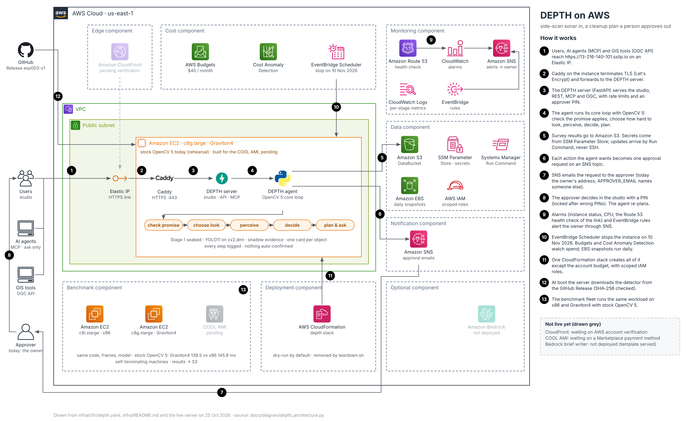

# DEPTH — Evaluation Guide for Judges

**OpenCV AI Competition 2026 · Team Syndicate (solo entrant: Madhesh) · Tracks: Agentic Vision · Best Use of COOL**

This guide gives the judging panel one self-contained route through DEPTH: what the system does, how to run
it, where the evidence for each criterion is found, and what remains incomplete. Every figure names the data
split on which it was measured and links to the report that regenerates it. The same guide is available inside
the application, under the **For judges** tab.

## Contents

1. [Summary](#1-summary)
2. [Access](#2-access)
3. [Practical: pinned dependencies, build, deployment and tests](#3-practical-pinned-dependencies-build-deployment-and-tests)
4. [Recommended evaluation path](#4-recommended-evaluation-path)
5. [Evidence by judging criterion](#5-evidence-by-judging-criterion)
6. [Principal measurements](#6-principal-measurements)
7. [Submission deliverables](#7-submission-deliverables)
8. [Outstanding items and limitations](#8-outstanding-items-and-limitations)
9. [Verifying the claims](#9-verifying-the-claims)
10. [Glossary](#10-glossary)
11. [Further reading](#11-further-reading)

## 1. Summary

DEPTH (Detect · Evidence · Prove · Triage · Hazard-map) converts side-scan sonar into a cleanup plan for
abandoned crab pots ("ghost gear") and wreck debris, which a named person approves before anything is
dispatched. Its contribution is not a better detector but a **dependable** one. An agent built on OpenCV 5:

- states, with 95% confidence, the minimum share of pots that will reach a human reviewer;
- checks that this statement applies to the recording in front of it, and withdraws it where it does not;
- chooses how intensively to inspect each frame within a compute budget, and re-plans when its own
  measurements require it;
- files one approval request per proposed action; only a person can approve.

| Item | Detail |
|---|---|
| Problem | Reviewing side-scan sonar for lost fishing gear by hand is slow, and an uncalibrated detector cannot be relied on to plan a recovery trip. |
| Approach | OpenCV 5 sonar geometry (Stage 1) → YOLO11 detection through `cv2.dnn` → physical evidence → statistically calibrated review tiers → survey planning → human approval. |
| Agent | A goal-driven loop ([`core.py`](src/agentic/core.py)): check applicability, choose a perception mode, monitor the compute budget, plan, and request approval. |
| Runtime | CPU-only and torch-free, OpenCV 5.0.0.93. A server on AWS EC2 Graviton4 (c8g.large) runs it with stock OpenCV 5, in rehearsal mode, at https://13-216-140-101.sslip.io. |
| Licence | AGPL-3.0 |

## 2. Access

| Route | How | Status |
|---|---|---|
| Public deployment | [https://13-216-140-101.sslip.io](https://13-216-140-101.sslip.io): the full studio on AWS Graviton4 (stock OpenCV 5, not COOL); approving needs the PIN from the submission form | Available |
| GitHub Codespaces | [Open in GitHub Codespaces](https://codespaces.new/madhesh60/depth?quickstart=1): the full studio in a browser, ready in about three minutes, free with a GitHub account | Available; the setup and the guided demo run in CI whenever the code changes on `main` ([`codespaces.yml`](.github/workflows/codespaces.yml)) |
| Local installation | The five commands below, on any laptop, CPU only | Available |
| Docker, Compose, Kubernetes | `docker compose up --build` or `kubectl apply -k infra/k8s` ([`containers.md`](docs/containers.md)) | Available; built, run and deployed to a test cluster in CI ([`container.yml`](.github/workflows/container.yml)) |
| Demonstration video | — | **Pending** |

```bash
git clone https://github.com/madhesh60/depth.git
cd depth
pip install -r requirements.txt                       # torch-free runtime: OpenCV 5.0.0.93, FastAPI
python -m src.detection.fetch_model                   # the detector, 38 MB, SHA-256 checked
python -m src.cv_pipeline.humminbird fetch            # a raw sonar recording with real GPS, 11 MB
python -m uvicorn src.dashboard.app:app --port 8000   # then open http://localhost:8000
```

On the deployed server, approving an action requires the **approver PIN**, which is supplied with the
submission. Agents and API clients can only file requests; the studio states where the PIN is found.

### Architecture



Grey boxes are not live yet: CloudFront, the COOL AMI and the Bedrock brief writer (§8).

## 3. Practical: pinned dependencies, build, deployment and tests

This section answers the judges' practical criterion in one place: every dependency is pinned, and the build and
test steps below are the ones CI runs. The AWS deployment is run by hand (dry run first), never by CI.

**Pinned dependencies.** Every package is pinned to an exact version (`==`), split by purpose so the runtime
stays small and torch-free:

| File | Purpose | Key pins |
|---|---|---|
| [`requirements.txt`](requirements.txt) | runtime (server, studio, MCP) | `opencv-python-headless==5.0.0.93`, `numpy==2.2.6`, `fastapi==0.127.0`, `uvicorn==0.40.0`, `mcp==1.28.1` |
| [`requirements-dev.txt`](requirements-dev.txt) | tests, lint, type check (includes the runtime) | `pytest==9.1.0`, `ruff==0.15.17`, `mypy==2.1.0` |
| [`requirements-train.txt`](requirements-train.txt) | training and ONNX export, Kaggle GPU only | `ultralytics==8.4.157`, `torch==2.9.1` |

Python 3.10 everywhere (CI, the Docker base `python:3.10-slim-bookworm`, Codespaces). The detector weights and
the raw recording are downloaded with SHA-256 checks, so a changed file is refused.

**Build.**

```bash
pip install -r requirements.txt && python -m src.detection.fetch_model   # local
docker build -t depth .                                                   # container (fetches the model itself)
```

**Run and deploy.**

| Target | Command | Notes |
|---|---|---|
| Local | `python -m uvicorn src.dashboard.app:app --port 8000` | http://localhost:8000 |
| Docker / Compose | `docker compose up --build` | non-root, read-only root, health check |
| Kubernetes | `kubectl apply -k infra/k8s` | one replica (surveys are in memory) |
| AWS (EC2 Graviton) | `./infra/deploy.sh` → read the change set → `APPLY=1 ./infra/deploy.sh` | dry-run by default; code updates with `APPLY=1 ./infra/update_server.sh` ([`infra/README.md`](infra/README.md)) |
| Remove from AWS | `./infra/teardown.sh` | deletes the stack |

**Test.**

```bash
pip install -r requirements-dev.txt
pytest -q                                   # the test suite
python -m ruff check . && python -m mypy    # lint; type check of the decision core
python tests/ui_smoke.py --full-demo        # headless Chrome plays the guided demo
python tests/container_smoke.py --url http://localhost:8000   # real work inside a running container
```

CI runs [`tests.yml`](.github/workflows/tests.yml) (tests, lint, type check) on every push to `main` and every
pull request; [`container.yml`](.github/workflows/container.yml) (build, run locked down, deploy to a throwaway
Kubernetes cluster) and [`codespaces.yml`](.github/workflows/codespaces.yml) (fresh setup, guided demo to the last
step) run when the code they cover changes.

## 4. Recommended evaluation path

The route below takes about ten minutes and touches every part of the system.

1. **Guided demo** (top bar): a 60-second walk through one frame and one survey.
2. **Analyze → a sample → Analyze frame.** Observe the tracked seabed line, one evidence card per object
   (overlapping boxes on one pot share a card), the agent's full trace on each card, and *How the agent decided*
   (which perception mode it chose, and why).
3. **Analyze → upload an image of your own.** The agent asks which edge of the frame the sonar is on; it never
   guesses. An image that is not sonar (a photograph, a screenshot) receives no recall promise.
4. **Survey → Raw recording (real GPS) → Agent tab.** The core loop on a real Humminbird recording: the promise
   is withdrawn because this river recording comes from another sonar, a full-review request is filed, the seabed
   track is cross-checked against the depth sounder, and the plan and the approvals inbox are built.
5. **Approvals.** A request can be approved only with a name and the approver PIN (with a lockout after wrong
   attempts); each decision re-plans the survey.
6. **Connect.** The standard interfaces: MCP for AI agents, OGC API – Features for GIS, signed webhooks, and an
   embeddable web panel.
7. **Study** and **Audit.** The built-in instruments for measuring analyst time and genuine false alarms. They
   have not yet been run with participants (see §8).

## 5. Evidence by judging criterion

### 5.1 Overall criteria

| Criterion | Where the evidence is |
|---|---|
| Technical execution | OpenCV 5 performs the work end to end: Stage 1 geometry (`cv2.Sobel`, `cv2.blur`, `cv2.remap`), YOLO11 through `cv2.dnn` on whichever of OpenCV 5's two engines measures faster on the host ([`dnn_engine.md`](docs/reports/dnn_engine.md)), shadow evidence and dropout masks. Evaluation is deploy-faithful, with confidence intervals ([`eval_exp003_test.md`](docs/reports/eval_exp003_test.md)). |
| Agentic vision | The core loop checks that its promise applies, chooses how hard to look, re-plans on its own measurements and requests approval before acting ([`agentic_vision.md`](docs/agentic_vision.md), [`agentic_loop.md`](docs/agentic_loop.md)). |
| Innovation | Statistical promises on an imperfect detector, checked for correlated frames and withdrawn where they do not apply ([`calibration_exp003.md`](docs/calibration_exp003.md), [`dependence.md`](docs/reports/dependence.md), [`applicability.md`](docs/reports/applicability.md)). |
| Real-world impact | Raw Humminbird recordings with real per-ping GPS; one review card per object; GPX, KML, GeoJSON, OGC API, webhooks and MCP; analyst time reported with its assumptions ([`effort_curve.md`](docs/reports/effort_curve.md)). |
| User experience | A zero-build studio: guided demo, evidence cards with the agent's trace, approvals inbox, 3D twin, failure drills, and one-click Codespaces. |
| Responsible cloud delivery | One CloudFormation stack, dry-run by default, budget alerts and a scheduled stop, PIN lockout, refusal to start without tokens, a non-root read-only container with health probes and a Kubernetes base ([`containers.md`](docs/containers.md)), protected wreck positions generalised ([`infra/README.md`](infra/README.md), [`responsible_use.md`](docs/responsible_use.md)). |

### 5.2 Agentic Vision award

| Requirement | Evidence |
|---|---|
| OpenCV 5 output changes a later decision or action | Re-running a survey with each OpenCV output withheld: without Stage 1's bottom track, **95 of 142** pins fall outside their own error circle and 4 of 39 re-survey passes regroup ([`causal_trace.md`](docs/reports/causal_trace.md), STUDY-12). The applicability statistics withdraw the promise and file a full-review request (STUDY-19); the measured pass time selects or downgrades the perception mode. |
| A multi-step perception–decision–action loop | inspect → check the promise applies → choose the perception mode → perceive under a compute budget → cross-check the seabed against the depth sounder (raw recordings) → plan → request approval; every step is logged in `agent_run` and shown in the Agent tab. |
| Requests for human approval | One request per action, each with its rationale. No MCP tool can decide, and the API refuses an approval without the PIN ([`mcp_session.md`](docs/reports/mcp_session.md)). |
| Failure handling | A catalogue of named incidents, each with a safe fallback and an action for a person; failure drills can be triggered in the studio (`?simulate=tool_failed`, `tool_timeout`, `no_detection`). |
| Decisions validated before they were switched on | Look harder (STUDY-18), applicability (STUDY-19), one card per object (STUDY-23), sensor cross-check (STUDY-16): each protocol was committed before the unseen data was scored ([`experiments.md`](docs/experiments.md)). |

### 5.3 Best Use of COOL award

| Criterion | Evidence | Status |
|---|---|---|
| Verified COOL execution | `GET /api/cool` returns the AWS-signed instance identity document and the OpenCV libraries mapped into the server process; `python -m src.bench.verify_cool <url>` checks the signature offline. | **Not yet run** (§8) |
| Architecture | One CloudFormation stack designed for EC2 Graviton4 from the COOL AMI, with an Elastic IP, S3, CloudWatch alarms, SSM-only access and a scheduled stop ([`infra/README.md`](infra/README.md)). | Deployed in rehearsal mode on stock Ubuntu and stock OpenCV 5; not yet on the COOL AMI |
| Measured value against a baseline | Stock OpenCV 5, 4 vCPU: Graviton4 **138.5 ms** per frame against x86 **145.8 ms**, at a 15% lower hourly price; identical detections (31 of 31) ([`cool_benchmark.md`](docs/reports/cool_benchmark.md)). | Stock measured; COOL comparison scripted |
| Innovation | The server times both OpenCV 5 DNN engines at start-up and keeps the faster one only if the answers match (STUDY-20); every result carries a provenance stamp naming the OpenCV build. | Shipped (on stock OpenCV 5) |
| Reproducibility | `infra/bench_fleet.sh` measures x86, stock Graviton and COOL Graviton in one command, with pinned commit, frames and model. | x86 and stock Graviton runs done; COOL runs not yet run |

## 6. Principal measurements

| Measurement | Result | Source |
|---|---|---|
| Recall promise, standard look (95% confidence) | **≥ 78%** of pots reach a person; held on unseen test at **81.1%** | [`calibration_exp003.md`](docs/calibration_exp003.md) |
| Recall promise, looking harder (2×2 tile pass) | **≥ 84%**; held on unseen test at **86.0%** (lower bound 82.0%) | [`look_harder.md`](docs/reports/look_harder.md) |
| Robustness to correlated frames | Standard: block-bootstrap bound 78.2%, so the promise was restated from 79% to **78%**; looking harder: 84.3%, unchanged | [`dependence.md`](docs/reports/dependence.md) (STUDY-21) |
| Per recording | The standard promise held on 5 of 6 recordings (Rec9: 74.7%), looking harder on 4 of 6 (Rec9: 81.5%); a promise is a pooled rate | same |
| The same calibration code, two detectors | EXP-001: ≥ 63%, held at 86.2% on its own unseen test · EXP-003: ≥ 78%, held at 81.1% | [`calibration_exp001.md`](docs/calibration_exp001.md) · [`calibration_exp003.md`](docs/calibration_exp003.md) |
| Promise withdrawn where it does not apply | Another sonar: withdrawn in **22 of 22** surveys (one look keeps only 23.9% of pots there) | [`applicability.md`](docs/reports/applicability.md) (STUDY-19) |
| Crab-pot detector, AP@0.5 | **0.482** (95% CI 0.43–0.55); mAP@0.5 0.319, **below the 0.70 target** | [`eval_exp003_test.md`](docs/reports/eval_exp003_test.md) |
| Against GhostVision (same split) | F1 **0.41** against their reported 0.71–0.73: **DEPTH's detector is weaker** | [`eval_exp003_test_official398.md`](docs/reports/eval_exp003_test_official398.md) |
| OpenCV 5's two DNN engines | Same answers (634 of 634 detections on the calibration frames; 31 of 31 on each EC2 machine). On Graviton the classic engine is **1.41–1.47×** faster at every thread count measured; on x86 it wins at 4 threads (1.11×), and the new engine wins at 1 thread (1.17×) | [`dnn_engine.md`](docs/reports/dnn_engine.md) (STUDY-20) |
| Frame time, standard look (stock OpenCV 5, 4 vCPU) | **138.5 ms** Graviton4 (c8g.xlarge) · **145.8 ms** x86 (c8i.xlarge) | [`cool_benchmark.md`](docs/reports/cool_benchmark.md) |
| Frame time, looking harder | **655 ms** Graviton4 · **693 ms** x86 (4 vCPU); **1.30 s** on the 2-vCPU demo server (one look: 268 ms) | same |
| Demo server under load | c8g.large, 4 clients back to back plus 1 survey, 120 s: **383 of 383** requests succeeded, analyze p95 **2.44 s** (target 3 s); the clients ran on the server itself with rate limits off, so no network time is included | `benchmarks/load/load_test__c8g_large_rehearsal.json` |
| One review card per object | Cards per frame **2.68 → 1.81** (one look) and **3.86 → 2.32** (looking harder); the same pots reach a person | [`card_grouping.md`](docs/reports/card_grouping.md) (STUDY-23) |
| On one CPU core | 435 ms per frame on one Graviton4 core: an hour of sonar in about 122 s, **about 30× faster than it is recorded**; no small board was measured | `benchmarks/graviton_stock_t1__product.json` |
| Analyst time (**assumed** 20 s per frame, 8 s per card) | Pot-dense test: one look **43.2 vs 55.7** minutes manual, looking harder **56.5 vs 57.3**; empty seabed 34 and 47 vs 56 minutes per survey-hour | [`effort_curve.md`](docs/reports/effort_curve.md) |
| A real 1-hour recording (another sonar) | **48 review cards per hour** of sonar, with the promise withdrawn | same |

## 7. Submission deliverables

| Deliverable | Location | Status |
|---|---|---|
| Technical paper | [`DEPTH_paper.md`](docs/DEPTH_paper.md) ([PDF](docs/paper/DEPTH_paper.pdf)) | Complete |
| Source code | This repository | Complete |
| Pinned dependencies, build, deployment and test instructions | `requirements*.txt`, [`README.md`](README.md), [`infra/README.md`](infra/README.md) | Complete |
| Architecture diagram | [`depth_architecture.png`](docs/diagram/depth_architecture.png) (AWS deployment, drawn from the live stack; [source](docs/diagram/depth_architecture.py)); module-level design in §3 of [`DEPTH_paper.md`](docs/DEPTH_paper.md) | Complete |
| Working endpoint or live demonstration | GitHub Codespaces and the public URL https://13-216-140-101.sslip.io (both available) | Complete |
| Demonstration video | — | Pending |
| Evaluation evidence | [`reports/`](docs/reports), [`experiments.md`](docs/experiments.md) | Complete |
| Limitations and responsible use | §8 below; [`responsible_use.md`](docs/responsible_use.md) | Complete |

## 8. Outstanding items and limitations

**Not finished yet**

- **COOL:** <!-- cool:status -->has not run yet: the AWS Marketplace subscription is blocked on payment. The demo server runs stock OpenCV 5 and says so; the COOL benchmark and its signed receipt run in one command once it is active.<!-- /cool:status -->
- **Demonstration video** — not yet recorded (`python tests/ui_video.py` produces the footage).
- **Human study and blinded audit** — analyst minutes use assumed timings, labelled as such.
- **Real language-model session** — built and tested with a stand-in model; recording it needs a Claude API key.

**Limits of the evidence**

- The detector is modest (mAP@0.5 0.319); DEPTH makes it usable, not accurate.
- The test split was used by four studies, so its figures are checked, not untouched.
- A promise is a pooled rate, not a per-survey guarantee; no recording yet has both real pots and real GPS.

Full detail: [`DEPTH_paper.md`](docs/DEPTH_paper.md) §8.

## 9. Verifying the claims

```bash
pip install -r requirements-dev.txt                 # runtime, test, lint and type-check dependencies
pytest -q                                           # the test suite
python -m ruff check . && python -m mypy            # lint; type check of the decision core
python tests/ui_smoke.py --full-demo                # headless Chrome drives every studio mode and the guided demo
python -m src.agentic.calibrate                     # fit the promise on validation, verify once on test
python -m src.agentic.study_applicability --verify  # STUDY-19: does the promise apply?
python -m src.agentic.study_dependence              # STUDY-21: correlated frames
python -m src.bench.product_bench --label my_host   # benchmark this machine
python -m src.bench.verify_cool <url|receipt.json>  # verify a COOL receipt
```

Studies marked as using `DATASET/` need the dataset, which is not redistributed; its builders are in
`DATASET/scripts/` ([`dataset_card.md`](docs/dataset_card.md)).

## 10. Glossary

The same terms are available in the studio (**Terms**, top bar).

| Term | Meaning |
|---|---|
| **Recall promise** | "At least R% of pots reach a person (95% confidence)": fit on held-out recordings, verified once on unseen ones. |
| **τ_review** | The detector-confidence threshold above which a find becomes a review card (0.06 standard, 0.055 looking harder). |
| **LCB** | Lower confidence bound: the value the true rate is at least, with 95% confidence. |
| **CP** | Clopper-Pearson: the exact binomial bound behind the promise; it treats pots as independent, which STUDY-21 checks. |
| **LTT** | Learn-Then-Test: scanning thresholds in a fixed order so that trying many does not break the bound. |
| **P(pot)** | A card's calibrated chance of being a real pot; it orders the review queue. |
| **VOI** | Value of information: whether another look could change the decision; if not, the agent does not spend it. |
| **Look harder** | A second pass over 2×2 tiles (5 forward passes per frame) that lifts the promise from 78% to 84%. |
| **One card per object** | Review boxes of one class that sit at least half inside each other share one card and one decision; no box is dropped (STUDY-23). |
| **Applicability check** | OpenCV statistics of each frame compared with the calibration recordings: is the promise valid here? |
| **Stage 1** | OpenCV sonar geometry: bottom track (altitude per ping), slant-to-ground range, water column. |
| **STUDY-n** | A registered experiment in [`experiments.md`](docs/experiments.md): protocol first, then the data. |
| **COOL** | The OpenCV-optimised AMI for AWS Graviton; a run counts as COOL only if `cv2` loads from `/opt/cool`. |

## 11. Further reading

| Document | Purpose |
|---|---|
| [`README.md`](README.md) | Project overview, results, installation and repository structure |
| [`DEPTH_paper.md`](docs/DEPTH_paper.md) ([PDF](docs/paper/DEPTH_paper.pdf)) | The technical paper: the complete system as built, its evaluation and its limitations |
| [`agentic_vision.md`](docs/agentic_vision.md) | The Agentic Vision entry in detail |
| [`model_card.md`](docs/model_card.md) · [`dataset_card.md`](docs/dataset_card.md) | The deployed detector and its data |
| [`experiments.md`](docs/experiments.md) | Every experiment in order, including negative results |
| [`README.md`](docs/README.md) | The documentation map |
