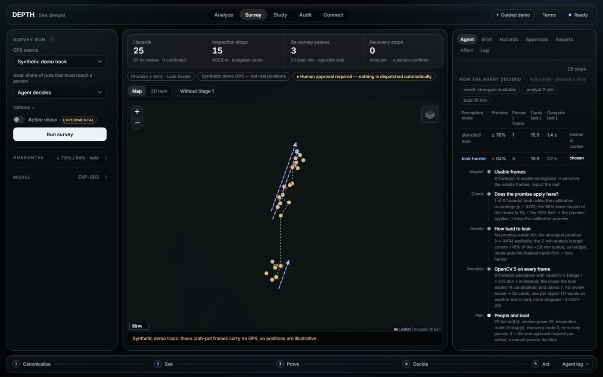

# DEPTH

**Calibrated, human-approved detection of ghost fishing gear and wreck debris in side-scan sonar**

[](https://github.com/madhesh60/depth/actions/workflows/tests.yml)
[](https://github.com/madhesh60/depth/actions/workflows/codespaces.yml)
[](https://codespaces.new/madhesh60/depth?quickstart=1)

DEPTH (**D**etect · **E**vidence · **P**rove · **T**riage · **H**azard-map) turns side-scan sonar into a cleanup plan
that a named person approves. It does not claim a better detector: **it makes an imperfect detector dependable.**
An agent built on OpenCV 5 states how many lost crab pots will reach a human reviewer (with 95% confidence), checks
that this statement applies to the recording in front of it, chooses how intensively to look within a compute
budget, re-plans when its own measurements require it, and asks a person before any action is taken.

| | |
|---|---|
| **Competition** | OpenCV AI Competition 2026 — tracks: **Agentic Vision** and **Best Use of COOL** |
| **Team** | Team Syndicate (solo entrant: Madhesh) |
| **Stack** | OpenCV 5 (`cv2.dnn`) on CPU, torch-free · FastAPI · AWS EC2 Graviton4 + COOL |
| **Licence** | AGPL-3.0 |

| Access | Link | Status |
|---|---|---|
| **For judges** | [`docs/JUDGES.md`](docs/JUDGES.md), also in the studio under **For judges** | Available |
| **Try it in a browser** | [Open in GitHub Codespaces](https://codespaces.new/madhesh60/depth?quickstart=1) (about three minutes, free with a GitHub account) | Available |
| **Run it on a laptop** | [Five commands, CPU only](#61-run-it-locally) | Available |
| **Public deployment** | — | Pending (AWS account verification) |
| **Demonstration video** | — | Pending |

## Contents

1. [At a glance](#1-at-a-glance)
2. [Project status](#2-project-status)
3. [Overview](#3-overview)
4. [The agent](#4-the-agent)
5. [Architecture](#5-architecture)
6. [Getting started](#6-getting-started)
7. [Results](#7-results)
8. [Deployment on AWS Graviton and COOL](#8-deployment-on-aws-graviton-and-cool)
9. [Limitations](#9-limitations)
10. [Reproducibility](#10-reproducibility)
11. [Repository structure](#11-repository-structure)
12. [Documentation](#12-documentation)
13. [Responsible use, development and licence](#13-responsible-use-development-and-licence)

## 1. At a glance

Every number names the split on which it was measured.

| Measure | Result | Measured on |
|---|---|---|
| **Pots that reach a person** (95% confidence) | **≥ 84%** looking harder (held: 86.0%) · **≥ 78%** one look (held: 81.1%) | Unseen test recordings |
| **Works with any detector** | The same code gives EXP-001 **≥ 63%** and EXP-003 **≥ 78%**; both held | Each model's own unseen test |
| **Knows when its promise does not apply** | Withdrawn in **22 of 22** surveys of another sonar | STUDY-19 |
| **One card per object** | Review cards per frame, looking harder: **3.86 → 2.32**; the same pots reach a person | STUDY-23, test |
| **Speed per frame** | One look **138.5 ms** · looking harder **655 ms** (x86: 145.8 / 693 ms) | EC2 Graviton4 c8g.xlarge, 4 vCPU, stock OpenCV 5 |
| **Demo server under load** | **383 of 383** requests succeeded, analyze p95 2.44 s (target 3 s) | EC2 c8g.large, 4 clients + 1 survey |
| **Analyst minutes** (assumed timings) | DEPTH vs manual: one look **43.2 vs 55.7** · looking harder **56.5 vs 57.3** · empty seabed **34 / 47 vs 56** per hour | Test; user study pending |
| **Crab-pot detector**, AP@0.5 | **0.482**; weaker than GhostVision (F1 0.41 vs 0.71–0.73) | v2b test, 214 frames |
| **Quality checks** | **315** tests · ruff · mypy · a headless-Chrome UI test, all in CI; the Codespaces setup run in its own image | 2026-10-24 |



## 2. Project status

The following items are not complete. They are stated here so that no reader has to discover them.

- **COOL:** <!-- cool:status -->has not run yet. The AWS Marketplace subscription to the COOL AMI is blocked on payment: the Marketplace does not accept the account's card (it needs a Visa or Mastercard), and an AWS Support case is open. Until then the demo server runs stock OpenCV 5 in rehearsal mode and says so. The COOL benchmark, the AWS-signed receipt and its verifier are built and run in one command once the subscription is active (`PHASE=cool ./infra/golive.sh`).<!-- /cool:status -->
- **Public URL.** Not live yet (CloudFront awaits AWS account verification). Codespaces and the local install run
  the same studio.
- **A session with a real language model.** The recorded MCP session uses a scripted client;
  `python -m src.dashboard.llm_session` lets Claude drive DEPTH and is tested with a stand-in model. Recording it on
  Amazon Bedrock failed on 2026-10-23 (the account cannot accept the Claude Marketplace agreement, the same payment
  block as COOL), so it requires a Claude API key.
- **Analyst time is not measured.** The minutes above use assumed timings until three to five people complete the
  Study tab.
- **No field proof.** No recording has both real pots and real GPS: the pot frames carry synthetic GPS (labelled on
  screen), and the real-GPS river recordings contain no known pots.
- **The detector is weak** (mAP@0.5 0.319 against the 0.70 target). DEPTH makes it usable, not accurate.
- **Evidence caveats.** The test split was used by four studies (STUDY-18, 19, 21 and 23), so its figures are
  checked rather than untouched; the eight demo frames all come from one test recording (Rec9), the one on which
  the standard promise fell short (74.7% against 78%).

## 3. Overview

### 3.1 The problem

Lost and abandoned fishing gear ("ghost gear") keeps catching marine life for years. Side-scan sonar can find it,
but somebody has to review hours of sonar imagery, and a detector that misses objects without saying so is not a
tool a recovery crew can plan a boat day on.

### 3.2 The approach

DEPTH wraps an imperfect detector in **promises that can be checked** and **measurements in place of assumptions**:

| Capability | What DEPTH does | Evidence |
|---|---|---|
| **Calibrated promises** | "≥ 78% of pots reach a person (95% confidence)" with one look, **≥ 84%** looking harder: fit on held-out recordings and verified once on unseen ones (held: 81.1% and 86.0%). Restated from 79% after a check for correlated frames (STUDY-21). It also states what it *cannot* promise: 90% recall, any auto-confirm precision, a per-survey guarantee. | [`calibration_exp003.md`](docs/calibration_exp003.md) · [`look_harder.md`](docs/reports/look_harder.md) · [`dependence.md`](docs/reports/dependence.md) |
| **Knows when its promise does not apply** | Every frame is compared with the recordings the promise was fit on (OpenCV statistics → conformal p-values). On another sonar the promise is withdrawn in 22 of 22 surveys (one look keeps only 23.9% of the pots there), and a person is asked to approve a full review. A single uploaded frame that is stranger than every calibration frame (a photograph, a screenshot) receives no promise either. | [`applicability.md`](docs/reports/applicability.md) |
| **One card per object** | The detector often places two or three boxes on one pot; boxes of one class that sit at least half inside each other share one review card and one decision. No box is dropped, so the same pots reach a person: 2.68 → 1.81 cards per frame with one look, 3.86 → 2.32 looking harder. | [`card_grouping.md`](docs/reports/card_grouping.md) (STUDY-23) |
| **Stage 1 measures the sonar** | Bottom tracking gives the sonar's altitude per ping, hence relative object height and slant-to-ground geotags. Checked without labels: port and starboard on the same pings agree to **1.6 px** (random pairs: 5.3 px). | [`stage1_canonical.md`](docs/reports/stage1_canonical.md) |
| **A goal-driven agent** | Chooses how hard to look from the goal and the compute budget, prices each mode by its measured pace and re-plans mid-run; orders the queue by calibrated P(pot); respects analyst and boat budgets. | Agent tab · trace on every card |
| **A physical second look** | Plans re-survey passes on the opposite side, ranked by information per boat-minute; each predicts the bearing its shadow must flip to, and each is approved or declined on its own. | Map · GPX / GeoJSON |
| **People decide, the agent re-plans** | A named person's confirm or reject on a card, and a crew's *recovered* or *not found*, re-plan the route, the queue, the budget and the passes; an impact ledger records the reviewed precision. | Survey tab · [`agentic_vision.md`](docs/agentic_vision.md) |
| **The agent re-measures its own geometry** | On a raw recording it cross-checks OpenCV's seabed track against the depth sounder per chunk and re-runs the tracker on a conflict. On a fresh 1-hour recording: 280 of 280 chunks resolved, 3 of 3 gross tracker failures corrected; one registered criterion failed and is reported. | [`sensor_check.md`](docs/reports/sensor_check.md) |
| **Real sonar recordings with real GPS** | Reads raw Humminbird recordings (`.DAT` + `.SON` / `.IDX`): per-ping GPS, heading, speed and depth, checked against physics (r = 0.95; course against heading 2.4° median); measures the range scale (2.03 cm per sample ± 10.2%); flags data dropouts per ping. | [`raw_recording.md`](docs/reports/raw_recording.md) |
| **OpenCV output moves the boat** | The same survey re-run with each OpenCV output withheld: without Stage 1, **95 of 142** pins fall outside their own error circle and 4 of 39 re-survey passes regroup; without the shadow nothing changes (it is evidence only). Live in the studio: **"Without Stage 1"** on the survey map. | [`causal_trace.md`](docs/reports/causal_trace.md) (STUDY-12) |
| **Connects to consoles and agents** | OGC API – Features (QGIS, ArcGIS), signed webhooks, a drop-in `<depth-hazards>` web component, and an MCP server (13 tools; the only write is *asking* a person). | [`integrations.md`](docs/integrations.md) · [`mcp.md`](docs/mcp.md) |
| **A language model that writes, never decides** | An optional Claude-on-Bedrock rewrite of the crew's mission brief is shown only if every number and identifier traces back to the survey; otherwise the template is served. Not deployed on the demo server. | Survey tab · `GET /api/brief` |
| **Measures the machine it runs on** | OpenCV 5 has two `cv2.dnn` engines; the server times both at start-up and keeps the faster one only if the answers match. ENGINE_AUTO loads the slower one on Graviton, where the classic engine is **1.47×** faster per forward; this took the Graviton frame from 197 to **138.5 ms**. | [`dnn_engine.md`](docs/reports/dnn_engine.md) (STUDY-20) |
| **COOL, proven by provenance** | A run counts as COOL only if `cv2` loads from `/opt/cool`; `/api/cool` returns an AWS-signed instance identity receipt, checked offline by `verify_cool`. | [`infra/README.md`](infra/README.md) |

Negative results are published as well: a classical ROI gate (STUDY-01), the acoustic shadow as a filter
(STUDY-03/04), re-look against plain confidence (STUDY-07), range-gain detector input (STUDY-08), seam inference
across chunk boundaries (STUDY-11b), a larger input with a flipped second view (STUDY-13: +0.10 AP on the
calibration recording, −0.06 on unseen data), and per-frame active vision (STUDY-15: both gates failed, so it is
off by default).

### 3.3 Mapping to the judging criteria

| Criterion | Where DEPTH demonstrates it |
|---|---|
| **Technical execution** | OpenCV 5 performs the work: Stage 1 (`cv2.Sobel`, `cv2.blur`, `cv2.remap`), YOLO11 through `cv2.dnn` on whichever of OpenCV 5's two engines measures faster on the machine ([`dnn_engine.md`](docs/reports/dnn_engine.md)), shadow evidence, dropout masks; deploy-faithful evaluation with confidence intervals ([`eval_exp003_test.md`](docs/reports/eval_exp003_test.md)). |
| **Agentic Vision** | The core loop ([`core.py`](src/agentic/core.py), §4) checks that its promise applies, chooses how hard to look, re-plans on its own measurements and asks a person before acting. |
| **Innovation** | Statistical promises on an imperfect detector, checked for correlated frames and withdrawn where they do not apply ([`calibration_exp003.md`](docs/calibration_exp003.md), [`dependence.md`](docs/reports/dependence.md), [`applicability.md`](docs/reports/applicability.md)). |
| **Real-world impact** | Raw Humminbird recordings with real GPS; one card per object; GPX, KML, GeoJSON, OGC API, webhooks and MCP; analyst minutes reported with their assumptions ([`effort_curve.md`](docs/reports/effort_curve.md)). |
| **User experience** | A zero-build studio: guided demo, one evidence card per object with the agent's trace, approvals inbox, 3D twin, failure drills, a **For judges** tab, one click in Codespaces. |
| **Responsible cloud delivery** | One stack, dry-run by default, budget alerts and a scheduled stop, PIN lockout, no start without tokens, protected wreck positions generalised ([`infra/README.md`](infra/README.md), [`responsible_use.md`](docs/responsible_use.md)). |

## 4. The agent

The core loop ([`src/agentic/core.py`](src/agentic/core.py)) runs every survey and is on by default. The operator
states a **goal**; the agent decides how to meet it and records every option it weighed (the studio's **Agent** tab,
`agent_run` in the API, `run_survey` over MCP).

```
Goal ─ recall to keep · compute budget · analyst minutes · boat minutes
 1 inspect      usable frames? (corrupt or blank frames are skipped and reported)
    check       does the promise apply here? OpenCV statistics of every frame vs the calibration recordings
                 └ no ─► withdraw the promise · cheapest look · ask a person to approve a FULL REVIEW
 2 decide       how hard to look: standard (≥ 78%, 1 cv2.dnn pass per frame) or look harder (≥ 84%, + 2×2 tiles)
                 = the cheapest mode that keeps the goal, else the strongest the compute budget allows
 3 perceive     every frame: Stage 1 · YOLO11 via cv2.dnn · evidence · one card per object — while watching the pace
                 └ the budget would overrun, or the closer look fails ─► RE-PLAN: standard look, re-tier
    sense       raw recording: OpenCV seabed track vs depth sounder ─► conflict ─► re-track ─► re-fit the scale
 4 plan         review queue · analyst budget · routes · opposite-side passes ranked by information per boat-minute
 5 hand off     one approval request per action ─► a named person decides ─► every decision RE-PLANS
- - - - - - - - - - - - - - - - experimental, off by default - - - - - - - - - - - - - - - - -
Per find ─► next OpenCV tool = the cheapest one whose result could CHANGE the action, else stop (STUDY-15)
```

| The agent decides alone | It asks a person | Only a person does |
|---|---|---|
| How hard to look, whether its promise applies, which seabed measurement to trust, where pins go, which boxes are one object, the queue order, which passes are worth boat time | Inspect · recover · re-survey · full review · public sharing — one request per action, with its rationale | Approve or decline (name and approver PIN, with a lockout), confirm or reject a card, mark recovered or not found — each decision re-plans |

DEPTH never dispatches; MCP and API clients can only ask. A recorded session on the real server shows the whole
chain: an external agent runs a survey over MCP and files a request, its own attempt to approve is refused, a person
approves, and the agent reads the work order back ([`mcp_session.md`](docs/reports/mcp_session.md)). With a real
model choosing every call: `python -m src.dashboard.llm_session` (Claude API or `--bedrock`; [`docs/mcp.md`](docs/mcp.md)).

**Every agent decision that is on by default was validated before it was switched on**, with the protocol committed
before the unseen data was scored:

| Decision | Evidence |
|---|---|
| **Look harder** to keep a stronger promise | Promise 78% → **84%**; on unseen test 81.1% → **86.0%** (lower bound 82.0%); 5 forward passes per frame — [`look_harder.md`](docs/reports/look_harder.md) (STUDY-18) |
| **Withdraw the promise** where it does not apply | Another sonar: 22 of 22 surveys; kept for all 3 test recordings and the demo frames — [`applicability.md`](docs/reports/applicability.md) (STUDY-19) |
| **One card per object** | 3.86 → 2.32 cards per frame looking harder; the same 227 of 264 pots reach a person; 1 of 462 cards holds two pots — [`card_grouping.md`](docs/reports/card_grouping.md) (STUDY-23) |
| **Re-measure the seabed** when image and sounder disagree | 280 of 280 chunks resolved, 3 of 3 gross tracker failures corrected — [`sensor_check.md`](docs/reports/sensor_check.md) (STUDY-16) |
| **Place pins where the measured geometry says** | Without Stage 1, 95 of 142 pins leave their own error circle — [`causal_trace.md`](docs/reports/causal_trace.md) (STUDY-12) |
| Re-plan on a person's decision | In the test suite: a decline drops the pass and re-ranks boat time; an approval issues a work order |

The same goal produces different runs. With no recall requested, the agent looks harder (≥ 84%); asked for ≥ 78%,
it takes the cheaper single look; with a tight compute budget it drops to one look, mid-run if necessary; on the raw
river recordings it withdraws the promise and asks for a full review. The studio's survey gives it **20 s of compute
by default**: on a small machine it prices both looks with its measured pace and takes the one that fits, while a
fast server keeps the closer look. A single analyze call has a 2-s answer budget, so an idle server looks harder and
a busy one takes the standard look. **Per-frame active vision** is built and tested but failed its own validation
(log-loss 0.637 → 0.648 on test; ACCEPT precision 0.86 → 0.848 on another sonar), so it stays off by default and is
labelled experimental ([`evidence_model_exp003.md`](docs/reports/evidence_model_exp003.md)). On the 8 shipped frames,
Stage 1 moves the median pin **7.0 m** and **12 of 18** pins leave their own error circle; with active vision on,
7 of 18 hazards also change action and the re-survey plan shrinks from 5 passes (13.7 boat-minutes) to 1 (3.3)
([`opencv_counterfactual.md`](docs/reports/opencv_counterfactual.md)).

## 5. Architecture


```
frame ─► Stage 1 canonicalise ─► See (YOLO11 · cv2.dnn) ─► Prove (evidence) ─► Decide (guaranteed tiers) ─► one card per object
          └► active vision (experimental): value-of-information tool choice · conflict ─► another observation
survey ─► stitch · merge repeat sightings ─► routes · budgets · opposite-side re-survey ─► exports
human ─► labels · timed study · blinded audit          offline ─► v2b ─► train ─► onboard (one command)
```

| Stage | Module | What it does |
|---|---|---|
| Stage 1 — canonicalise | [`canonical.py`](src/cv_pipeline/canonical.py) | Palette to luminance, orientation by source rule (never guessed), bottom tracking, slant-to-ground, water-column mask |
| See | [`infer.py`](src/detection/infer.py) | YOLO11 ONNX through `cv2.dnn`, class-aware NMS, the measured engine |
| Prove | [`shadow.py`](src/agentic/shadow.py), [`evidence.py`](src/agentic/evidence.py) | Acoustic shadow, relative height, water-column check — evidence, never a silent gate |
| Decide | [`policy.py`](src/agentic/policy.py), [`cards.py`](src/agentic/cards.py) | Guaranteed tiers fit on held-out recordings; one card per object |
| Act | [`mission.py`](src/agentic/mission.py), [`resurvey.py`](src/agentic/resurvey.py) | Geotags, stitching, routes, re-survey passes, exports, provenance, mission brief |
| Human loop | [`approvals.py`](src/agentic/approvals.py), [`feedback.py`](src/agentic/feedback.py) | Approvals with PIN and lockout, labels, timed study, blinded audit |

The complete design is in [`docs/architecture.md`](docs/architecture.md).

## 6. Getting started

### 6.1 Run it locally

```bash
git clone https://github.com/madhesh60/depth.git
cd depth
pip install -r requirements.txt                       # torch-free runtime: OpenCV 5.0.0.93, FastAPI
python -m src.detection.fetch_model                   # the detector: 38 MB, SHA-256 checked
python -m src.cv_pipeline.humminbird fetch            # a raw sonar recording with real GPS: 11 MB
python -m uvicorn src.dashboard.app:app --port 8000   # open http://localhost:8000 → Guided demo
```

Alternatively, [open the project in GitHub Codespaces](https://codespaces.new/madhesh60/depth?quickstart=1): the same
setup runs automatically and the studio opens in the browser.

### 6.2 A tour of the studio


Press **Guided demo** in the top bar for a walk through everything below; **Terms** explains the studio's
vocabulary. In **Survey**, the *Goal* selector sets the recall the agent must keep (by default the strongest it
can), and *Options → Compute budget* gives it a time limit (20 s by default; empty means no limit).

| Tab | What it shows |
|---|---|
| **Analyze** | One frame: the tracked seabed, verdict-coloured boxes, one evidence card per object (tier promise, P(pot), shadow, relative height, the full agent trace) and the agent's-eye re-look view. Label finds, or draw a missed pot (`M`). An uploaded frame asks which edge the sonar is on. |
| **Survey** | All samples (synthetic GPS) or the raw recording (real GPS) as a background job: hazards on a map with error radii, the inspection route, re-survey passes, analyst and boat budgets, the approvals inbox, the mission brief, and GeoJSON, GPX, KML, CSV and JSON exports. |
| **3D twin** | The seabed in true ground-range geometry, the sonar at its tracked altitude, finds with shadow-derived heights, and a replay of the boat sweeping its sonar. |
| **Study** | The timed user study (manual review against DEPTH cards) and the live effort curve for both modes. |
| **Audit** | The blinded false-alarm audit. |
| **Connect** | MCP, OGC API, signed webhooks and the drop-in panel. |
| **For judges** | This project's evaluation guide, with live facts from the running server and shortcuts to each part of the demonstration. |

The 8 sample frames ship with the application (CC-BY-SA, [`webui/samples/ATTRIBUTION.md`](webui/samples/ATTRIBUTION.md)).
They come from the v2b **test** split, so the default model never trained or tuned on them; their GPS is synthetic and
labelled as such. The raw recording is real: PINGMapper's sample data (MIT code, Zenodo 10.5281/zenodo.6604666),
fetched with a hash check and not redistributed.

## 7. Results

Every number names its split.

### 7.1 Detector

EXP-003, the deployed model (YOLO11s, 640 px, dataset v2b tiles, 2 classes), run through `cv2.dnn`
([`onboard_exp003.md`](docs/reports/onboard_exp003.md)):

| Metric | Value | Split |
|---|--:|---|
| Crab pots (ghost gear) on sonar: AP@0.5 (95% CI) · AP@0.5:0.95 | **0.482** (0.43–0.55) · 0.165 | v2b test, 285 pots |
| Crab pots: precision / recall / F1 at the validation-tuned threshold | 0.50 / 0.47 / 0.49 | v2b test |
| Wreck debris: AP@0.5 · AP@0.5:0.95 | 0.156 · 0.047 (weak) | v2b test, 70 boxes |
| **mAP@0.5 · mAP@0.5:0.95** (both classes) | **0.319** · 0.106 — the proposal's 0.70 is **not met** | v2b test |
| GhostVision head-to-head: F1 · AP@0.5 | 0.41 · 0.39 (GhostVision reports F1 0.71–0.73) | Official 398-frame split |
| Cross-sonar: ghost gear AP@0.5 | 0.34; the validation threshold does not transfer (recall 0.11) | `test_xsonar` |

Full reports with confusion matrices and precision-recall curves: [test](docs/reports/eval_exp003_test.md) ·
[official 398](docs/reports/eval_exp003_test_official398.md) · [cross-sonar](docs/reports/eval_exp003_test_xsonar.md).
The gap is a data problem rather than a recipe problem: most training "wrecks" are fish-finder screenshots and the
wreck boxes are loose ([`exp003_diagnosis.md`](docs/reports/exp003_diagnosis.md)). Five later training runs (EXP-003f,
004, 004g, 005, 005a) did not beat it ([`exp005_diagnosis.md`](docs/reports/exp005_diagnosis.md)). The recall promise
is what makes this detector safe to use: every pot it covers reaches a person.


**Earlier baseline — EXP-001** (YOLO11s, dataset v1, 4 classes; [`eval_exp001.md`](docs/reports/eval_exp001.md)):
mAP@0.5 0.822 on test is **inflated** by an optical-only class; crab pots on **sonar**: AP@0.5 0.473, recall 0.599.

### 7.2 Recall promise

The recall promise is **≥ 84%** looking harder (2×2 tile pass; held on test at 86.0%, lower bound 82.0%) and **≥ 78%**
with one look (held at 81.1%, lower bound 76.7%); EXP-001's is ≥ 63%. Clopper-Pearson alone supported 79% for one look;
a block bootstrap over correlated frames supports 78.2%, so that promise was restated (STUDY-21). A promise is a pooled
rate: per recording, the standard promise held on 5 of 6 (test Rec9: 74.7%). Nothing is auto-confirmed, because no
precision promise is supportable.

### 7.3 Analyst effort

Assumed 20 s per frame and 8 s per card until the study runs; one card per object
([`effort_curve.md`](docs/reports/effort_curve.md)):

| Mode | Promise | Cards to the promise | DEPTH min | Manual min | Break-even card time | Per survey-hour on empty seabed |
|---|--:|--:|--:|--:|--:|--:|
| One look | ≥ 78% | 324 | **43.2** | 55.7 | 10.3 s | 34 vs 56 min |
| Looking harder (the default when time allows) | ≥ 84% | 424 | **56.5** | 57.3 | 8.1 s | 47 vs 56 min |


### 7.4 Runtime

EC2, stock OpenCV 5, both modes interleaved, 2026-10-23. The network forward is 92–99% of a frame, so the closer look
costs about its five passes (4.7–4.9×):

| Frame | Host | p50 per frame |
|---|---|--:|
| One look (standard) | EC2 c8g.xlarge Graviton4, 4 vCPU | **138.5 ms** |
| One look (standard) | EC2 c8i.xlarge x86, 4 vCPU | **145.8 ms** |
| Looking harder | EC2 c8g.xlarge Graviton4 · c8i.xlarge x86, 4 vCPU | **655 ms** · **693 ms** |
| One look · looking harder | EC2 c8g.large Graviton4, 2 vCPU (the demo server's size) | **268 ms** · **1,300 ms** |
| One look, one CPU core | EC2 Graviton4, 1 thread | 435 ms: an hour of sonar (280 frames) in about 122 s, about 30× faster than it is recorded; 409 MB peak (both engines are loaded while the server measures them; 240 MB with one engine on 2026-10-20 — set `DEPTH_DNN_ENGINE` on a small board) |

**The `cv2.dnn` engine is measured, not assumed (STUDY-20).** OpenCV 5 ships two DNN engines that give the same
answers here (634 of 634 detections on the calibration frames, 31 of 31 on every EC2 machine). ENGINE_AUTO loads the
new one, but on Graviton the classic one is **1.41–1.47× faster** at every thread count measured (one forward on
c8g.xlarge: 187.3 → 127.4 ms, same machine and commit, interleaved), and on x86 it wins at 4 threads but loses at 1.
The server therefore times both when it starts and keeps the faster one (`DEPTH_DNN_ENGINE=fastest`; `/api/health`
shows the rounds). That moved stock Graviton from slower than x86 (197 vs 157 ms on 2026-10-20) to faster
(138.5 vs 145.8 ms), at a 15% lower hourly price — the bar COOL now has to clear.

The four tile passes run one after another: the published ONNX is exported with batch size 1, and `cv2.dnn` refuses a
batch of four (a batch-dynamic export would change the model's hash, so it waits for the next model release). One card
per object also lightens an Analyze response on the demo frames from 0.72 to 0.57 MB. The c8g.large demo server passed
its load test again with the look-harder default and the measured engine (4 clients back to back plus 1 survey, 120 s:
383 of 383, analyze p95 2.44 s against the 3-s mark, 190 analyses a minute; under load the agent took the standard look
for 382 of the 383). Results: [`benchmarks/`](benchmarks) · [`cool_benchmark.md`](docs/reports/cool_benchmark.md) ·
[`dnn_engine.md`](docs/reports/dnn_engine.md).

<!-- cool:readme -->
**Graviton + COOL:** measured automatically the moment the Marketplace subscription is active (`PHASE=cool ./infra/golive.sh`).
<!-- /cool:readme -->

### 7.5 Real recordings

Raw Humminbird recordings with real per-ping GPS ([`raw_recording.md`](docs/reports/raw_recording.md)). The Colorado
River sample (150.6 s): 3,453 pings per channel parsed, 0 malformed; range scale 2.19 → **2.03 cm per sample ± 10.2%**
after the sensor cross-check; the full agent in 3–4 s on a laptop; **1 review card** (two boxes on one object), that is
24 cards per hour on water with no known pots. The 1-hour Solix recording (Pearl River) gives **48 cards per hour**.
Both come from another sonar, so the core loop withdraws its promise there and asks for a full review.

## 8. Deployment on AWS Graviton and COOL

The live demonstration is one EC2 Graviton4 instance launched from the COOL Marketplace AMI, defined as a single
CloudFormation stack ([`infra/cfn/depth.yaml`](infra/cfn/depth.yaml)) and deployed by [`infra/deploy.sh`](infra/deploy.sh),
which is a dry run by default.

| Component | Role |
|---|---|
| EC2 c8g.large (Graviton4) | Runs the studio and the agent under systemd; the COOL virtual environment is never modified |
| Elastic IP · CloudFront (pending verification) or Caddy HTTPS | The public address |
| S3 (versioned, TLS-only) | Survey results, uploads, benchmark results |
| CloudWatch and SNS | Per-stage latency, CPU and memory, a dashboard and four alarms |
| SSM | The only access path: no SSH port, no key pair, IMDSv2 |
| EventBridge Scheduler · AWS Budgets (outside the stack) | A scheduled stop after judging; spending alerts |

`GET /api/cool` serves the AWS-signed instance identity document and the OpenCV libraries mapped into the server
process; `python -m src.bench.verify_cool <url>` checks the signature offline. `infra/bench_fleet.sh` measures x86,
stock Graviton and COOL Graviton in one run. Details, costs and the teardown procedure: [`infra/README.md`](infra/README.md).

## 9. Limitations

- **The detector is weak.** mAP@0.5 0.319 against the proposal's 0.70; crab-pot AP@0.5 0.482; wreck 0.156; on the
  official split F1 0.41 against GhostVision's reported 0.71–0.73; cross-sonar recall 0.11 at the validation
  threshold. DEPTH's promises make *this* detector usable; they do not make it accurate.
- **A promise is a pooled rate**, fit on 3 recordings and verified on 3 others, not a per-survey guarantee (one test
  recording reached 74.7% against the 78% promise). The applicability check catches another sonar or rendering, not
  subtle site or gain drift.
- **No field proof.** No recording has both real pots and real GPS; the river recordings contain no known pots.
- **No human study and no blinded audit yet.** Analyst minutes and audited precision are assumptions until people run
  them (Study and Audit tabs). A card with several boxes is assumed to take as long as a one-box card.
- **Looking harder costs 4.7–4.9× the compute** (four tile passes after the full frame): 655 ms on a 4-vCPU Graviton
  and 1.3 s on the 2-vCPU demo server — over the 300-ms target, inside the studio's 2-s budget.
- **Vehicle motion.** Stage 1 tracks the seabed per ping (heave); **pitch and roll are not corrected**, because the
  ping header carries no attitude. Data dropouts are **flagged, not repaired**: a pot inside a dropout cannot be found.
- **Boxes, not pixel masks** (the brief allows either; the crab-pot labels are boxes).
- **No small board measured** (Raspberry Pi, Jetson): the on-board figure is one core of a server CPU.
- **Not deployed yet:** a public URL (CloudFront account verification) and the optional Bedrock brief writer; COOL's
  status is given in §2. Active vision is built but off: it failed its own validation.

## 10. Reproducibility

```bash
pip install -r requirements-dev.txt                 # runtime + test + lint + type-check dependencies
pytest -q                                           # test suite
python -m ruff check .                              # lint (configuration: pyproject.toml)
python -m mypy                                      # type check the agent's decision core (files: pyproject.toml)
python tests/ui_smoke.py --full-demo                # headless Chrome drives every studio mode and the guided demo
python -m src.detection.evaluate                    # deploy-faithful detector evaluation
python -m src.agentic.calibrate                     # fit + verify the guaranteed tiers
python -m src.agentic.effort                        # analyst-effort curve, both perception modes
python -m src.agentic.counterfactual                # same survey: detector only vs + Stage 1 + evidence
python -m src.bench.product_bench --label my_host   # benchmark this machine (product workload)
python -m src.cv_pipeline.study_canonical           # STUDY-08: Stage 1 altitude, port vs starboard
python -m src.detection.study_scale_tta             # STUDY-13: input size + flip TTA
python -m src.cv_pipeline.humminbird report         # STUDY-14: raw recording, real GPS
python -m src.agentic.evidence_model                # STUDY-15: evidence LRs (val) → test → fresh split
python -m src.agentic.study_sensor                  # STUDY-16: seabed track vs depth sounder
python -m src.agentic.study_look_harder --verify    # STUDY-18: look harder (calibration -> test once)
python -m src.agentic.study_applicability --verify  # STUDY-19: does the promise apply? (fit -> verify once)
python -m src.bench.dnn_engine --label my_host      # STUDY-20: OpenCV 5's two DNN engines, speed + same answers
python -m src.agentic.study_dependence              # STUDY-21: does the promise survive correlated frames?
python -m src.agentic.study_cards --verify          # STUDY-23: one review card per object (calibration -> test once)
python -m src.agentic.effort --real-water           # analyst effort + a raw 1-h recording end to end

# STUDY-12: the counterfactual trace on up to 80 v2b test frames
python -m src.agentic.study_causal \
    --frames DATASET/03_yolo_ready_dataset_v2b/test/images --limit 80

# A new Kaggle-trained model: diagnose on validation (never test), then plug it in (+ speed gate)
python -m src.detection.diagnose --zip EXP-003_complete.zip
python -m src.detection.onboard_model --zip EXP-003_complete.zip
```

The datasets are git-ignored (large); their builders are in `DATASET/scripts/`
([`docs/dataset_card.md`](docs/dataset_card.md)). Deployment: [`infra/README.md`](infra/README.md).

## 11. Repository structure

```
src/cv_pipeline/  Stage 1 (canonical.py) · raw Humminbird reader (humminbird.py) · retired ROI gate (STUDY-01)
src/detection/    cv2.dnn detector, calibration, evaluation, training, onboarding (+ speed gate), model fetch,
                  false-alarm audit, failure gallery, STUDY-11b / 13
src/agentic/      the core loop (core.py: goal -> check the promise -> choose how hard to look -> perceive ->
                  plan -> ask), the frame agent, one card per object (cards.py, STUDY-23), applicability
                  (STUDY-19), look harder (STUDY-18), sensor cross-check (STUDY-16), active vision, guarantees,
                  geo, routes, re-survey, approvals, mission brief, 3D twin, provenance, labels, study, effort
src/bench/        COOL benchmark (product workload, provenance, comparison, COOL receipt)
src/dashboard/    FastAPI service: app.py (wiring) · service.py (state) · routes/ (one router per area) ·
                  jobs, limits, rate limits, metrics · MCP server + recorded sessions · OGC API · webhooks
webui/            zero-build studio (+ three.js twin) · embed/depth-embed.js (drop-in panel) · 8 sample frames
infra/            Graviton + COOL deployment (dry-run by default) + 3-way benchmark
models/<MODEL>/   calibration.json + effort/audit data (weights: GitHub Release, fetch_model)
benchmarks/       measured benchmark results (JSON): laptop and EC2
tests/            the pytest suite, run by CI on every push (.github/workflows/tests.yml); the Codespaces
                  path in its own image, guided demo to the end (.github/workflows/codespaces.yml)
notebooks/        the Kaggle training notebook and its generator
DATASET/scripts/  dataset builders (the data itself is git-ignored)
docs/             judges' guide, technical report, architecture, cards, guides (MCP, integrations, training),
                  project record (proposal, progress, experiments); docs/reports/ holds the evaluation reports
.devcontainer/    GitHub Codespaces: the studio in a browser, nothing to install
```

## 12. Documentation

| Document | Purpose |
|---|---|
| [`docs/JUDGES.md`](docs/JUDGES.md) | The evaluation guide: access, a ten-minute path, evidence by criterion, deliverables, limitations |
| [`docs/technical_report.md`](docs/technical_report.md) | The whole system, its evaluation and its limits in one document |
| [`docs/architecture.md`](docs/architecture.md) | The as-built design, module by module |
| [`docs/agentic_vision.md`](docs/agentic_vision.md) · [`docs/agentic_loop.md`](docs/agentic_loop.md) | The Agentic Vision entry and the loop step by step |
| [`docs/model_card.md`](docs/model_card.md) · [`docs/dataset_card.md`](docs/dataset_card.md) | The deployed detector and the data it learned from |
| [`docs/mcp.md`](docs/mcp.md) · [`docs/integrations.md`](docs/integrations.md) | Connecting AI agents, GIS and operations consoles |
| [`docs/responsible_use.md`](docs/responsible_use.md) | Human control, protected wrecks, honest geotags, data |
| [`docs/experiments.md`](docs/experiments.md) · [`docs/progress.md`](docs/progress.md) | Every experiment including negative results; the working log |
| [`docs/README.md`](docs/README.md) | The complete documentation map, grouped by what each document proves |

## 13. Responsible use, development and licence

**Responsible use.** Human approval is required before any dispatch; low-risk finds are kept for audit and never
deleted; protected-wreck coordinates and data retention are covered in [`docs/responsible_use.md`](docs/responsible_use.md).

**How it was built.** By Madhesh (Team Syndicate, solo), with an AI coding assistant (Claude Code) writing much of the
code under the author's direction. Every number in this repository comes from a script in it that can be re-run, and
each study's protocol was committed before its unseen data was scored.

**Licence.** AGPL-3.0 ([`LICENSE`](LICENSE)); DEPTH builds on Ultralytics YOLO11 (AGPL-3.0). Data sources keep their
own licences (crab-pot: the dataset card's metadata says CC-BY-SA-4.0 and its text says GPL — recorded in the
attribution; UATD CC-BY-4.0; the PINGMapper recording is fetched, not redistributed) — see the dataset card.

*Team Syndicate · OpenCV AI Competition 2026.*
