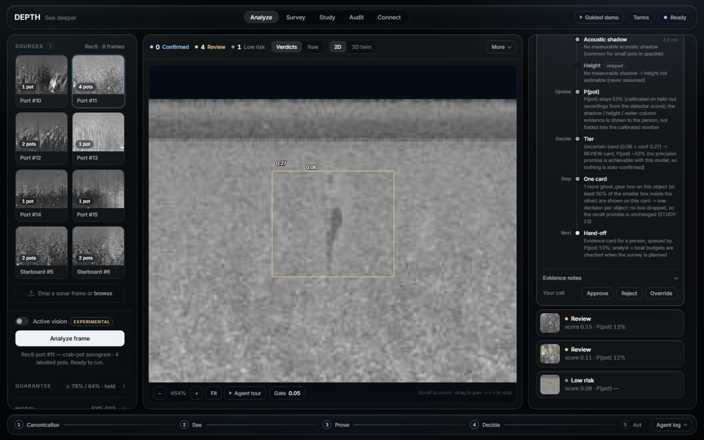
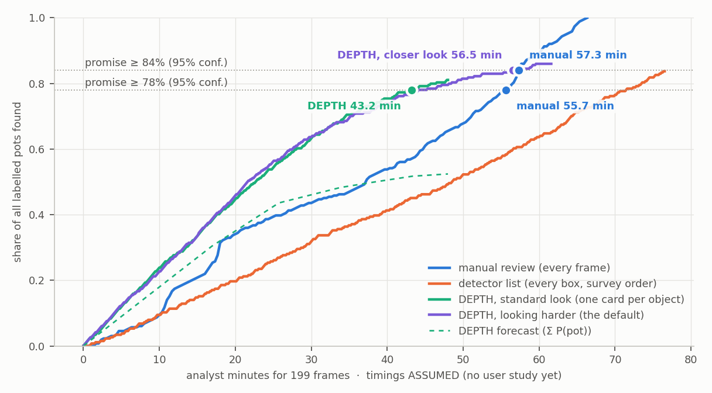

# DEPTH — side-scan sonar in, a cleanup plan a person approves out

[](https://github.com/madhesh60/depth/actions/workflows/tests.yml)
[](https://github.com/madhesh60/depth/actions/workflows/codespaces.yml)
[](https://codespaces.new/madhesh60/depth?quickstart=1)

**DEPTH does not claim a better detector. It makes any detector dependable.** It finds lost crab pots
(ghost gear) and wreck debris in side-scan sonar, **promises how many pots reach a person**, checks that the
promise applies to the recording in front of it, and plans the cleanup. Nothing is dispatched until a named
person approves it.

**D**etect · **E**vidence · **P**rove · **T**riage · **H**azard-map — OpenCV 5 on a CPU, torch-free, built for
AWS Graviton + COOL · OpenCV AI Competition 2026 · Team Syndicate (solo — Madhesh) · targets: **Agentic Vision**
and **Best Use of COOL** · AGPL-3.0

| | |
|---|---|
| **Try it in your browser** | [Open in GitHub Codespaces](https://codespaces.new/madhesh60/depth?quickstart=1): the real studio, ready in ~3 minutes, free with a GitHub account |
| **Try it on a laptop** | five commands, CPU only — [below](#five-minutes-from-a-clean-clone) |
| **Live demo** | not live yet: AWS CloudFront is waiting on account verification |
| **Video** | not recorded yet |
| **For judges** | [`docs/JUDGES.md`](docs/JUDGES.md): every number with its split, three clicks, a glossary |

### At a glance

| | number | measured on |
|---|---|---|
| **Pots that reach a person** (95% confidence) | **≥ 84%** looking harder (held: 86.0%) · **≥ 78%** one look (held: 81.1%) | unseen test recordings |
| **Works with any detector** | the same code gives EXP-001 **≥ 63%** and EXP-003 **≥ 78%**; both held | each on its own unseen test |
| **Knows when its promise does not apply** | withdrawn in **22 of 22** surveys on another sonar | STUDY-19 |
| **One card per object** | review cards per frame, looking harder: **3.86 → 2.32**; the same pots reach a person | STUDY-23, test |
| **Analyst minutes** (assumed timings) | DEPTH vs manual: one look **43.2 vs 55.7** · looking harder **56.5 vs 57.3** · empty seabed **34 / 47 vs 56** per hour | test · user study pending |
| **Speed per frame** | one look **157 ms** · looking harder (the default when time allows) ≈ **5×**, about 0.8 s | EC2 x86, 4 vCPU · the 5× is the laptop's ratio |
| **Crab-pot detector**, AP@0.5 | **0.482**; weaker than GhostVision (F1 0.41 vs 0.71–0.73) | v2b test, 214 frames |
| **Checks** | **301** tests · ruff · mypy · a headless-Chrome UI test, all in CI; the Codespaces setup run in its own image on 2 CPUs, guided demo to the end | 2026-10-22 |

### Not done — said plainly

- **COOL has not run.** The AWS Marketplace subscription is waiting on a payment method. The benchmark, the
  AWS-signed receipt and its verifier are built, and run in one command once it is active.
- **No live link yet** (CloudFront account verification). Codespaces or the five commands run the same studio.
- **No field proof.** No recording has both real pots and real GPS: the pot frames carry synthetic GPS
  (labelled on screen), and the real-GPS river recordings hold no known pots.
- **Time saved is not measured.** The minutes above use assumed timings until 3–5 people run the Study tab.
- **The detector is weak** (mAP@0.5 0.319 against the 0.70 target). DEPTH makes it usable, not accurate.


### Five minutes from a clean clone

```bash
git clone https://github.com/madhesh60/depth.git
cd depth
pip install -r requirements.txt                       # torch-free runtime: OpenCV 5.0.0.93, FastAPI
python -m src.detection.fetch_model                   # the detector: 38 MB, SHA-256 checked
python -m src.cv_pipeline.humminbird fetch            # a raw sonar recording with real GPS: 11 MB
python -m uvicorn src.dashboard.app:app --port 8000   # open http://localhost:8000 → ▶ Guided demo
```

### How the evidence maps to the judging criteria

| criterion | where DEPTH shows it |
|---|---|
| **Technical execution** | OpenCV 5 does the work: Stage 1 (`cv2.Sobel`, `cv2.blur`, `cv2.remap`), YOLO11 through `cv2.dnn` on the new engine, shadow evidence, dropout masks; deploy-faithful evaluation with CIs ([`eval_exp003_test.md`](docs/reports/eval_exp003_test.md)) |
| **Agentic Vision** | the core loop ([`core.py`](src/agentic/core.py), §2) checks that its promise applies, chooses how hard to look, re-plans on its own measurements, and asks a person before acting |
| **Innovation** | statistical promises on an imperfect detector, checked for correlated frames and withdrawn where they do not apply ([`calibration_exp003.md`](docs/calibration_exp003.md), [`dependence.md`](docs/reports/dependence.md), [`applicability.md`](docs/reports/applicability.md)) |
| **Real-world impact** | raw Humminbird recordings with real GPS; one card per object; GPX / KML / GeoJSON, OGC API, webhooks, MCP; analyst minutes reported with their assumptions ([`effort_curve.md`](docs/reports/effort_curve.md)) |
| **UX** | zero-build studio: a guided demo, one evidence card per object with the agent's trace, an approvals inbox, a 3D twin, failure drills (`?drills`), one click in Codespaces |
| **Responsible cloud delivery** | one stack, dry-run by default, budget alerts and a scheduled stop, PIN lockout, no start without tokens, protected wrecks generalised ([`infra/README.md`](infra/README.md), [`responsible_use.md`](docs/responsible_use.md)) |

---

## 1. Why this is different

Detectors for sonar debris exist. An imperfect detector is not a tool an NGO can plan a boat day on, so DEPTH
wraps one in **promises you can check** and **measurements instead of assumptions**:

| | what DEPTH does | evidence |
|---|---|---|
| **Calibrated promises** | "≥ 78% of pots reach a person (95% confidence)" with one look, **≥ 84%** looking harder — fit on held-out recordings, verified once on unseen ones (held: 81.1% and 86.0%). Restated from 79% after a check for correlated frames (STUDY-21). It also says what it *cannot* promise: 90% recall, any auto-confirm precision, a per-survey guarantee | [`calibration_exp003.md`](docs/calibration_exp003.md) · [`look_harder.md`](docs/reports/look_harder.md) · [`dependence.md`](docs/reports/dependence.md) |
| **Knows when its promise does not apply** | it compares every frame with the recordings the promise was fit on (OpenCV statistics → conformal p-values). Another sonar: withdrawn in 22 of 22 surveys (one look keeps only 23.9% of the pots there), and a person is asked to approve a full review. A single uploaded frame stranger than every calibration frame (a photo, a screenshot) gets no promise either | [`applicability.md`](docs/reports/applicability.md) |
| **One card per object** | the detector often puts two or three boxes on one pot; boxes of one class that sit half inside each other share **one review card** and one decision. No box is dropped, so the same pots reach a person: 2.68 → 1.81 cards per frame with one look, 3.86 → 2.32 looking harder | [`card_grouping.md`](docs/reports/card_grouping.md) (STUDY-23) |
| **Stage 1 measures the sonar** | bottom tracking gives the sonar's altitude per ping → relative object height and slant → ground geotags. Checked without labels: port and starboard on the same pings agree to **1.6 px** (random pairs: 5.3 px) | [`stage1_canonical.md`](docs/reports/stage1_canonical.md) |
| **Goal-driven agent** | chooses how hard to look from the goal and the compute budget, prices each mode by its measured pace and re-plans mid-run; orders the queue by calibrated P(pot); analyst and boat budgets | Agent tab · trace on every card |
| **A physical second look** | plans re-survey passes on the **opposite side**, ranked by information per boat-minute; each predicts the bearing its shadow must flip to; each is approved or declined on its own | map + GPX / GeoJSON |
| **Minutes saved — to be measured** | a timed, counterbalanced user study is built in (not yet run with people). At *assumed* timings (20 s per frame, 8 s per card) DEPTH reaches its promise in **43.2 vs 55.7** minutes with one look and **56.5 vs 57.3** looking harder on the pot-dense test; on empty seabed **34 / 47 vs 56** per survey-hour. Before one card per object it was slower in both modes | Study tab · [`effort_curve.md`](docs/reports/effort_curve.md) |
| **People decide, the agent re-plans** | a named person's ✓ / ✕ on a card (and a crew's *recovered* / *not found*) re-plans the route, queue, budget and passes; an impact ledger measures the reviewed precision | Survey tab · [`agentic_vision.md`](docs/agentic_vision.md) |
| **The agent re-measures its own geometry** | on a raw recording it cross-checks OpenCV's seabed track against the depth sounder per chunk and re-runs the tracker on a conflict. Fresh 1-h recording: 280 of 280 chunks resolved, 3 of 3 gross tracker failures corrected; one registered criterion failed and is reported | [`sensor_check.md`](docs/reports/sensor_check.md) |
| **Real sonar recordings, real GPS** | reads a raw Humminbird recording (`.DAT` + `.SON` / `.IDX`): per-ping GPS, heading, speed and depth, checked against physics (r = 0.95; course vs heading 2.4° median); **measures the range scale** (2.03 cm/sample ± 10.2%); flags data dropouts per ping | [`raw_recording.md`](docs/reports/raw_recording.md) |
| **OpenCV output moves the boat** | the same survey re-run with each OpenCV output withheld: without Stage 1, **95 of 142** pins fall outside their own error circle and 4 of 39 re-survey passes regroup; without the shadow nothing changes (evidence only). Live: **"⊘ without Stage 1"** on the survey map | [`causal_trace.md`](docs/reports/causal_trace.md) (STUDY-12) |
| **Plugs into consoles and agents** | **OGC API – Features** (QGIS / ArcGIS), signed webhooks, a drop-in `<depth-hazards>` web component, and an **MCP server** (13 tools; the only write is *asking* a person) | [`integrations.md`](docs/integrations.md) · [`mcp.md`](docs/mcp.md) |
| **An LLM that writes, never decides** | an optional Claude-on-Bedrock rewrite of the crew's mission brief is shown only if every number and ID traces back to the survey; otherwise the template is served. **Not deployed on the demo server** | Survey tab · `GET /api/brief` |
| **COOL, proven by provenance** | a run counts as COOL only if `cv2` loads from `/opt/cool`; `/api/cool` returns an AWS-signed instance identity receipt, checked offline by `verify_cool` | [`infra/README.md`](infra/README.md) |

We also publish what did **not** work: a classical ROI gate (STUDY-01), the acoustic shadow as a filter
(STUDY-03/04), re-look vs plain confidence (STUDY-07), range-gain detector input (STUDY-08), seam inference
across chunk boundaries (STUDY-11b), a larger input + flipped second view (STUDY-13: +0.10 AP on the calibration
recording, −0.06 on unseen data), and per-frame active vision (STUDY-15: both gates failed, so it is off).

## 2. The agent — a goal, OpenCV tools, and a loop that re-plans on what it sees

The core loop ([`src/agentic/core.py`](src/agentic/core.py)) runs every survey, on by default. The operator
states a **goal**; the agent decides how to meet it and logs every option it weighed (the studio's **Agent**
tab, `agent_run` in the API, `run_survey` over MCP):

```
Goal ─ recall to keep · compute budget · analyst minutes · boat minutes
 1 inspect      usable frames? (corrupt / blank ones skipped and reported)
    check       does the promise apply here? OpenCV statistics of every frame vs the calibration recordings
                 └ no ─► withdraw the promise · cheapest look · ask a person to approve a FULL REVIEW
 2 decide       how hard to look: standard (≥ 78%, 1 cv2.dnn pass/frame) or look harder (≥ 84%, + 2×2 tiles)
                 = the cheapest mode that keeps the goal, else the strongest the compute budget allows
 3 perceive     every frame: Stage 1 · YOLO11 via cv2.dnn · evidence · one card per object — and watch the pace:
                 └ budget would overrun, or the closer look fails ─► RE-PLAN: standard look, re-tier
    sense       raw recording: OpenCV seabed track vs depth sounder ─► conflict ─► re-track ─► re-fit the scale
 4 plan         review queue · analyst budget · routes · opposite-side passes ranked by information per boat-minute
 5 hand off     one approval request per action ─► a named person decides ─► every decision RE-PLANS
- - - - - - - - - - - - - - - - experimental, off by default - - - - - - - - - - - - - - - - -
Per find ─► next OpenCV tool = the cheapest one whose result could CHANGE the action, else stop (STUDY-15)
```

| the agent decides alone | it asks a person | only a person does |
|---|---|---|
| how hard to look, whether its promise applies, which seabed measurement to trust, where pins go, which boxes are one object, the queue order, which passes are worth boat time | inspect · recover · re-survey · full review · public sharing — one request per action, with its rationale | approve or decline (name + approver PIN, with a lockout), confirm or reject a card, mark recovered / not found — each decision re-plans |

It never dispatches; MCP and API clients can only ask. A recorded session on the real server shows the whole
chain — an external agent runs a survey over MCP, asks, its own attempt to approve is refused, a person
approves, the agent reads the work order back: [`mcp_session.md`](docs/reports/mcp_session.md).

**Every agent decision that is on by default was validated before it was switched on** (protocol committed
before the unseen data was scored):

| decision | evidence |
|---|---|
| **look harder** to keep a stronger promise | promise 78% → **84%**; on unseen test 81.1% → **86.0%** (lower bound 82.0%); 5 forward passes per frame — [`look_harder.md`](docs/reports/look_harder.md) (STUDY-18) |
| **withdraw the promise** where it does not apply | another sonar: 22 of 22 surveys; kept for all 3 test recordings and the demo frames — [`applicability.md`](docs/reports/applicability.md) (STUDY-19) |
| **one card per object** | 3.86 → 2.32 cards per frame looking harder, the same 227 of 264 pots reach a person, 1 of 462 cards holds two pots — [`card_grouping.md`](docs/reports/card_grouping.md) (STUDY-23) |
| **re-measure the seabed** when image and sounder disagree | 280 of 280 chunks resolved, 3 of 3 gross tracker failures corrected — [`sensor_check.md`](docs/reports/sensor_check.md) (STUDY-16) |
| **put pins where the measured geometry says** | without Stage 1, 95 of 142 pins leave their own error circle — [`causal_trace.md`](docs/reports/causal_trace.md) (STUDY-12) |
| re-plan on a person's decision | in the test suite: a decline drops the pass and re-ranks boat time; an approval issues a work order |

The same goal produces different runs: with no recall asked for, the agent looks harder (≥ 84%); asked for
≥ 78% it takes the cheaper single look; with a tight compute budget it drops to one look, mid-run if needed; on
the raw river recordings it withdraws the promise and asks for a full review. The studio's survey gives it
**20 s of compute by default**: on a small machine (a laptop, a 2-core codespace) it prices both looks with its
measured pace and takes the one that fits, switching mid-run if the pace says so; a fast server keeps the
closer look. A single analyze call has a 2-s
answer budget, so an idle server looks harder and a busy one takes the standard look. **Per-frame active
vision** (below the dashed line) is built and tested, but it failed its own validation (log-loss 0.637 → 0.648
on test; ACCEPT precision 0.86 → 0.848 on another sonar), so it stays off by default and labelled experimental
([`evidence_model_exp003.md`](docs/reports/evidence_model_exp003.md)). On the 8 shipped frames, Stage 1 moves
the median pin **7.0 m** and **12 of 18** pins leave their own error circle; with active vision on, 7 of 18
hazards also change action and the re-survey plan shrinks from 5 passes (13.7 boat-min) to 1 (3.3)
([`opencv_counterfactual.md`](docs/reports/opencv_counterfactual.md)).

## 3. Try it (no sonar files needed)



Press **▶ Guided demo** in the top bar for a walk through everything below; **Terms** (top bar) explains the
studio's words. In **Survey**, the *Goal* selector sets the recall the agent must keep (default: the strongest
it can) and *Options → Compute budget* gives it a time limit (20 s by default, so a first survey stays quick on
two cores; empty = no limit); the **Agent** tab shows how it decided.

* **Analyze** — pick a sample frame → *Analyze frame*: the tracked seabed, verdict-coloured boxes, one evidence
  card per object (tier promise, P(pot), shadow, relative height, the full agent trace), the agent's-eye
  re-look view; label finds, or draw a **missed pot** (`M`).
* **Survey** — all samples (synthetic GPS) or the **raw recording (real GPS)** as a background job → hazards
  on a map with error radii, the inspection route, **re-survey passes**, analyst + boat budgets; ✓ a card and
  the **recovery route** re-plans; approvals inbox, mission brief, GeoJSON / GPX / KML / CSV / JSON.
* **3D twin** — the seabed in true ground-range geometry, the sonar at its tracked altitude, finds with
  shadow-derived heights; the survey laid out along the track with a replay of the boat sweeping its sonar.
* **Study** — the timed user study (manual review vs DEPTH cards) and the live effort curve for both modes.
* **Audit** — the blinded false-alarm audit. **Connect** — MCP, OGC API, signed webhooks, the drop-in panel.

The 8 sample frames ship with the app (CC-BY-SA, [`webui/samples/ATTRIBUTION.md`](webui/samples/ATTRIBUTION.md)).
They come from the v2b **test** split, so the default model never trained or tuned on them. Their GPS is
synthetic and labelled as such. The raw recording is real: PINGMapper's sample data (MIT code, Zenodo
10.5281/zenodo.6604666), fetched hash-checked, not redistributed.

## 4. Results (every number names its split)

**Detector — EXP-003, the deployed model** (YOLO11s, 640 px, dataset v2b tiles, 2 classes), `cv2.dnn`
([`onboard_exp003.md`](docs/reports/onboard_exp003.md)):

| | value | split |
|---|--:|---|
| crab pots (ghost gear) on sonar: AP@0.5 (95% CI) · AP@0.5:0.95 | **0.482** (0.43–0.55) · 0.165 | v2b test, 285 pots |
| crab pots: P / R / F1 at the validation-tuned threshold | 0.50 / 0.47 / 0.49 | v2b test |
| wreck debris: AP@0.5 · AP@0.5:0.95 | 0.156 · 0.047 (weak) | v2b test, 70 boxes |
| **mAP@0.5 · mAP@0.5:0.95** (both classes) | **0.319** · 0.106 — the proposal's 0.70 is **not met** | v2b test |
| GhostVision head-to-head: F1 · AP@0.5 | 0.41 · 0.39 (GhostVision reports F1 0.71–0.73) | official 398-frame split |
| cross-sonar: ghost gear AP@0.5 | 0.34; the val threshold does not transfer (recall 0.11) | `test_xsonar` |

Full reports with confusion matrices and PR curves: [test](docs/reports/eval_exp003_test.md) ·
[official 398](docs/reports/eval_exp003_test_official398.md) · [cross-sonar](docs/reports/eval_exp003_test_xsonar.md).
Why the gap: most training "wrecks" are fish-finder screenshots and the wreck boxes are loose — a data problem,
not the recipe ([`exp003_diagnosis.md`](docs/reports/exp003_diagnosis.md)). Five training runs after it (EXP-003f,
004, 004g, 005, 005a) did not beat it ([`exp005_diagnosis.md`](docs/reports/exp005_diagnosis.md)). The recall
promise is what makes this detector safe to use: every pot it covers reaches a person.


**Earlier baseline — EXP-001** (YOLO11s, dataset v1, 4 classes; [`eval_exp001.md`](docs/reports/eval_exp001.md)):
mAP@0.5 0.822 on test is **inflated** by an optical-only class; crab pots on **sonar**: AP@0.5 0.473, recall 0.599.

**Agent** — recall promise **≥ 84%** looking harder (2×2 tile pass; held on test at 86.0%, lower bound 82.0%) and
**≥ 78%** with one look (held at 81.1%, lower bound 76.7%); EXP-001's is ≥ 63%. Clopper-Pearson alone supported 79%
for one look; a block bootstrap over correlated frames supports 78.2%, so that promise was restated (STUDY-21). A
promise is a pooled rate: per recording, one look held on 5 of 6 (test Rec9: 74.7%). Nothing is auto-confirmed (no
precision promise is supportable).

**Analyst effort** (assumed 20 s per frame and 8 s per card until the study runs; one card per object;
[`effort_curve.md`](docs/reports/effort_curve.md)):

| mode | promise | cards to the promise | DEPTH min | manual min | break-even card time | per survey-hour on empty seabed |
|---|--:|--:|--:|--:|--:|--:|
| one look | ≥ 78% | 324 | **43.2** | 55.7 | 10.3 s | 34 vs 56 min |
| looking harder (the default when time allows) | ≥ 84% | 424 | **56.5** | 57.3 | 8.1 s | 47 vs 56 min |



**Runtime.** The network forward is 93–98% of a frame on EC2, so the closer look costs about its 5 passes:

| frame | host | p50 per frame |
|---|---|--:|
| one look (standard) | EC2 c8i.xlarge x86, 4 vCPU, stock OpenCV 5 | **157 ms** |
| one look (standard) | EC2 c8g.xlarge Graviton4, 4 vCPU, stock OpenCV 5 | **197 ms** (stock Graviton is slower: the bar COOL must clear) |
| looking harder (the default when time allows) | laptop x86, both modes interleaved | 406 → 2,110 ms (≈ 5×; 4.7–5.9× per repeat) |
| looking harder | EC2 | ≈ 0.8 s estimated (5 × 157 ms) — the EC2 run is pending |
| one look, one CPU core | EC2 Graviton4, 1 thread | 599 ms, 240 MB → a survey-hour in ~168 s, ~21× faster than the sonar records |

The four tile passes run one after another: the published ONNX is exported with batch size 1, and `cv2.dnn`
refuses a batch of four (a batch-dynamic export would change the model's hash, so it waits for the next model
release). One card per object also lightens an Analyze answer on the demo frames from 0.72 to 0.57 MB. The
c8g.large demo server passed its load test (4 clients + 1 survey: 291 / 291, p95 2.0 s) **before** the look-harder
mode existed; the re-run is pending. The engine that loads is OpenCV 5's new one (STUDY-20: 634 of 634 detections
identical to the classic engine). Results: [`benchmarks/`](benchmarks) · [`cool_benchmark.md`](docs/reports/cool_benchmark.md)
· [`dnn_engine.md`](docs/reports/dnn_engine.md).
<!-- cool:readme -->
**Graviton + COOL:** measured automatically the moment the Marketplace subscription is active (`PHASE=cool ./infra/golive.sh`).
<!-- /cool:readme -->

**Real recordings** (raw Humminbird, real per-ping GPS — [`raw_recording.md`](docs/reports/raw_recording.md)):
the Colorado River sample (150.6 s): 3,453 pings per channel parsed, 0 malformed; range scale 2.19 → **2.03 cm/sample
± 10.2%** after the sensor cross-check; the full agent in 3–4 s on a laptop; **1 review card** (two boxes on one object) =
24 cards per hour on water with no known pots. The 1-h Solix recording (Pearl River) gives **48 cards per hour**.
Both are another sonar, so the core loop withdraws its promise there and asks for a full review.

## 5. Limits — what DEPTH does not do (yet)

- **The detector is weak.** mAP@0.5 0.319 against the proposal's 0.70; crab-pot AP@0.5 0.482; wreck 0.156; on the
  official split F1 0.41 against GhostVision's reported 0.71–0.73; cross-sonar recall 0.11 at the validation
  threshold. DEPTH's promises make *this* detector usable; they do not make it accurate.
- **A promise is a pooled rate**, fit on 3 recordings and verified on 3 others — not a per-survey guarantee (one test
  recording reached 74.7% against the 78% promise). The applicability check catches another sonar or rendering,
  not subtle site or gain drift.
- **No field proof**: no recording has both real pots and real GPS; the river recordings have no known pots.
  **No human study and no blinded audit yet**: analyst minutes and audited precision are assumptions until people
  run them (Study and Audit tabs). A card with several boxes is assumed to take as long as a one-box card.
- **Looking harder costs ≈ 5× the compute** (4 tile passes after the full frame), and its EC2 timing is not measured yet.
- **Vehicle motion.** Stage 1 tracks the seabed per ping (heave); **pitch and roll are not corrected** — the ping
  header carries no attitude. Data dropouts are **flagged, not repaired**: a pot inside a dropout cannot be found.
- **Boxes, not pixel masks** (the brief allows either; the crab-pot labels are boxes).
- **No small board measured** (Raspberry Pi / Jetson): the on-board figure is one core of a server CPU.
- **Not deployed yet**: COOL (Marketplace subscription), a public URL (CloudFront account verification), the
  optional Bedrock brief writer. Active vision is built but off: it failed its own validation.

## 6. How it works

```
frame ─► Stage 1 canonicalise ─► See (YOLO11 · cv2.dnn) ─► Prove (evidence) ─► Decide (guaranteed tiers) ─► one card per object
          └► active vision (experimental): value-of-information tool choice · conflict ─► another observation
survey ─► stitch · merge repeat sightings ─► routes · budgets · opposite-side re-survey ─► exports
human ─► labels · timed study · blinded audit          offline ─► v2b ─► train ─► onboard (one command)
```
Full design: [`docs/architecture.md`](docs/architecture.md). Agentic write-up: [`docs/agentic_vision.md`](docs/agentic_vision.md).
Every document, grouped by what it proves: [`docs/README.md`](docs/README.md).

## 7. Reproduce

```bash
pip install -r requirements-dev.txt                 # runtime + test + lint + type-check dependencies
pytest -q                                           # test suite
python -m ruff check .                              # lint (configuration: pyproject.toml)
python -m mypy                                      # type check the agent's decision core (files: pyproject.toml)
python -m src.detection.evaluate                    # deploy-faithful detector evaluation
python -m src.agentic.calibrate                     # fit + verify the guaranteed tiers
python -m src.agentic.effort                        # analyst-effort curve, both perception modes
python -m src.agentic.counterfactual                # same survey: detector only vs + Stage 1 + evidence
python -m src.bench.product_bench --label my_host   # benchmark this machine (product workload)
python -m src.cv_pipeline.study_canonical           # STUDY-08: Stage 1 altitude, port vs starboard
python -m src.detection.study_scale_tta             # STUDY-13: input size + flip TTA
python -m src.cv_pipeline.humminbird report         # STUDY-14: raw recording, real GPS
python -m src.agentic.evidence_model                # STUDY-15: evidence LRs (val) → test → fresh split
python -m src.agentic.study_sensor                  # STUDY-16: seabed track vs depth sounder
python -m src.agentic.study_look_harder --verify    # STUDY-18: look harder (calibration -> test once)
python -m src.agentic.study_applicability --verify  # STUDY-19: does the promise apply? (fit -> verify once)
python -m src.bench.dnn_engine --label my_host      # STUDY-20: OpenCV 5's two DNN engines, speed + same answers
python -m src.agentic.study_dependence              # STUDY-21: does the promise survive correlated frames?
python -m src.agentic.study_cards --verify          # STUDY-23: one review card per object (calibration -> test once)
python -m src.agentic.effort --real-water           # analyst effort + a raw 1-h recording end to end

# STUDY-12: the counterfactual trace on up to 80 v2b test frames
python -m src.agentic.study_causal \
    --frames DATASET/03_yolo_ready_dataset_v2b/test/images --limit 80

# A new Kaggle-trained model: diagnose on validation (never test), then plug it in (+ speed gate)
python -m src.detection.diagnose --zip EXP-003_complete.zip
python -m src.detection.onboard_model --zip EXP-003_complete.zip
```
Datasets are git-ignored (large); their builders are in `DATASET/scripts/`
([`docs/dataset_card.md`](docs/dataset_card.md)). Deploy: [`infra/README.md`](infra/README.md).

## 8. Repository

```
src/cv_pipeline/  Stage 1 (canonical.py) · raw Humminbird reader (humminbird.py) · retired ROI gate (STUDY-01)
src/detection/    cv2.dnn detector, calibration, evaluation, training, onboarding (+ speed gate), model fetch,
                  false-alarm audit, failure gallery, STUDY-11b / 13
src/agentic/      the core loop (core.py: goal -> check the promise -> choose how hard to look -> perceive ->
                  plan -> ask), the frame agent, one card per object (cards.py, STUDY-23), applicability
                  (STUDY-19), look harder (STUDY-18), sensor cross-check (STUDY-16), active vision, guarantees,
                  geo, routes, re-survey, approvals, mission brief, 3D twin, provenance, labels, study, effort
src/bench/        COOL benchmark (product workload, provenance, comparison, COOL receipt)
src/dashboard/    FastAPI service: app.py (wiring) · service.py (state) · routes/ (one router per area) ·
                  jobs, limits, rate limits, metrics · MCP server + a recorded session · OGC API · webhooks
webui/            zero-build studio (+ three.js twin) · embed/depth-embed.js (drop-in panel) · 8 sample frames
infra/            Graviton + COOL deploy (dry-run by default) + 3-way benchmark
models/<MODEL>/   calibration.json + effort/audit data (weights: GitHub Release, fetch_model)
benchmarks/       measured benchmark results (JSON): laptop and EC2
tests/            the pytest suite, run by CI on every push (.github/workflows/tests.yml); the Codespaces
                  path in its own image, guided demo to the end (.github/workflows/codespaces.yml)
notebooks/        the Kaggle training notebook and its generator
DATASET/scripts/  dataset builders (the data itself is git-ignored)
docs/             technical report, architecture, cards, guides (MCP, integrations, training), project
                  record (proposal, progress, experiments); docs/reports/ holds the evaluation and study reports
.devcontainer/    GitHub Codespaces: the studio in a browser, nothing to install
```
Documentation map: [`docs/README.md`](docs/README.md). Logs: [`docs/experiments.md`](docs/experiments.md) (every
study, including negative results) · [`docs/progress.md`](docs/progress.md).

## 9. Responsible use, how it was built, license

Human approval before any dispatch; low-risk finds kept for audit, never deleted; protected-wreck coordinates and
data retention are covered in [`docs/responsible_use.md`](docs/responsible_use.md).

**How it was built:** by Madhesh (Team Syndicate, solo), with an AI coding assistant (Claude Code) writing much of
the code under the author's direction. Every number in this repository comes from a script in it that you can
re-run, and each study's protocol was committed before its unseen data was scored.

**AGPL-3.0** ([`LICENSE`](LICENSE)) — builds on Ultralytics YOLO11 (AGPL-3.0). Data sources keep their own
licenses (crab-pot: the dataset card's metadata says CC-BY-SA-4.0, its text says GPL — recorded in the attribution;
UATD CC-BY-4.0; the PINGMapper recording is fetched, not redistributed) — see the dataset card.
*Team Syndicate · OpenCV AI Competition 2026.*
