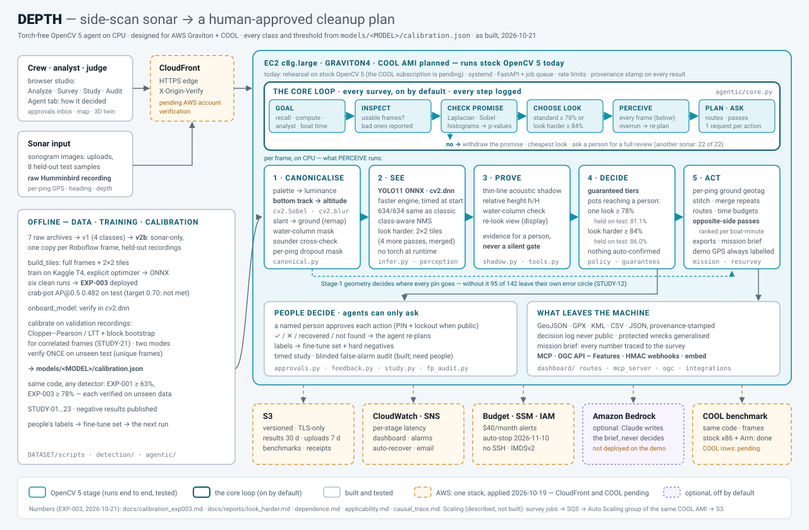
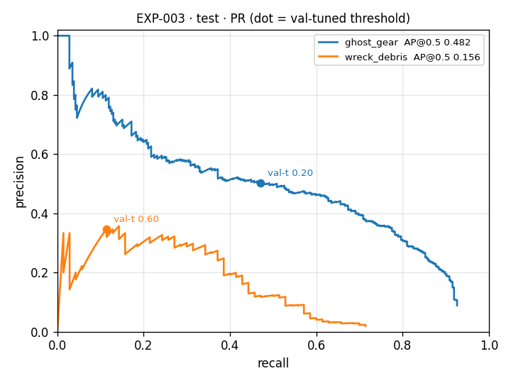

# DEPTH — Derelict Fishing Gear Detection from Side-Scan Sonar

[](https://github.com/madhesh60/depth/actions/workflows/tests.yml)
[](https://github.com/madhesh60/depth/actions/workflows/codespaces.yml)
[](https://codespaces.new/madhesh60/depth?quickstart=1)

**DEPTH turns a side-scan sonar survey into a cleanup plan that a named person approves.** It finds lost crab
pots (ghost gear) and wreck debris, promises with 95% confidence how many pots reach a human reviewer, checks
that the promise applies to the recording in hand, and plans the recovery. It does not claim a better
detector; it makes an imperfect one dependable.

**D**etect · **E**vidence · **P**rove · **T**riage · **H**azard-map — OpenCV 5 on a CPU, torch-free, built for
AWS Graviton + COOL · OpenCV AI Competition 2026 · Team Syndicate (solo) · **Agentic Vision** and **Best Use of
COOL** · AGPL-3.0

| | |
|---|---|
| **For judges** | [`JUDGES.md`](JUDGES.md): try it, see the agent decide, every key number with its split · also in the studio under **For judges** |
| **Try it in the browser** | [Open in GitHub Codespaces](https://codespaces.new/madhesh60/depth?quickstart=1): the real studio in about 3 minutes, free with a GitHub account |
| **Run it locally** | five commands, CPU only: [Installation and Reproduction](#installation-and-reproduction) |
| **Practical (deps · build · deploy · test)** | [Practical: Pinned Dependencies, Build, Deployment and Tests](#practical-pinned-dependencies-build-deployment-and-tests): exact pins, one command per step, all run in CI |
| **Docker · Compose · Kubernetes** | [`docs/containers.md`](docs/containers.md): one non-root image, read-only root, health probes |
| **Live demo · video** | **[13-216-140-101.sslip.io](https://13-216-140-101.sslip.io)** (AWS Graviton4 c8g.large, stock OpenCV 5 in rehearsal mode - not COOL; the approver PIN is in the submission form) · not recorded yet |

**Contents:** [Problem](#problem-statement) · [Current practice](#how-it-is-currently-handled) ·
[What DEPTH builds](#what-depth-builds) · [Architecture](#architecture) ·
[Agentic workflow](#agentic-vision-and-human-approval-workflow) · [Model](#model-and-training) ·
[Data](#dataset-sources) · [Metrics](#evaluation-metrics) · [Studies](#experimental-studies-and-ablations) ·
[Performance](#system-details-and-key-numbers) · [Comparison](#competitive-analysis) ·
[AWS + OpenCV 5](#use-of-aws-and-opencv-5) · [Install](#installation-and-reproduction) ·
[Practical](#practical-pinned-dependencies-build-deployment-and-tests) ·
[Limitations](#limitations) · [Docs](#documentation) · [License](#attribution-and-license)

---

## Problem Statement

An estimated **640,000 tonnes** of fishing gear is lost at sea every year. Lost pots and nets keep catching
animals for years; this is **ghost fishing**. In Virginia alone, a six-year VIMS CCRM study
counted more than **31,000** crabs, finfish, birds and sea turtles killed by derelict blue-crab traps. VIMS CCRM
modelling found that removing 43,968 derelict pots returned **38.17 million lb** of harvestable blue crab, worth
about **$33.5 million**. Derelict gear also fouls propellers and carries invasive species.

<!-- IMAGE PLACEHOLDER 1: derelict crab pots on the seafloor, or a ghost net entangling wildlife (VIMS CCRM, NOAA Marine Debris Program, Global Ghost Gear Initiative). Replace with  -->

Side-scan sonar is how this gear is found. VIMS CCRM first mapped the problem with it in 2006, which led to
Virginia's first derelict-trap removal programme in 2008; it recovered more than 34,000 pots in six years. In
2023, NOAA selected VIMS CCRM to lead an **$8 million** national programme. Yet every sonar recording still
needs an expert to review it frame by frame, which is too slow and too costly to scale.

<!-- IMAGE PLACEHOLDER 2: a map of derelict-gear hotspots or a debris-category chart (VIMS CCRM Marine Debris Reduction Plan, NOAA ghost-gear GIS data). Replace with  -->

**Further reading:** [VIMS CCRM Marine Debris Programme](https://www.vims.edu/ccrm/research/marine_debris/) ·
[Marine debris problems](https://www.vims.edu/ccrm/research/marine_debris/problems/index.php) ·
[Derelict gear removal](https://www.vims.edu/ccrm/research/marine_debris/solutions/removal/index.php) ·
[NOAA Marine Debris Program](https://marinedebris.noaa.gov/info/ghostgear.html) ·
[Global Ghost Gear Initiative](https://www.ghostgear.org/) ·
[FAO: lost fishing gear](https://www.fao.org/fishery/en/topic/16999)

---

## How It Is Currently Handled

| Approach | What it offers | Why it is not enough |
|---|---|---|
| **Optical and SAR satellites** (Planet, Maxar, Sentinel) | wide-area surface monitoring | light reaches 1–2 m and SAR stops at the surface, so gear at 5–50 m is invisible; revisit gaps, cloud and sun glint; area alerts, not objects a crew can recover |
| **Side-scan sonar, reviewed by an analyst** | acoustic images of the seabed: a pot shows as a bright return with a shadow | a trained analyst must review every frame: slow, inconsistent and hard to scale |
| **An automated detector** (for example GhostVision) | finds pots in sonar automatically | a detector alone outputs boxes and confidence scores; it does not promise coverage, check that it suits the recording, or plan a cleanup for a person to approve |

---

## What DEPTH Builds

DEPTH takes a side-scan survey (sonogram images, or a raw Humminbird recording with per-ping GPS) and returns a
georeferenced cleanup plan: a prioritised review queue, a hazard map, inspection and recovery routes,
opposite-side re-survey passes, and GeoJSON / GPX / KML / CSV exports. It runs on OpenCV 5 on a CPU, with no
PyTorch at runtime. Nothing is dispatched until a named, PIN-authenticated person approves it.

1. **A recall promise you can check.** With 95% confidence, **≥ 78%** of pots reach a person with one look
   (138.5 ms per frame on Graviton4), and **≥ 84%** when the agent looks harder (655 ms). The promise is fit on
   held-out validation recordings and verified once on unseen test recordings, where it held at 81.1% and 86.0%.
2. **It knows when the promise does not apply.** An OpenCV applicability check compares every frame with the
   calibration recordings. On another sonar it withdraws the promise (22 of 22 surveys) and asks a person to
   approve a full review.
3. **One card per object.** Overlapping boxes on one pot share one review card: 3.86 → 2.32 cards per frame when
   looking harder, and the same pots still reach a person.
4. **An agent with a goal.** It chooses how hard to look from the operator's recall goal and compute budget,
   re-plans on its own measurements, and asks before acting.
5. **Measured geometry.** Stage 1 tracks the seabed per ping, converts slant range to ground range and
   cross-checks the depth sounder, so each pin lands where the measurements put it.

---

## Architecture

Five OpenCV 5 stages run inside one agentic loop: **Stage 1 Canonicalise → See → Prove → Decide → Act**. The
system is built for EC2 Graviton + COOL. The agent sets the goal, checks applicability, chooses the perception
mode, perceives every frame, plans, and requests human approval before anything is dispatched.



| Stage | What it does | Module |
|---|---|---|
| **Stage 1 — Canonicalise** | palette → luminance, orientation by source rule (never guessed), per-ping bottom tracking, slant → ground range, water-column mask. It measures geometry and never gates a detection | `src/cv_pipeline/canonical.py` |
| **See** | YOLO11s (ONNX) through `cv2.dnn`, class-aware NMS, on the faster of OpenCV 5's two DNN engines (measured at start-up) | `src/detection/infer.py` |
| **Prove** | acoustic shadow, relative height, water-column check: evidence on the card, never a silent gate | `src/agentic/shadow.py`, `evidence.py` |
| **Decide** | calibrated tiers (the recall promise), P(pot) queue order, one card per object | `src/agentic/calibrate.py`, `cards.py` |
| **Act** | geotags, chunk stitching, repeat-sighting merge, routes, re-survey passes, exports, provenance, mission brief | `src/agentic/mission.py`, `geo.py`, `brief.py` |

The full as-built design is in [`docs/architecture.md`](docs/architecture.md).

---

## Agentic Vision and Human Approval Workflow

The core loop ([`src/agentic/core.py`](src/agentic/core.py)) runs every survey toward the operator's goal: the
recall to keep, plus compute, analyst and boat minutes. It logs every option it weighed: the studio's **Agent**
tab, `agent_run` in the API and `run_survey` over MCP all show it.

```
Goal: recall to keep · compute budget · analyst minutes · boat minutes
 1 inspect    usable frames? corrupt or blank ones are skipped and reported
 2 check      does the promise apply? OpenCV statistics of each frame vs the calibration recordings
                └ no → withdraw the promise · cheapest look · ask a person to approve a FULL REVIEW
 3 decide     standard look (≥ 78%, 1 cv2.dnn pass) or look harder (≥ 84%, + a 2×2 tile pass):
                the cheapest mode that keeps the goal, else the strongest the compute budget allows
 4 perceive   Stage 1 · YOLO11 via cv2.dnn · evidence · one card per object, while watching its own pace
                └ budget would overrun, or the closer look fails → RE-PLAN to the standard look
   sense      raw recording: seabed track vs depth sounder → conflict → re-track → re-fit the range scale
 5 plan       review queue · analyst budget · routes · opposite-side passes ranked by information per boat-minute
 6 hand off   one approval request per action → a named person decides → every decision RE-PLANS
```

| The agent decides alone | The agent asks a person | Only a person does |
|---|---|---|
| how hard to look, whether its promise applies, which seabed measurement to trust, where pins go, which boxes are one object, the queue order, which passes are worth boat time | inspect · recover · re-survey · full review · public sharing: one request per action, each with its rationale | approve or decline (name + approver PIN), confirm or reject a card, mark recovered / not found; each decision re-plans |

### The Approval Workflow

1. **The agent asks.** It files one approval request per action. On the deployed server the approver also
   receives one email per survey through Amazon SNS (at most 6 an hour; the email never contains the PIN).
2. **A named person decides.** Approving or declining needs a name and the approver PIN. Five wrong PINs within
   15 minutes lock that client out for 15 minutes. MCP and API clients can only ask: no tool can approve. A
   public server will not start without its tokens and PIN.
3. **The agent re-plans.** Every decision re-plans the queue, routes, budgets and passes. A pending request that
   the re-plan makes stale is withdrawn and asked again.
4. **Everything is logged.** `GET /api/survey/{id}/log` merges plan steps, incidents, requests, decisions and
   re-plans, each with its actor (agent · person · system · llm). `/api/report/trace` is a replayable JSONL
   flight recorder.

A recorded session on the real server shows the whole chain: an external agent runs a survey over MCP, its own
attempt to approve is refused, and a person approves ([`mcp_session.md`](docs/reports/mcp_session.md)).

### Failure Handling

Every failure becomes an incident with a stated fallback and a human action. It is shown to the person and
written to the audit log; nothing fails silently.

| Situation | What DEPTH does |
|---|---|
| The promise does not apply (another sonar, or a frame unlike every calibration frame) | withdraws the promise, takes the cheapest look, files `promise_not_applicable` and asks a person to approve a full review (STUDY-19) |
| The goal cannot be met (for example 95% recall) | refuses in plain words, names the strongest promise it can keep (≥ 84%) and leaves the choice to a person |
| The compute budget would overrun, or the closer look fails | re-plans to the standard look for the remaining frames and re-tiers the earlier ones; the ≥ 78% promise still holds |
| A detector call is still busy (timeout) | waits and runs the frame again; the frame is never skipped |
| An evidence tool fails | uses the detector score and sends the find to a person, never auto-confirmed; one bad frame never sinks a survey |
| A frame is corrupt or invalid | skips and reports it (`/api/analyze` returns 422); the survey continues |
| The seabed track and the depth sounder disagree | re-tracks inside the sounder's window; if nothing coherent remains, marks the chunk *not measured* (slant range and a wider error radius, no metres) (STUDY-16) |
| A raw recording has data dropouts | flags them per ping and files `data_dropout`; the promise covers imaged seabed only, so the stretch is proposed for re-survey (STUDY-22) |
| GPS is missing, or the geometry or orientation is invalid | withholds what it cannot measure (positions, routes, ground range, height); every find still reaches a person |
| The model is unavailable | answers 503 with the reason; nothing is decided |
| Storage (S3) or the LLM brief writer fails | keeps results on local disk; serves the template brief |
| Two people decide the same request at once | the first decision stands; the second gets a 409 naming who decided first |
| The server restarts mid-survey | withdraws the agent's requests whose survey is gone, with the reason |

**Run the drills yourself:** open `http://localhost:8000/?drills`, then **Ready** (top right) → *Failure drills*,
or add `?simulate=<code>` to `/api/analyze`, `/api/survey`, `/api/jobs/survey` or `/api/brief`. Drill incidents
are tagged `simulated`. The full list is in [`docs/agentic_loop.md`](docs/agentic_loop.md) §4.

**Active vision** (choosing the next OpenCV tool for each find by value of information) is built and tested, but
it failed both validation gates (STUDY-15), so it is off by default (`?active=1`, labelled experimental).

---

## Model and Training

**EXP-003** is the deployed detector: YOLO11s trained on Kaggle, exported to ONNX and run through OpenCV 5
`cv2.dnn`, with no PyTorch at runtime. Five follow-up runs did not beat it
([`model_card.md`](docs/model_card.md)).

| Setting | EXP-003 |
|---|---|
| Architecture | YOLO11s (detect), from COCO-pretrained `yolo11s.pt`; 2 classes: `ghost_gear`, `wreck_debris` |
| Input | 640 px |
| Training data | v2b tiles: 1,773 full frames + 2×2 tiles with cut boxes inpainted (4,839 images) |
| Optimizer | explicit SGD, lr 0.01, nominal batch 64 (16 × 4 accumulation), seed 42 |
| Schedule | 150 epochs planned; early stop at 104 (135 min on a Kaggle T4) |
| Augmentation | sonar-aware: no hue or saturation shift, no rotation, no vertical flip; horizontal flip 0.5 (along-track), brightness ±0.2, translate 0.1, scale 0.5, mosaic (off for the last 10 epochs) |
| Checkpoint selection | best ghost-gear AP@0.5 on the held-out validation recordings (Rec10/12/16), not Ultralytics' default fitness |
| Export and runtime | ONNX opset 12 → `cv2.dnn`, output (1, 6, 8400); 37.9 MB, SHA-256 pinned, GitHub Release `exp003-v1` |
| Training stack | Ultralytics 8.4.157 and PyTorch, pinned in `requirements-train.txt`; never installed on the server |

### Training Process

1. **Build the data.** `DATASET/scripts/build_dataset_v2b.py` builds the sonar-only, de-duplicated set, split by
   recording; `build_tiles.py` adds 2×2 tiles and inpaints cut boxes, so no tile shows an unlabelled partial
   object.
2. **Train on Kaggle.** Import `notebooks/exp005_kaggle.ipynb` (generated by `notebooks/make_kaggle_notebook.py`)
   and run it on a T4 GPU. The optimizer actually built is recorded in `model_meta.json`
   ([`kaggle_training.md`](docs/kaggle_training.md)).
3. **Diagnose on validation, never on test.** `python -m src.detection.diagnose --zip <run>_complete.zip` checks
   the fit on the model's own training frames (ghost AP@0.3 ≥ 0.65), validation AP per source and the wreck
   recall ceiling.
4. **Onboard with one command.** `python -m src.detection.onboard_model --zip <run>_complete.zip` checks the ONNX
   hash and a `cv2.dnn` forward pass, applies a speed gate, fits the tiers on validation, verifies them once on
   test, scores the test, official-398 and cross-sonar splits, and writes `docs/reports/onboard_<run>.md`.

### Model Selection

All runs were compared on the validation recordings Rec10/12/16 through the deploy path (`cv2.dnn`):

| Run | Change | Ghost AP@0.5 (val) | Verdict |
|---|---|--:|---|
| EXP-002 · 002s | 1024 / 640 px, `optimizer=auto` | 0.26 · 0.29 | underfit: AdamW at lr 0.00167 was built silently; tile label poisoning |
| **EXP-003** | **explicit SGD 0.01, fixed tiles** | **0.39** | **deployed** |
| EXP-003f | full frames only, 300 epochs | 0.36 | generalisation gap |
| EXP-004 · 004g | cleaned data · ghost-gear only | 0.365 · Δ −0.07 | no gain |
| EXP-005 · 005a | cleaned data + stronger jitter, two seeds | 0.292 · 0.327 | worse on both seeds |

The earlier EXP-001 (4 classes, dataset v1) is kept as a baseline; it is not leakage-free on v2b test, so it is
not in this table. Lesson recorded: `optimizer=auto` underfit EXP-002, so every run since passes an explicit
optimizer.

---

## Dataset Sources

All data comes from public archives. It is git-ignored and never redistributed, except the 8 demo frames
(CC BY-SA 4.0). The builders are in `DATASET/scripts/`; provenance is in the
[dataset card](docs/dataset_card.md).

| Source | Sensor | Role in DEPTH | Licence |
|---|---|---|---|
| Ghost Pot Side-Scan Sonar Detection Dataset, PINGEcosystem (`PINGEcosystem/sss-crab-pot-detection-ds`; Bodine et al., GhostVision) | side-scan sonar | `ghost_gear` train / val / test; the official 398-frame split; `test_xsonar` (555 crops from another sonar); the 8 demo frames | CC BY-SA 4.0 per the card's metadata (its text says GPL; authors asked) |
| SeabedObjects-KLSG · AI4Shipwrecks | side-scan sonar | `wreck_debris` | research use · per source terms |
| Marine PULSE | side-scan sonar | natural-seabed background | per source terms |
| UATD | forward-looking sonar | v1 only (EXP-001); held out of v2b | CC BY 4.0 |
| ICRA19 · TrashCan (JAMSTEC) | optical camera | v1 only; dropped from v2b (off-domain) | research use |
| PINGMapper `Test-Small-DS` (Zenodo 10.5281/zenodo.6604666) · `Test-Large-DS` | raw Humminbird / Solix recordings, real per-ping GPS | no labels: the real-GPS demo and the geometry studies (STUDY-14, 16, 19, 22); the 1-h `Test-Large-DS` never set a threshold | PINGMapper code MIT; fetched with SHA-256 pins, never redistributed |

| Version | Content | Split | Used by |
|---|---|---|---|
| v1 | 4 classes, 7 archives (including optical and forward-looking) | train 26,533 · val 1,204 · test 1,276 | EXP-001 |
| **v2b** | 2 classes, side-scan only, augmented copies removed (1,015 unique crab-pot frames in all), split by recording | train 1,773 · val 234 (Rec10/12/16, held out whole) · test 285 (214 unique crab-pot frames + 71 wreck) | EXP-002 to EXP-005 (**EXP-003 deployed**) |

v2b removed three evaluation traps found in v2: baked-in augmentation (1,615 frames appeared as 5,275 copies),
duplicate test frames (the official 398 images are 214 unique frames), and a validation split taken from a
different sonar (it is now the cross-sonar test).

---

## Evaluation Metrics

These scores are for the deployed EXP-003, run through `cv2.dnn` with the shipped ONNX. Thresholds were tuned on
validation, each test split was scored once, and only unique frames count. STUDY-18, 19, 21 and 23 later reused
the v2b test split, so treat its numbers as checked, not untouched.

| Metric | Value | Split |
|---|---|---|
| **Crab-pot AP@0.5** (95% CI) | **0.482** (0.43–0.55) | v2b test · 285 pots · 214 frames |
| Crab-pot AP@0.5:0.95 | 0.165 | v2b test |
| Crab-pot precision / recall / F1 (validation-tuned threshold) | 0.50 / 0.47 / 0.49 | v2b test |
| Wreck-debris AP@0.5 · AP@0.5:0.95 | 0.156 · 0.047 (weak) | v2b test · 70 boxes |
| **mAP@0.5** · mAP@0.5:0.95 (both classes) | **0.319** · 0.106; the 0.70 target is **not met** | v2b test |
| GhostVision head-to-head: F1 · AP@0.5 | 0.41 · 0.39 (GhostVision reports F1 0.71–0.73) | official 398-frame split |
| Cross-sonar crab-pot AP@0.5 | 0.34; recall 0.11 at the validation threshold | `test_xsonar` |
| **Recall promise, one look** | **≥ 78%**; held at 81.1% (lower bound 76.7%) | fit: val (3 recordings, 186 pots) · verified once: test (3 recordings, 264 pots) |
| **Recall promise, looking harder** | **≥ 84%**; held at 86.0% (lower bound 82.0%) | same |
| Promise per recording | one look ≥ 78% on 5 of 6 recordings (test Rec9: 74.7%) | val + test (STUDY-21) |
| Applicability check | promise withdrawn in 22 of 22 surveys on another sonar; kept on all 3 test recordings | `test_xsonar` · v2b test (STUDY-19) |
| One card per object | 3.86 → 2.32 cards per frame looking harder (2.68 → 1.81 with one look); the same 227 of 264 pots still reach a person | v2b test (STUDY-23) |
| Stage 1 geometry | port and starboard altitude on the same pings agree to 1.6 px median (random pairs: 5.3 px) | 107 un-augmented frames (STUDY-08) |
| Sensor cross-check | 280 of 280 chunks resolved; 3 of 3 gross tracker failures corrected | 1-h `Test-Large-DS` (STUDY-16) |
| OpenCV output changes the plan | without Stage 1, 95 of 142 pins leave their own error circle | v2b test, 80 frames (STUDY-12) |

Full reports with confusion matrices and PR curves: [test](docs/reports/eval_exp003_test.md) ·
[official 398](docs/reports/eval_exp003_test_official398.md) · [cross-sonar](docs/reports/eval_exp003_test_xsonar.md) ·
[calibration](docs/calibration_exp003.md). The detector gap is a data problem, not the recipe: most training
wrecks are fish-finder screenshots and the wreck boxes are loose ([`exp003_diagnosis.md`](docs/reports/exp003_diagnosis.md)).



---

## Experimental Studies and Ablations

Every study is registered in [`docs/experiments.md`](docs/experiments.md) with its hypothesis, protocol and gates,
committed before its unseen data is scored. Negative results are published. *Shipped* means on by default.

| Study | Question | Result | Outcome |
|---|---|---|---|
| STUDY-01 | Does a classical-CV ROI gate cut false alarms? | recall 0.708 → 0.147 | ❌ retired |
| STUDY-02 | Does 2×2 tiled inference find small pots? | recall +8 pts, but precision falls on large objects | ➖ became look harder (STUDY-18) |
| STUDY-03 · 04 | Is the acoustic shadow a filter? | a shadow gate lowers precision (0.59 → 0.31–0.50) | ❌ evidence only, never a gate |
| STUDY-05 | Deploy-faithful evaluation | EXP-001's 0.822 mAP is domain-inflated; sonar crab-pot AP is 0.473 | ✅ the evaluation standard |
| STUDY-06 | Orientation and the thin-line shadow | the old auto-nadir guess was right on 26% of frames; replaced by a source rule | ✅ shipped |
| STUDY-07 | Guaranteed tiers vs sorting by confidence | the promise held on unseen data; re-looks did not beat confidence | ✅ tiers shipped, no re-look spend |
| STUDY-08 | Stage 1 as measured geometry | port vs starboard 1.6 px (null 5.3 px); range-gain input Δ −0.006 AP | ✅ measurement stage · ❌ as detector input |
| STUDY-09 · 10 | Analyst effort; blinded false-alarm audit | 43.2 vs 55.7 min at assumed timings; audit built | ⏳ needs people |
| STUDY-11a · 11b | Why pots are missed; seam inference | 32% of misses touch the chunk edge; seam inference adds no recall | ❌ seam inference not shipped |
| STUDY-12 | Does OpenCV output change the plan? | without Stage 1, 95 of 142 pins leave their error circle | ✅ Stage 1 decides where the boat goes |
| STUDY-13 | Larger input + flip TTA | +0.10 AP on calibration, −0.06 on unseen data | ❌ not shipped |
| STUDY-14 | Read a raw Humminbird recording | GPS speed vs the speed field r = 0.95; course vs heading 2.4° median; range scale measured | ✅ shipped |
| STUDY-15 | Active vision: evidence → action | log-loss 0.637 → 0.648; ACCEPT precision 0.86 → 0.848 | ❌ off by default |
| STUDY-16 | Seabed track vs depth sounder | 280 of 280 chunks resolved; 1 of 3 registered criteria failed (reported) | ✅ on for recordings |
| STUDY-17 | COOL vs stock Graviton vs x86 | stock rows: 138.5 vs 145.8 ms per frame | ⏳ COOL rows pending |
| STUDY-18 | Look harder (2×2 tile pass) | promise 78% → 84%, held at 86.0% | ✅ calibrated mode |
| STUDY-19 | Does the promise apply here? | another sonar flagged 22 of 22; test recordings kept | ✅ on by default |
| STUDY-20 | OpenCV 5's two DNN engines | same answers (634 of 634); classic 1.41–1.47× faster on Graviton | ✅ measured at start-up |
| STUDY-21 | Does the promise survive correlated frames? | block-bootstrap bound 78.2% → restated 79% → 78% | ✅ applied |
| STUDY-22 | Data dropouts per ping | 0 of 6,906 and 2 of 140,032 pings flagged; injected dropouts all found | ✅ on for recordings |
| STUDY-23 | One card per object | 3.86 → 2.32 cards per frame; the same pots reach a person | ✅ on by default |

✅ shipped · ❌ negative, published, not shipped · ➖ superseded · ⏳ pending. The training-recipe ablations
(EXP-002 to EXP-005a) are in [Model Selection](#model-selection).

---

## System Details and Key Numbers

**Runtime.** Measured on EC2 with stock OpenCV 5.0.0.93, both perception modes interleaved (2026-10-23). The
network forward pass is 92–99% of a frame. At start-up the server times both `cv2.dnn` engines and keeps the
faster one, provided the answers match. On Graviton4 that is the classic engine, 1.41–1.47× faster than
ENGINE_AUTO's pick, which cut the frame time from 197 to 138.5 ms (STUDY-20).

| Mode | Host | Median per frame |
|---|---|--:|
| One look (standard) | EC2 c8g.xlarge Graviton4 · 4 vCPU | **138.5 ms** |
| One look | EC2 c8i.xlarge x86 · 4 vCPU | **145.8 ms** |
| Looking harder (5 passes) | EC2 c8g.xlarge Graviton4 · 4 vCPU | **655 ms** |
| Looking harder | EC2 c8i.xlarge x86 · 4 vCPU | **693 ms** |
| One look · looking harder | EC2 c8g.large Graviton4 · 2 vCPU (demo server) | **268 ms · 1,300 ms** |
| One look, one core | EC2 Graviton4 · 1 thread | **435 ms**: a survey-hour (280 frames) in ≈ 122 s, ≈ 30× faster than the sonar records |
| Peak memory | EC2 Graviton4 · 1 thread | **409 MB** with both engines loaded for the start-up measurement (240 MB with one; set `DEPTH_DNN_ENGINE`) |

<!-- cool:readme -->
**Graviton + COOL:** measured automatically the moment the Marketplace subscription is active (`PHASE=cool ./infra/golive.sh`).
<!-- /cool:readme -->

| Target | Measured | Met |
|---|---|---|
| < 300 ms per frame | one look: 138.5 ms (4 vCPU), 268 ms (2-vCPU demo server) · looking harder: 655 ms | ✅ one look · ❌ looking harder |
| ≥ 5 frames per second | 7.18 fps (c8g.xlarge) · 3.73 fps (c8g.large) | ✅ 4 vCPU · ❌ 2 vCPU |
| mAP@0.5 ≥ 0.70 | 0.319 (v2b test) | ❌ |

**Load test.** The demo server (c8g.large, 2 vCPU) served 4 clients back to back plus 1 survey for 120 s:
383 of 383 requests completed, analyze p95 2.44 s against a 3-s mark, about 190 analyses a minute. Under load the
agent chose the standard look for 382 of 383 requests.

**Analyst effort.** These figures use *assumed* timings (20 s per frame, 8 s per card) until the timed study runs
([`effort_curve.md`](docs/reports/effort_curve.md)):

| Mode | DEPTH | Manual |
|---|--:|--:|
| One look (≥ 78% recall), v2b test | 43.2 min | 55.7 min |
| Looking harder (≥ 84% recall), v2b test | 56.5 min | 57.3 min |
| Empty seabed, per survey-hour (one look · looking harder) | 34 · 47 min | 56 min |

**Raw recordings (real GPS).** Colorado River (`Test-Small-DS`, 150.6 s): 3,453 pings per channel parsed, 0
malformed; range scale 2.03 cm/sample ± 10.2%; the full agent runs in 3–4 s on a laptop; 24 review cards per hour
on water with no known pots. Pearl River (`Test-Large-DS`, 1 h, Solix): 48 cards per hour. Both are another
sonar, so the agent withdraws its promise and requests a full review
([`raw_recording.md`](docs/reports/raw_recording.md)).

**Integrations.** An MCP server (stdio and HTTP `/mcp`, bearer token; 13 tools, and the only write is asking a
person), OGC API – Features for QGIS / ArcGIS, HMAC-signed webhooks, and a drop-in `<depth-hazards>` web component
([`mcp.md`](docs/mcp.md) · [`integrations.md`](docs/integrations.md)).

---

## Competitive Analysis

| Dimension | Optical / SAR satellites | Manual sonar review | Raw sonar detector | **DEPTH** |
|---|---|---|---|---|
| **Sees the seabed (5–50 m)** | no: light reaches < 2 m; SAR stops at the surface | yes | yes | yes |
| **Coverage guarantee** | none | depends on the analyst | uncalibrated confidence scores | **≥ 78% / ≥ 84% of pots reach a person (95% confidence), verified on unseen recordings** |
| **Knows when it does not apply** | — | analyst judgement | no | **applicability check withdraws the promise (22 of 22 surveys on another sonar)** |
| **Sonar geometry** | orbital ortho-rectification | analyst judgement | none: image in, boxes out | **Stage 1: per-ping seabed track, slant → ground range, sounder cross-check** |
| **Review load** | no seabed targets | every frame | one card per box, with duplicates on one object | **one card per object (3.86 → 2.32 cards per frame)** |
| **Operational output** | area-level anomalies | hand-logged GPS marks | bounding boxes | **routes, re-survey passes, GeoJSON / GPX / KML** |
| **Human control** | — | manual sign-off | no approval step | **named, PIN-gated approval of every action; agents can only ask** |
| **Runtime** | cloud post-processing | analyst time | framework-dependent, often GPU | **CPU only, OpenCV 5 `cv2.dnn`: 138.5 ms per frame on Graviton4** |

Detector accuracy is not DEPTH's claim. On the official 398-frame split, GhostVision reports F1 0.71–0.73 and
DEPTH's EXP-003 scores 0.41. DEPTH's contribution is the layer above the detector. The same calibration code
already wraps two detectors (EXP-001 ≥ 63%, EXP-003 ≥ 78%), so a better-trained detector plugs in with one
command (`onboard_model`) and its promise is re-fit.

---

## Use of AWS and OpenCV 5

### OpenCV 5: the Perception and Geometry Engine

- **OpenCV 5 does the perception and geometry work on a CPU** (`opencv-python-headless` 5.0.0.93, no PyTorch at
  runtime):
  - Stage 1 geometry: `cv2.Sobel`, `cv2.blur`, and `cv2.remap` for slant → ground range;
  - the YOLO11 detector through `cv2.dnn`;
  - the applicability check: `cv2.Laplacian`, `cv2.Sobel`, `cv2.calcHist` / `cv2.compareHist`;
  - the agent's-eye re-look view (zoom + CLAHE).
- **The engine is measured, not assumed (STUDY-20).** OpenCV 5 ships two DNN engines, and they give identical
  answers here (634 of 634 detections). ENGINE_AUTO loads the new one, but on Graviton4 the classic engine is
  1.41–1.47× faster, so the server times both at start-up and keeps the faster (`DEPTH_DNN_ENGINE=fastest`).
- **OpenCV output changes the plan.** Without Stage 1, 95 of 142 pins leave their own error circle (STUDY-12).

### COOL on Graviton

- **COOL:** <!-- cool:status -->has not run yet: the AWS Marketplace subscription is blocked on payment. The demo server runs stock OpenCV 5 and says so; the COOL benchmark and its signed receipt run in one command once it is active.<!-- /cool:status -->
- **Proven by provenance.** A run counts as COOL only if `cv2` loads from `/opt/cool`. `/api/cool` returns an
  AWS-signed instance-identity receipt, and `python -m src.bench.verify_cool` checks it offline.
- **A registered benchmark (STUDY-17).** COOL, stock Graviton4 and x86 run on the same commit, frames, model and
  recordings, with criteria fixed before any AWS number existed. The stock bar COOL must clear is 138.5 ms per
  frame on Graviton4, which already beats x86 (145.8 ms) at a 15% lower hourly price.

### AWS: One Stack, Every Service With a Job

| Service | Job |
|---|---|
| EC2 c8g.large (Graviton4) + Elastic IP | the demo server (IMDSv2, no SSH) |
| S3 | survey results (30 days), uploads (7 days), benchmark JSONs and receipts; encrypted, versioned, TLS-only |
| CloudFront | HTTPS at the edge for the studio; awaiting AWS account verification |
| Systems Manager | Parameter Store SecureStrings for the approver PIN and the MCP / admin tokens; Session Manager instead of SSH |
| CloudWatch | logs, metrics, alarms, a dashboard and saved queries |
| SNS · EventBridge | alerts and approval emails · alert rules and the scheduled stop (2026-11-10) |
| DLM · Budgets · Cost Anomaly Detection | daily snapshots · spend alerts |
| Route 53 health check · Resource Group | uptime while public · one view of the stack |

The whole stack is one CloudFormation template (`infra/cfn/depth.yaml`). It was validated with cfn-lint 1.58.0 and
cfn-guard 3.2.1 (AWS Well-Architected rule sets) with 0 findings. `infra/deploy.sh` is a dry run by default, and
`infra/teardown.sh` removes everything. Each service stays in the free tier or costs cents, plus the instance
([`infra/README.md`](infra/README.md)).

*Optional, not deployed:* Amazon Bedrock can rewrite the crew's mission brief (any model through Converse, for
example Amazon Nova). The rewrite is shown only if every number and ID traces back to the survey; otherwise the
template is served.

---

## Installation and Reproduction

**Requirements:** Python 3.10 and a CPU. No GPU and no PyTorch. Tested on Windows 11 and on Ubuntu 24.04 (CI).

### Practical: Pinned Dependencies, Build, Deployment and Tests

This section answers the judges' practical criterion in one place: every dependency is pinned, and the build,
deployment and test steps below are the ones CI runs on every push.

**Pinned dependencies.** Every package is pinned to an exact version (`==`), split by purpose so the runtime
stays small and torch-free:

| File | Purpose | Key pins |
|---|---|---|
| [`requirements.txt`](requirements.txt) | runtime (server, studio, MCP) | `opencv-python-headless==5.0.0.93`, `numpy==2.2.6`, `fastapi==0.127.0`, `uvicorn==0.40.0`, `mcp==1.28.1` |
| [`requirements-dev.txt`](requirements-dev.txt) | tests, lint, type check (includes the runtime) | `pytest==9.1.0`, `ruff==0.15.17`, `mypy==2.1.0` |
| [`requirements-train.txt`](requirements-train.txt) | training and ONNX export, Kaggle GPU only | `ultralytics==8.4.157`, `torch==2.9.1` |

Python 3.10 everywhere (CI, the Docker base `python:3.10-slim-bookworm`, Codespaces). The detector weights and
the raw recording are downloaded with SHA-256 checks, so a changed file is refused.

**Build.**

```bash
pip install -r requirements.txt && python -m src.detection.fetch_model   # local
docker build -t depth .                                                   # container (fetches the model itself)
```

**Run and deploy.**

| Target | Command | Notes |
|---|---|---|
| Local | `python -m uvicorn src.dashboard.app:app --port 8000` | http://localhost:8000 |
| Docker / Compose | `docker compose up --build` | non-root, read-only root, health check |
| Kubernetes | `kubectl apply -k infra/k8s` | one replica (surveys are in memory) |
| AWS (EC2 Graviton) | `./infra/deploy.sh` → read the change set → `APPLY=1 ./infra/deploy.sh` | dry-run by default; code updates with `APPLY=1 ./infra/update_server.sh` ([`infra/README.md`](infra/README.md)) |
| Remove from AWS | `./infra/teardown.sh` | deletes the stack |

**Test.**

```bash
pip install -r requirements-dev.txt
pytest -q                                   # the test suite
python -m ruff check . && python -m mypy    # lint; type check of the decision core
python tests/ui_smoke.py --full-demo        # headless Chrome plays the guided demo
python tests/container_smoke.py --url http://localhost:8000   # real work inside a running container
```

CI runs these on every push: [`tests.yml`](.github/workflows/tests.yml) (tests, lint, type check),
[`container.yml`](.github/workflows/container.yml) (build, run locked down, deploy to a throwaway Kubernetes
cluster) and [`codespaces.yml`](.github/workflows/codespaces.yml) (fresh setup, guided demo to the last step).

### Option A: GitHub Codespaces (Nothing to Install)

Click [Open in GitHub Codespaces](https://codespaces.new/madhesh60/depth?quickstart=1). The studio is ready in
about 3 minutes, and the setup runs the same commands as Option B. CI runs that setup in the codespace's own image
on 2 CPUs and plays the guided demo to its last step ([`codespaces.yml`](.github/workflows/codespaces.yml)).

### Option B: Local, Five Commands

```bash
git clone https://github.com/madhesh60/depth.git
cd depth
pip install -r requirements.txt                       # torch-free runtime: OpenCV 5.0.0.93, FastAPI
python -m src.detection.fetch_model                   # the detector: 38 MB, SHA-256 checked
python -m src.cv_pipeline.humminbird fetch            # a raw sonar recording with real GPS: 11 MB
python -m uvicorn src.dashboard.app:app --port 8000   # open http://localhost:8000 → ▶ Guided demo
```

| Studio mode | What it shows |
|---|---|
| **Analyze** | one frame: the tracked seabed, one evidence card per object with the agent's full trace, and "How the agent decided" |
| **Survey** | the 8 samples (synthetic GPS, labelled) or the raw recording (real GPS) → hazard map, routes, re-survey passes, approvals inbox, exports |
| **3D twin** | the seabed in ground-range geometry, with the sonar at its tracked altitude |
| **Study · Audit** | the timed user study and the blinded false-alarm audit |
| **Connect** | MCP, OGC API, signed webhooks, the drop-in panel |

The 8 sample frames ship with the app. They come from the v2b **test** split, so the model never trained or
tuned on them.

### Option C: Docker, Compose or Kubernetes

```bash
docker compose up --build                             # or: docker build -t depth . && docker run -p 8000:8000 depth
kubectl apply -k infra/k8s                            # Kubernetes: probes, non-root, read-only root, one volume
```

On every change, CI builds the image, runs it locked down, does real work in it and deploys it to a throwaway
Kubernetes cluster ([`container.yml`](.github/workflows/container.yml); details in
[`docs/containers.md`](docs/containers.md)). The image uses stock OpenCV 5, not COOL.

### Verify the Code

```bash
pip install -r requirements-dev.txt                 # runtime + test, lint and type-check tools
pytest -q                                           # the test suite (322 tests)
python -m ruff check .                              # lint (configuration: pyproject.toml)
python -m mypy                                      # type-check the agent's decision core
python tests/ui_smoke.py --full-demo                # headless Chrome plays the guided demo
```

### Reproduce the Results

Re-scoring needs the v2b dataset. It is git-ignored; rebuild it from the public archives with
`DATASET/scripts/` (see the [dataset card](docs/dataset_card.md)). The raw recordings fetch themselves with
SHA-256 pins (`python -m src.cv_pipeline.humminbird fetch --large` for the 1-h recording).

```bash
python -m src.detection.evaluate                    # detector metrics: cv2.dnn, val-tuned, test scored once
python -m src.agentic.calibrate                     # fit the recall promise on val, verify it once on test
python -m src.agentic.study_look_harder --verify    # STUDY-18: look harder
python -m src.agentic.study_applicability --verify  # STUDY-19: does the promise apply?
python -m src.agentic.study_dependence              # STUDY-21: correlated frames
python -m src.agentic.study_cards --verify          # STUDY-23: one card per object
python -m src.agentic.effort                        # analyst-effort curve, both modes
python -m src.bench.product_bench --label my_host   # benchmark this machine (product workload)
```

<details>
<summary>Every other study command</summary>

```bash
python -m src.agentic.study_causal \
    --frames DATASET/03_yolo_ready_dataset_v2b/test/images --limit 80   # STUDY-12: counterfactual trace
python -m src.detection.study_scale_tta             # STUDY-13: input size + flip TTA
python -m src.cv_pipeline.humminbird report         # STUDY-14: raw recording, real GPS
python -m src.agentic.evidence_model                # STUDY-15: active vision evidence model
python -m src.agentic.study_sensor                  # STUDY-16: seabed track vs depth sounder
python -m src.bench.dnn_engine --label my_host      # STUDY-20: OpenCV 5's two DNN engines
python -m src.cv_pipeline.study_canonical           # STUDY-08: Stage 1 altitude, port vs starboard
python -m src.agentic.counterfactual                # detector only vs + Stage 1 + evidence
python -m src.agentic.effort --real-water           # analyst effort on the raw 1-h recording
```

</details>

**Train or plug in a model:** see [Training Process](#training-process). **Deploy to AWS:**
[`infra/README.md`](infra/README.md) (`infra/deploy.sh` prints the change set; `APPLY=1` applies it).

---

## Limitations

- **Detector accuracy.** mAP@0.5 is 0.319 against the 0.70 target (crab-pot AP@0.5 0.482, wreck debris 0.156).
  On the official split, F1 is 0.41 against GhostVision's reported 0.71–0.73. DEPTH outputs boxes, not masks,
  because the crab-pot labels are boxes. DEPTH makes this detector usable, not accurate.
- **Cross-sonar transfer.** On another sonar, AP@0.5 is 0.34 and recall at the validation threshold is 0.11, so a
  new sonar needs re-calibration. The applicability check catches another sonar or rendering, not subtle site or
  gain drift.
- **The promise is a pooled rate.** It was fit on 3 recordings and verified on 3 others; it is not a per-survey
  guarantee (test Rec9 reached 74.7% against 78%). The 8 demo frames all come from Rec9.
- **No field proof.** No recording has both real pots and real GPS. The pot frames carry synthetic GPS (labelled
  on screen), and the real-GPS river recordings hold no known pots.
- **Not yet measured with people.** Analyst minutes use assumed timings, and a card with several boxes is assumed
  to cost one decision. The timed study and the blinded audit are built but have not run.
- **Compute.** Looking harder costs 4.7–4.9× the compute: 655 ms on 4-vCPU Graviton4 and 1.3 s on the 2-vCPU
  demo server. That is over the 300-ms target but inside the studio's 2-s answer budget. No small board
  (Raspberry Pi, Jetson) has been measured.
- **Sensing.** Stage 1 follows heave per ping; pitch and roll are not corrected, because the ping header carries
  no attitude. Data dropouts are flagged, not repaired.
- **Deployment.** The live demo (https://13-216-140-101.sslip.io) runs behind Caddy with a Let's Encrypt certificate, not CloudFront (account
  verification pending), on stock OpenCV 5, not COOL. The recorded MCP session uses a
  scripted client; a run with a real LLM needs a Claude API key, because this account cannot accept the Claude
  Marketplace agreement on Bedrock.

---

## Documentation

| Read | For |
|---|---|
| [`JUDGES.md`](JUDGES.md) | one page for judges: try it, see the agent decide, key numbers, what is not done |
| [`docs/technical_report.md`](docs/technical_report.md) | the whole system, its evaluation and its limits |
| [`docs/architecture.md`](docs/architecture.md) | the as-built design, module by module |
| [`docs/agentic_vision.md`](docs/agentic_vision.md) · [`docs/agentic_loop.md`](docs/agentic_loop.md) | the Agentic Vision entry; the loop step by step, failure handling and the audit log |
| [`docs/model_card.md`](docs/model_card.md) · [`docs/dataset_card.md`](docs/dataset_card.md) | the deployed detector; the data and its provenance |
| [`docs/experiments.md`](docs/experiments.md) | every experiment and study, including the negative ones |
| [`docs/responsible_use.md`](docs/responsible_use.md) | human control, protected wrecks, honest geotags, data retention |
| [`docs/mcp.md`](docs/mcp.md) · [`docs/integrations.md`](docs/integrations.md) | MCP agents (they can only ask); OGC API, webhooks, the web component |
| [`infra/README.md`](infra/README.md) | Graviton + COOL deployment and the 3-way benchmark |
| [`docs/README.md`](docs/README.md) | the full documentation map, grouped by what each document proves |

```
src/cv_pipeline/  Stage 1 (canonical.py) · raw Humminbird reader (humminbird.py)
src/detection/    cv2.dnn detector, calibration, evaluation, training, onboarding, model fetch, false-alarm audit
src/agentic/      the core loop (core.py), applicability, look harder, one card per object, sensor cross-check,
                  guarantees, geo, routes, re-survey, approvals, incidents, mission brief, 3D twin, provenance
src/bench/        product benchmark, provenance, comparison, COOL receipt and verifier
src/dashboard/    FastAPI service, one router per area, jobs, rate limits, MCP server, OGC API, webhooks
webui/            zero-build studio (+ three.js twin) · embed/ (drop-in panel) · samples/ (8 demo frames)
infra/            one CloudFormation stack, deploy (dry run by default), teardown, fleet benchmark; k8s/ base
Dockerfile        the CPU-only, torch-free image (compose.yaml runs it locked down)
models/<MODEL>/   calibration.json and its studies' outputs (weights: GitHub Release, fetch_model)
benchmarks/ · tests/ · notebooks/ · DATASET/scripts/ · docs/ (reports in docs/reports/)
```

---

## Attribution and License

- **License:** [AGPL-3.0](LICENSE). The detector was trained with Ultralytics YOLO11 (AGPL-3.0).
- **Data:** each source keeps its own licence ([Dataset Sources](#dataset-sources)). The 8 demo frames are
  redistributed under CC BY-SA 4.0 ([`webui/samples/ATTRIBUTION.md`](webui/samples/ATTRIBUTION.md)); the PINGMapper
  recordings are fetched, never redistributed.
- **Third-party software:** OpenCV 5 (Apache 2.0), Ultralytics YOLO11 (AGPL-3.0, training only), FastAPI (MIT),
  Leaflet (BSD-2-Clause), three.js (MIT), and the Inter and JetBrains Mono fonts (SIL OFL 1.1). The vendored copies
  sit in `webui/vendor/` with their licence files.
- **Cite:** Bodine, C. S., et al. (2026). *GhostVision: Democratizing Derelict Gear Detection Using Low-Cost Sonar
  and Artificial Intelligence.* Journal of Marine Science and Engineering, 14(10), 951.
  [doi:10.3390/jmse14100951](https://doi.org/10.3390/jmse14100951). This is the crab-pot dataset and the
  head-to-head split. PINGMapper sample data: Zenodo [10.5281/zenodo.6604666](https://doi.org/10.5281/zenodo.6604666).
- **Responsible use:** a person approves before any dispatch; low-risk finds are kept for audit, never deleted;
  protected-wreck coordinates are generalised ([`docs/responsible_use.md`](docs/responsible_use.md)).

**How it was built:** by Madhesh (Team Syndicate, solo), with an AI coding assistant (Claude Code) writing much of
the code under the author's direction. Every number in this repository comes from a script in it that you can
re-run, and each study's protocol was committed before its unseen data was scored.

*Team Syndicate · OpenCV AI Competition 2026*
