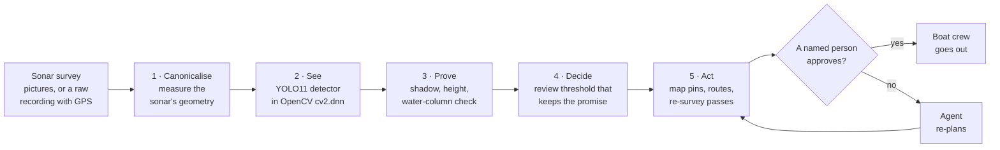
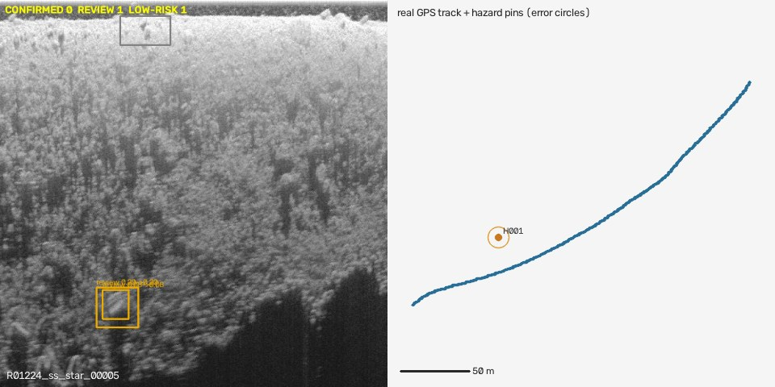

# DEPTH: Turning Side-Scan Sonar into a Cleanup Plan a Person Can Trust

**D**etect · **E**vidence · **P**rove · **T**riage · **H**azard-map

**Madhesh** — Team Syndicate (solo)
OpenCV AI Competition 2026 · Tracks: *Agentic Vision* and *Best Use of COOL*
Code: <https://github.com/madhesh60/depth> · License: AGPL-3.0

*Technical paper · status of 25 October 2026 · deployed detector: EXP-003*

> **How to read this paper.** It follows the layout of a standard research paper, like the YOLO paper [1]:
> abstract, problem, method, data, metrics, results, limitations. It is written in plain words. Every hard word
> is explained right after it is first used, and Appendix B is a glossary. Every number names the data *split*
> it was measured on (a split is a separate slice of the data; Section 4 explains why this matters). Every
> number comes from a script in the repository that anyone can run again; Appendix C says which report holds it.

---

## Abstract

Fishing traps that get lost at sea keep catching animals for years. This is called **ghost fishing**. Survey
boats find lost traps with **side-scan sonar**, a device that sends sound pulses out to both sides of a boat and
draws a picture of the seabed from the echoes. Today a trained person has to scroll through hours of these
pictures by hand. A computer detector can help, but a detector on its own has two problems: it misses traps
without telling anyone, and its scores can collapse on a sonar it has never seen.

We present **DEPTH**, a system that wraps a detector inside an **agent**: a program that has a goal, makes
choices toward it, writes down why, and asks a person before anything is acted on. Instead of reporting only an
average score, DEPTH makes a **promise that can be checked**. With 95% confidence, at least **78%** of crab pots
reach a human reviewer when it looks once, and at least **84%** when it looks harder (five detector passes per
frame instead of one). We set these promises on 3 held-out sonar recordings and then tested them once on 3
recordings never used before: **81.1%** and **86.0%** of the pots reached a person, so both promises held.

DEPTH also checks whether its promise applies to the recording in front of it. On a different sonar it withdrew
the promise in **22 of 22** surveys and asked for a full human review instead. It groups overlapping boxes into
one review card per object (**3.86 → 2.32** cards per frame, with no pot lost). It measures the sonar's geometry
so that map pins land where the measurements put them. Finally, it turns finds into routes and re-survey plans that
a named person must approve.

The whole system runs on an ordinary CPU with OpenCV 5 and no PyTorch: **138.5 ms** per frame on an AWS
Graviton4 server with 4 virtual CPUs. The detector itself is modest, and we say so. Crab-pot AP@&#8203;0.5 is
**0.482**, both-class mAP@&#8203;0.5 is **0.319** (our target of 0.70 was **not met**), and on the official GhostVision
test split our F1 is **0.41** against their reported 0.71–0.73. DEPTH's contribution is not a better detector. It
is the layer that makes an imperfect detector safe to rely on.



*Figure 1: The DEPTH system. A survey passes through five OpenCV 5 stages. The agent around them chooses how hard
to look and checks that its promise applies. Nothing leaves the machine until a named person approves it.*

---

## 1. Introduction

### 1.1 The problem: ghost fishing

A lost crab pot is a wire cage lying on the seabed. A crab walks in for the bait and cannot get out. When it dies,
it becomes bait for the next animal. Nobody comes to empty the cage, so it can keep doing this for years.

The numbers are large:

- An estimated **640,000 tonnes** of fishing gear is lost at sea every year [2].
- In Virginia, a six-year study by the Virginia Institute of Marine Science (VIMS CCRM) counted more than
  **31,000** crabs, fish, birds and sea turtles killed by lost blue-crab pots [3].
- The same group estimated that removing **43,968** lost pots returned **38.17 million lb** of harvestable blue
  crab, worth about **\$33.5 million** [3].

Sunken wreck debris causes a second problem. It snags nets and damages boat propellers.

### 1.2 How lost gear is found today

Lost gear lies 5–50 m under water. Satellites cannot see it: sunlight reaches only 1–2 m into murky coastal
water, and radar satellites see only the surface. So survey teams use **side-scan sonar**.

Think of walking through a dark room holding a torch out to your side. Anything that sticks up lights up on the
side facing you and throws a dark shadow behind it. Side-scan sonar does the same thing with sound instead of
light. A crab pot shows up as a **bright spot with a dark shadow** behind it.

The sonar turns a survey into a long strip of pictures called **frames**. An hour of survey makes a few hundred
frames (about 170 to 280 in this paper's surveys). A trained analyst must look at every frame. At an
assumed 20 seconds per frame, that is close to one hour of human work for every hour of survey.

### 1.3 Why a detector alone is not enough

Suppose someone hands a cleanup crew a detector that "finds 80% of pots on average". The crew lead still cannot
answer the three questions that matter to them:

1. **On my survey, how many pots did it miss?** An average over someone else's data says nothing certain about
   this one.
2. **Does the 80% even hold on my sonar?** In our tests, the same detector at the same threshold found only
   **11%** of the pots on a different sonar (Section 6.1).
3. **Where exactly do I send the boat?** A detector gives boxes on a picture, not positions on a map.

A detector gives boxes and scores. A crew needs answers, and it needs to know when the answers cannot be trusted.

### 1.4 What DEPTH adds

DEPTH keeps the detector and builds the missing layer around it. Our contributions are:

1. **A recall promise you can check.** DEPTH promises, with 95% confidence, that at least 78% of pots reach a
   person (≥ 84% when it looks harder). The promise is set on held-out recordings and tested once on unseen
   ones, where it held at 81.1% and 86.0%. It is also re-checked for correlated frames (Section 3.5).
2. **It knows when the promise does not apply.** An OpenCV check compares each new recording with the
   calibration recordings. On another sonar it withdrew the promise in 22 of 22 surveys.
3. **Measured sonar geometry.** OpenCV tracks the seabed in every sonar line and converts slanted distances
   into flat ground distances. Without this step, 95 of 142 map pins move outside their own error circle.
4. **An agent with a goal.** It chooses how hard to look from the operator's goal and compute budget,
   re-plans when its measurements say it must, logs every choice, and asks a person before every action.
5. **A small, honest runtime.** CPU only, OpenCV 5, no PyTorch on the server: 138.5 ms per frame on
   Graviton4. Every number names its split, and the experiments that failed are published (Section 7).

**What we do not claim.** DEPTH does not have a better detector than the published state of the art. Our
detector is weaker than GhostVision's [5] on their own test split. DEPTH's claim is that an imperfect detector
becomes dependable when it is wrapped in measured geometry, checkable promises and a human approval step.

**Paper layout.** Section 2 explains side-scan sonar and earlier work. Section 3 describes the system. Section 4
covers the data and training. Section 5 explains every metric with an example. Section 6 gives the results.
Sections 7–9 cover what failed, the limitations and responsible use. Section 10 concludes.

---

## 2. Background and Related Work

### 2.1 Side-scan sonar in plain words

| Word | What it means | Everyday comparison |
|---|---|---|
| **Ping** | One short sound pulse. The echoes from one ping become one line of the picture. | One clap in a canyon, and the echoes that come back |
| **Sonogram (frame)** | Many ping lines stacked side by side as the boat moves forward. | A photo built one line at a time, like a scanner |
| **Port / starboard** | The left and right sides of the boat. The sonar images both. | Your left and right hands |
| **Water column** | The dark band at the start of each line, before the sound reaches the seabed. Nothing lying on the seabed can appear here. | The empty air between a drone and the ground |
| **Altitude** | The height of the sonar above the seabed. | How high you hold the torch |
| **Slant range** | The distance the sound actually travels, on a slant from the sonar down to the object. | The length of a ladder leaning on a wall |
| **Ground range** | The flat distance along the seabed to the object. This is what a map needs. | The distance from the wall to the foot of the ladder |
| **Acoustic shadow** | The dark patch behind an object that blocks the sound. Taller objects throw longer shadows. | A pole's shadow in the evening sun |

The sonar measures slant range. A map needs ground range. Section 3.2 shows how DEPTH converts one into the other.

### 2.2 Related work

| Approach | What it gives | Why it is not enough on its own |
|---|---|---|
| **Optical and radar satellites** (e.g. Sentinel-2 debris mapping [4]) | Wide-area maps of *floating* debris | Light reaches only 1–2 m; radar stops at the surface. Gear at 5–50 m is invisible. |
| **Manual sonar review** (e.g. the VIMS CCRM programme [3]) | Expert judgement on every frame | Slow, tiring, and hard to scale. Removal programmes rely on it today. |
| **A sonar detector** (e.g. GhostVision [5]: F1 0.71–0.73 on its official split) | Boxes and confidence scores, automatically | No promise about coverage, no check that it suits the recording, no plan for a crew. |
| **Real-time detectors** (the YOLO family [1], YOLO11 [6]) | Fast boxes from one look at the whole image | A general tool; it knows nothing about sonar geometry or survey planning. |

DEPTH builds on three lines of earlier work:

- **Detection.** We use YOLO11s [6], a descendant of the original YOLO design [1]: one network looks at the
  whole image once and outputs all the boxes at the same time.
- **Statistics that turn scores into promises.** We use the Clopper–Pearson confidence bound [7], the
  Learn-Then-Test procedure for choosing a threshold with a guarantee [8], conformal p-values for spotting
  unusual inputs [9], and the block bootstrap for data where neighbouring samples are related [10].
- **Data design over model design.** Rußwurm et al. [4] found that a debris detector's performance came from
  "dataset design with extensive sampling of negative examples and label refinements rather than … the
  particular deep learning model". Their data is satellite imagery, not sonar, so we borrow their lesson only.
  Our own training runs point the same way (Section 4.5).

The crab-pot sonar data and the head-to-head test split come from the GhostVision authors [5]. The raw sonar
recordings with real GPS come from the PINGMapper project [11].

---

## 3. The DEPTH System


*Figure 2: The as-built architecture. The core loop (top) runs every survey. The five OpenCV 5 stages do the
seeing and measuring. People approve every action.*

### 3.1 The agent loop

The agent is the part that makes decisions. It behaves like a careful contractor: given a budget and a deadline,
it picks the tools, tells you plainly when your request cannot be met, and asks before spending your money.

Every survey runs toward the operator's **goal**: the share of pots that must reach a person, plus limits on
compute time, analyst minutes and boat minutes.

| Step | What the agent does | Example |
|---|---|---|
| **1 · Inspect** | Finds the usable frames. Broken or blank frames are skipped and reported. | A corrupt frame is skipped, and an incident is logged. |
| **2 · Check** | Asks: does my promise apply to this recording? (Section 3.6) | A different sonar → the promise is withdrawn, and a full human review is requested. |
| **3 · Decide** | Chooses the *standard look* (1 detector pass, ≥ 78%) or *look harder* (5 passes, ≥ 84%): the cheapest mode that meets the goal within the compute budget. | Goal "keep 84%" with time to spare → look harder. |
| **4 · Perceive** | Runs Stages 1–3 on every frame while timing itself. If the pace would overrun the budget, it re-plans to the standard look. | The server is busy → it switches to one look; the ≥ 78% promise still holds. |
| **5 · Plan** | Builds the review queue, routes and re-survey passes. | 25 hazards → a 15-stop inspection route. |
| **6 · Hand off** | Files one approval request per action. A named person decides. Every decision triggers a re-plan. | The person declines a re-survey pass → the boat time is re-ranked over the other passes. |

If the operator asks for something impossible, such as "95% of pots", the agent refuses in plain words. It
explains that the detector's ceiling is about 85%, names the strongest promise it can keep (≥ 84%), and leaves
the choice to the person. Every step, with the options it weighed, is written to a log (`agent_run`) that anyone
can read.

### 3.2 Stage 1 — Canonicalise: measure the sonar picture

Stage 1 (`src/cv_pipeline/canonical.py`) does not look for pots. It **measures** the picture so that later
stages can place things correctly. It takes about 5 ms per 640 × 640 frame.

1. **Colour to brightness.** Some sonars draw in colour palettes. Stage 1 turns every frame into plain
   grey brightness, so all frames are measured the same way.
2. **Orientation by rule, never guessed.** Stage 1 needs to know which edge of the frame is under the boat.
   It reads this from a known rule about the data source. An earlier automatic guess was right on only 26% of
   frames, so it was removed. Unknown sources are marked *not measured*.
3. **Bottom tracking.** In each ping line, Stage 1 finds the first point where the dark water turns into
   bright seabed. That point gives the sonar's altitude for that ping. The values are then smoothed along the
   track.
4. **Slant to ground.** The sound path, the altitude and the ground distance form a right-angled triangle,
   so Pythagoras' rule gives the ground range $g$ from the slant range $s$ and the altitude $a$:

   $$
   g = \sqrt{s^{2} - a^{2}}
   $$

   *Example.* A 5 m ladder leans on a wall with its top 3 m up. Its foot is $\sqrt{25 - 9} = 4$ m from the
   wall. In the same way, an echo at slant range 50 pixels with an altitude of 30 pixels lies 40 pixels out
   along the seabed. Stage 1 redraws the whole frame this way with `cv2.remap`. Without this step, every
   object would look farther from the boat than it is.
5. **Water-column mask.** Stage 1 marks the band above the tracked seabed. A "pot" found there cannot be
   real.

**Real-world scale.** For a raw recording, the sonar also logs its depth in metres. Dividing that depth by the
tracked altitude in samples gives the size of one sample in centimetres:

$$
c = \frac{\text{depth (m)}}{\text{altitude (samples)}} \;\Rightarrow\; c = 2.03\ \text{cm per sample} \pm 10.2\%
$$

**Sensor cross-check.** For every 500-ping chunk, the agent compares OpenCV's seabed track with the boat's depth
sounder. If they disagree, it re-tracks inside the sounder's window, tries the other side's channel, or marks
the chunk *not measured*. It never quietly trusts a bad line.

**How we know bottom tracking works, without labels.** Port and starboard frames of the same pings share one
sonar, so both sides must report the same altitude. On 107 single-copy frames, the two sides agree to a median
of **1.6 pixels**. Random pairs from different recordings differ by **5.3 pixels**. 97% of frames were tracked;
the rest were marked *not measured*.

**Stage 1 is a measurement, not a filter.** An early version used classical computer vision to cut away
"uninteresting" regions before detection. It cut recall from 0.708 to 0.147, so it was retired (STUDY-01).

### 3.3 See — the detector

- **Network.** YOLO11s [6], small version, trained for 2 classes: `ghost_gear` (crab pots) and `wreck_debris`.
  Like all YOLO models, it looks at the whole frame once and outputs every box at the same time [1].
- **No PyTorch on the server.** The network is trained in PyTorch on Kaggle, then exported to **ONNX**, a
  standard file format for trained networks. ONNX is to a network what PDF is to a document: any reader can
  open it. OpenCV's `cv2.dnn` module runs it on the CPU.
- **Input and output.** The frame is resized to 640 × 640 with padding so its shape is not squashed. This is
  called *letterboxing*. The network returns 8,400 candidate boxes. Each box has 4 numbers for its position and
  size, plus 2 class scores.
- **Removing duplicates.** Several boxes often cover the same object. **Non-maximum suppression (NMS)** keeps
  the highest-scoring box and drops any box of the same class that overlaps it heavily (IoU ≥ 0.45; IoU is
  explained in Section 5.1).
- **Choosing the faster engine.** OpenCV 5 ships two engines for running networks. They give identical
  answers here (634 of 634 detections), but not at the same speed. On Graviton4, the older "classic" engine
  is 1.41–1.47× faster than the default. The server times both at start-up and keeps the faster one (STUDY-20).
- **No hard-coded numbers.** Class names, input size and every threshold are read from
  `models/EXP-003/calibration.json`. A new model plugs in with one command (`onboard_model`).

### 3.4 Prove — evidence for each find

For each candidate, DEPTH gathers physical evidence and prints it on the review card.

- **Water-column check.** Is the box above the tracked seabed? On 150 frames with a tracked bottom, 0 of 259
  labelled pots lay in the water column.
- **Acoustic shadow.** In these sonars, a pot's shadow is a thin dark line 2–4 pixels wide. DEPTH compares its
  darkness with same-size windows on either side and labels it CLEAR, WEAK or NONE.
- **Relative height.** At sunset a tall pole throws a long shadow. Sonar works the same way. With shadow length
  $L_s$, range to the object $R$ and sonar altitude $H$, similar triangles give the object's height $h$ as a
  fraction of the altitude:

  $$
  \frac{h}{H} = \frac{L_s}{R + L_s}
  $$

  *Example.* A shadow 10 pixels long behind an object 90 pixels away gives $h/H = 10/100 = 0.10$. If the sonar
  is 3 m above the seabed, the object is about 0.3 m tall. DEPTH gives heights in metres only when the altitude
  is measured in metres (raw recordings). Otherwise it reports only the fraction.
- **Agent's-eye view.** A zoomed crop with CLAHE contrast enhancement. CLAHE brightens dark areas one small
  tile at a time, instead of the whole image at once [15]. It is for display only.

**Evidence never deletes a find.** We tested the shadow as a gate (STUDY-03/04). It lowered precision from 0.59 to
0.31–0.50, and the shadow separates real from false finds only weakly (AUC 0.563 on the verification split). So
evidence goes on the card for a person to weigh. It never silently removes a find.

### 3.5 Decide — the recall promise

This is the core idea of DEPTH.

**Three tiers.** Every find lands in one of three tiers:

- **CONFIRMED** would mean "a promised share of these are real".
- **REVIEW** means "a person must look".
- **LOW-RISK** means "below the review threshold". These finds are kept for audit, never deleted.

No precision promise was possible: the best supportable precision was 0.565, against a 0.85 target. So
CONFIRMED stays empty, and every find above the review threshold goes to a person. DEPTH states openly what it
cannot promise.

**How the promise is set.** We use the **calibration split**: three whole recordings (Rec10, Rec12, Rec16; 163
frames; 186 labelled pots). The model never trained on them.

1. Run the detector and keep every candidate with a score of at least 0.05 (the *detector floor*).
2. For a threshold $\tau$, count how many pots have a box scoring at least $\tau$ that overlaps them (IoU ≥ 0.3).
   A pot the detector never proposed counts as a miss.
3. The observed rate, $k$ found out of $n$, is only an estimate. The **Clopper–Pearson** method [7] gives a
   number we can be 95% sure the true rate is above, called the **lower confidence bound**:

   $$
   \underline{r}(\tau) = \mathrm{Beta}^{-1}\!\left(0.05;\; k,\; n-k+1\right)
   $$

   Here $\mathrm{Beta}^{-1}$ is a standard statistical table lookup; you do not need its details. It answers one
   question: "Given $k$ successes out of $n$, what is the lowest true rate that is still believable?"

   *Example.* A basketball player scores 157 of 186 free throws, which is 84.4%. We cannot say the true skill is
   exactly 84.4%. We can say, with 95% confidence, that it is **at least 79.4%**. DEPTH's detector is in exactly
   this position. At $\tau = 0.060$ it reaches 157 of 186 calibration pots, so it may promise 79%.
4. DEPTH first asks for 90%, but that is impossible here. Even at the floor, the detector proposes only 85% of
   the pots; this is its **recall ceiling**. So it promises the best bound it can support. Thresholds are tested
   from strict to loose in a fixed order, which is the Learn-Then-Test procedure [8]. This keeps the 95%
   confidence honest even though many thresholds are tried.

**Correlated frames (STUDY-21).** Clopper–Pearson treats every pot as an independent trial. Sonar frames are not
independent: neighbouring frames, and the port and starboard frames of the same pings, show the same stretch of
seabed. Asking ten members of one family for an opinion gives you less independent information than asking ten
strangers. To correct for this, we resampled runs of 8 ping indices within each recording, 20,000 times (a
*block bootstrap* [10]). The bound fell from 79.4% to **78.2%**. The *design effect* was 1.86, which means the
186 pots carry about as much information as 100 independent pots:

$$
n_{\text{eff}} = \frac{n}{\text{design effect}} = \frac{186}{1.86} \approx 100
$$

By a rule written down before any number was computed, the promise was restated from 79% to **78%**.

**Tested once on unseen data.** Think of a sealed exam. You practise on past papers (the calibration split) and
then sit the real exam (the **verification split**) once. Retaking it until you pass would make the result
meaningless. The verification split has three other recordings (Rec8, Rec9, Rec14; 199 frames; 264 pots). At
the same threshold, **214 of 264** pots reached a person: **81.1%**, with a lower bound of 76.7%. The ≥ 78% promise
**held**.

**Looking harder (STUDY-18).** Small or faint pots are easier to see up close. In this mode DEPTH also cuts the
frame into four overlapping tiles, each 60% of the frame's side, which is the scale the detector was trained on.
It runs the detector on each tile and merges the boxes (IoU ≥ 0.5). This raises the recall ceiling from 0.850 to
0.892 (paired bootstrap gain +0.043, 95% interval +0.016 to +0.076). The threshold becomes 0.055 and the promise
becomes **≥ 84%**. On the verification split, 227 of 264 pots reached a person: **86.0%**, lower bound 82.0%. It
**held**. The cost is 5 detector passes per frame instead of 1.

**One card per object (STUDY-23).** The detector often puts two or three boxes on one pot: a tight box and a
looser one around it. Each box used to be its own review card, so a person judged the same pot several times.
Now, two boxes of the same class in one frame share a card when at least half of the smaller box lies inside the
larger one:

$$
\mathrm{IoS}(A, B) = \frac{\text{area}(A \cap B)}{\min\big(\text{area}(A),\ \text{area}(B)\big)} \;\ge\; 0.5
$$

The strongest box heads the card, and the others stay on it, drawn dashed. **No box is dropped**, so exactly the
same pots reach a person.

**Queue order.** Each card carries a calibrated probability that it is a real pot, $P(\text{pot})$. The queue
shows the likeliest cards first. When an analyst has only $N$ minutes, the agent forecasts how many real pots
those minutes will find as $\sum P(\text{pot})$ over the cards that fit.

### 3.6 Does the promise apply here? (STUDY-19)

A promise made on one kind of sonar should not be trusted on another. A child's height chart works the same way:
if a child is taller than everyone on the chart, the chart cannot tell you much about them.

For every frame, DEPTH computes **eight OpenCV statistics**: brightness, contrast, speckle texture
(`cv2.Laplacian`), along-track versus across-track edges (`cv2.Sobel`), the share of very dark pixels, the share of
very bright pixels, colour saturation (`cv2.cvtColor` to HSV), and the distance between its grey histogram and the
calibration recordings' (`cv2.calcHist`, `cv2.compareHist`). These give the frame a "strangeness" score $s$.
DEPTH compares it with the scores $s_j$ of the 163 calibration frames to get a **conformal p-value** [9]:

$$
p = \frac{1 + \#\{\, j : s_j \ge s_{\text{new}} \,\}}{n + 1}, \qquad n = 163
$$

In words, $p$ is the share of calibration frames that are at least as strange as the new one. A frame stranger
than all 163 gets $p = 1/164 \approx 0.006$. A frame with $p \le 0.05$ is marked *atypical*.

For a survey, DEPTH computes the 95% lower bound of the share of atypical frames. If that bound is above **0.20**,
the promise is **withdrawn**. The 0.20 limit was set from the training recordings before any test data was read.
When the promise is withdrawn, the agent takes the cheapest look, files a `promise_not_applicable` incident and
asks a person to approve a full manual review.

### 3.7 Act — from finds to a plan

- **Map pins (geotags).** With no GPS there are no coordinates; DEPTH never invents them. With a raw recording,
  each object is placed from the GPS fix and heading of *its own ping*, at its Stage-1 ground range times the
  measured scale. Each pin has an **error radius**:

  $$
  r = 3\ \text{m} + R \times \left(u_{\text{scale}} + \sin 6^\circ\right)
  $$

  Here 3 m is the assumed GPS error, $R$ is the ground range, $u_{\text{scale}}$ is the scale uncertainty
  (0.102), and 6° is the measured 90th-percentile heading error. *Example:* at $R$ = 20 m the radius is about
  3 + 20 × (0.102 + 0.105) ≈ **7.1 m**.
- **Stitching.** An object cut by the edge between two frames becomes one hazard. The same object seen in
  several frames with overlapping error circles becomes one hazard with several sightings.
- **Routes.** DEPTH builds a nearest-neighbour inspection route for the cards that fit the analyst's budget, and
  a recovery route for finds a person has confirmed.
- **Opposite-side re-survey passes.** For an uncertain target, DEPTH plans a pass on the far side of it and
  predicts which way its shadow must flip. A real object's shadow flips; random speckle noise cannot fake that.
  Passes are ranked by the information they gain per boat-minute, using $\sum p(1-p)$ over the targets they
  cover. A target at $P = 0.5$ is the most uncertain (0.5 × 0.5 = 0.25); one at $P = 0.95$ adds little
  (0.95 × 0.05 ≈ 0.05).
- **Exports.** GeoJSON, GPX, KML, CSV and JSON for GIS tools and boat plotters. Every export carries a
  provenance stamp: model hash, calibration hash, OpenCV build, code commit and host. Synthetic demo GPS is
  always labelled as synthetic.
- **Mission brief.** A one-page hand-over for the crew. It is written from a template. An optional language
  model on Amazon Bedrock may rewrite it, but its text is shown only if every number and ID in it traces back to
  the survey. The language model never decides anything.

### 3.8 The human in the loop

- **The agent asks; a person decides.** There is one approval request per action: inspect, recover,
  re-survey, full review or public sharing. Approving needs a name and a PIN. Five wrong PINs within 15
  minutes lock that client out.
- **Other AI agents can only ask.** DEPTH exposes its tools to AI agents through the Model Context Protocol
  (MCP). No MCP tool can approve anything.
- **Every decision re-plans.** A person's ✓ or ✕ on a card, or a crew's *recovered* or *not found*, updates the
  queue, routes, budgets and passes. Corrections are saved as new training labels.
- **Connections.** Map tools such as QGIS and ArcGIS read the hazards through OGC API – Features. Dispatch
  systems receive signed webhooks. Any web page can embed the hazard panel.


*Figure 3: The studio's Survey mode on the 8 demo frames. The map uses labelled synthetic GPS. The right panel
shows how the agent decided: it compared the two perception modes, chose to look harder, and kept the ≥ 84%
promise. The banner says that nothing is dispatched without a person.*

---

## 4. Data and Training

### 4.1 Data sources

All data comes from public archives. The datasets are not stored in the repository and are never redistributed;
scripts in `DATASET/scripts/` rebuild them. The only exception is the 8 demo frames, which ship under
CC BY-SA 4.0.

| Source | Sensor | Used for |
|---|---|---|
| Ghost-pot side-scan dataset (PINGEcosystem; the GhostVision authors [5]) | side-scan sonar | `ghost_gear` training, validation and test; the official 398-frame split; the cross-sonar test; the 8 demo frames |
| SeabedObjects-KLSG · AI4Shipwrecks | side-scan sonar | `wreck_debris` |
| Marine PULSE | side-scan sonar | empty-seabed background frames |
| UATD · ICRA19 · TrashCan | forward-looking sonar · optical camera | the earlier 4-class model only (EXP-001); dropped later because they are not side-scan |
| PINGMapper recordings [11]: `Test-Small-DS` (Colorado River, 150.6 s) and `Test-Large-DS` (Pearl River, 1 h) | raw Humminbird / Solix files with **real per-ping GPS** | no labels; used for the real-GPS demo and the geometry studies. The 1-hour file never set a threshold. |

### 4.2 Three evaluation traps we found and removed

Before trusting any number, we checked how the test data was built and found three traps.

1. **Hidden copies.** The crab-pot archive had been augmented before release: 1,615 real frames appeared as
   5,275 slightly changed copies. If the same photo is in an exam three times, getting it right counts three
   times. So DEPTH scores only **unique frames** (`src/detection/frames.py` removes the copies).
2. **Duplicate test frames.** The official 398 test images are only **214** unique frames.
3. **A validation set from another sonar.** The original validation split came from a different sonar. It now
   serves as the **cross-sonar test** (`test_xsonar`) instead.

We also **split by recording, not by frame**. Frames from one recording look alike, like photos from one
holiday. If some went to training and their neighbours to testing, the test would be too easy.

### 4.3 Dataset versions and splits

| Version | Content | Splits | Used by |
|---|---|---|---|
| v1 | 4 classes, 7 archives (including optical and forward-looking sonar) | train 26,533 · val 1,204 · test 1,276 | EXP-001 (earlier model) |
| **v2b** | 2 classes, side-scan only, augmented copies removed, split by recording | train 1,773 · val 234 (Rec10/12/16, held out whole) · test 285 (214 unique crab-pot frames + 71 wreck frames) | EXP-002 to EXP-005 (**EXP-003 deployed**) |
| v2b tiles | v2b train as full frames plus 2 × 2 tiles | 4,839 training images | training only |
| `test_official398` | the GhostVision test split as published | 398 images (214 unique), 567 pot boxes | head-to-head only |
| `test_xsonar` | crops from a different sonar | 555 images, 1,265 pot boxes | cross-sonar test |

The recall promise uses the frames that come from named recordings (file pattern `wcp_ss_*`). That gives 163
frames with 186 pots for calibration (Rec10/12/16) and 199 frames with 264 pots for verification (Rec8/9/14).
The 8 demo frames in the studio are v2b **test** frames, and the model never trained on them.

### 4.4 Training

| Setting | EXP-003 (deployed) |
|---|---|
| Architecture | YOLO11s, starting from COCO-pretrained weights; 2 classes |
| Input size | 640 px |
| Training data | v2b tiles: 1,773 full frames + 2 × 2 tiles, 4,839 images |
| Optimizer | **explicit** SGD, learning rate 0.01, batch 64 (16 × 4 accumulation), seed 42 |
| Schedule | 150 epochs planned; early stop at epoch 104 (135 min on a Kaggle T4 GPU) |
| Augmentation | sonar-aware (below) |
| Checkpoint choice | best ghost-gear AP@&#8203;0.5 on the validation recordings, not the training tool's default score |
| Export | ONNX opset 12; output shape (1, 6, 8400); 37.9 MB; SHA-256 pinned |

**Sonar-aware augmentation.** *Augmentation* means showing the network changed copies of training images so it
learns the object rather than one exact picture. Ordinary photo tricks can produce impossible sonar pictures,
so we chose them with care:

- **Kept: horizontal flip.** In a sonogram, left–right is the direction the boat travels. A flip simply
  looks like the boat going the other way.
- **Not used: vertical flip or rotation.** Up–down is distance from the boat. A flipped frame would put the
  seabed above the water.
- **Not used: hue or saturation shifts.** Sonar brightness is echo strength, not colour.
- **Kept, mildly:** brightness ±0.2, translation 0.1, scale 0.5, and mosaic (switched off for the last 10
  epochs).

**Tiles with clean labels.** A 2 × 2 tile can cut a pot in half. If that half-pot stays unlabelled, the network
is taught that "half a pot is background". The tile builder therefore paints over (inpaints) any box that a tile
edge cuts.

**A lesson about defaults.** The first run, EXP-002, used the training tool's `optimizer=auto` setting. It
silently chose AdamW at a learning rate of 0.00167, and the model underfit. Since then, every run passes an
explicit optimizer, and the optimizer actually used is recorded in `model_meta.json`.

### 4.5 Model selection

All runs were compared on the validation recordings through the same `cv2.dnn` path the server uses. The test
split was scored only for the winner.

| Run | What changed | Ghost-gear AP@&#8203;0.5 (val) | Verdict |
|---|---|--:|---|
| EXP-002 · 002s | 1024 / 640 px, `optimizer=auto` | 0.26 · 0.29 | underfit; tile label poisoning |
| **EXP-003** | **explicit SGD 0.01, fixed tiles** | **0.39** | **deployed** |
| EXP-003f | full frames only, 300 epochs | 0.36 | overfits; generalises worse |
| EXP-004 · 004g | cleaned data · ghost gear only | 0.365 · change −0.07 | no gain |
| EXP-005 · 005a | cleaned data + stronger jitter, two seeds | 0.292 · 0.327 | worse on both seeds |

Five follow-up runs did not beat EXP-003. The diagnosis points at the **data**, not the recipe. Of the 459 training
frames with wreck labels, 389 are screenshots of consumer fish-finder displays, not side-scan sonar. The
side-scan wreck boxes are loose (45–57% run off the frame edge). Pots still show a gap between training and
validation (AP@&#8203;0.3 of 0.76 on training frames against 0.51 on validation).

---

## 5. Evaluation Metrics

A metric is a number that answers one question about how well something works. Different questions need
different numbers. This section explains each metric used in Section 6 with a small example.

### 5.1 IoU — how much two boxes overlap

**Intersection over Union (IoU)** compares a predicted box $B_p$ with the true box $B_t$:

$$
\mathrm{IoU} = \frac{\text{area}(B_p \cap B_t)}{\text{area}(B_p \cup B_t)}
$$

*Example.* Two 10 × 10 boxes overlap in a 5 × 10 strip. The overlap is 50 and the union is 100 + 100 − 50 = 150,
so IoU = 50 / 150 = **0.33**. IoU = 1 means a perfect match and 0 means no overlap. A prediction counts as a hit
when IoU passes a cut-off: **0.5** for the detector scores (AP), and **0.3** for "this pot reached a person" in
the promise. Pot boxes in sonar are small and their edges are fuzzy, so 0.3 is the fairer test of "a person
would see it".

### 5.2 Precision, recall and F1

Each prediction is one of three things:

- **True positive (TP):** a box on a real pot.
- **False positive (FP):** a box on nothing, a false alarm.
- **False negative (FN):** a real pot with no box, a miss.

$$
\text{Precision} = \frac{TP}{TP + FP} \qquad
\text{Recall} = \frac{TP}{TP + FN} \qquad
F_1 = \frac{2 \cdot \text{Precision} \cdot \text{Recall}}{\text{Precision} + \text{Recall}}
$$

- **Precision** asks: of the alarms raised, how many were real?
- **Recall** asks: of the real pots, how many were found?
- **F1** combines the two into one number, and it is low if either one is low.

*Example from our test split* (crab pots, validation-tuned threshold 0.20): 134 TP, 133 FP and 151 FN. Precision
= 134 / 267 = **0.502**. Recall = 134 / 285 = **0.470**. F1 = **0.486**.

For a cleanup crew, **recall matters most**. A missed pot keeps killing, while a false alarm costs a few seconds
of an analyst's time. That is why DEPTH's promise is about recall.

### 5.3 AP and mAP — one number over all thresholds

Raising the threshold gives fewer, surer boxes: precision goes up and recall goes down. Plotting precision
against recall for every threshold gives a **precision–recall curve** (Figure 4). **Average precision (AP)** is
the area under that curve. It runs from 0 (useless) to 1 (perfect).

$$
\mathrm{AP} = \int_{0}^{1} p(r)\,dr \qquad\qquad
\mathrm{mAP} = \frac{1}{C}\sum_{c=1}^{C}\mathrm{AP}_c
$$

- **AP@&#8203;0.5** uses IoU ≥ 0.5 to decide hits. We compute it with the all-points method of PASCAL VOC [16].
- **AP@&#8203;0.5:0.95** averages AP over ten IoU cut-offs from 0.50 to 0.95, as in COCO [17]. It rewards tight boxes.
- **mAP** is the mean AP over the $C$ classes. **It can hide the class that matters**, so DEPTH always reports
  the crab-pot AP on its own.
- **95% CI** (confidence interval) comes from a **bootstrap** [13]: re-draw the test frames with replacement
  1,000 times, recompute AP each time, and keep the middle 95% of the results. It shows how much the number
  could move with a different sample of frames.

### 5.4 Recall ceiling

The **recall ceiling** is the recall at the lowest threshold the system ever uses (0.05). It counts every pot
the detector proposed at all. No threshold can do better, so it caps any promise. For EXP-003 it is **0.850** on
calibration and **0.837** on verification. That is why a 90% promise was impossible.

### 5.5 The promise and its lower confidence bound

A **promise** here is a statement of the form "at least R% of pots reach a person, with 95% confidence". It is
**held** on a split if the observed recall there is at least R%. We also report the **lower confidence bound
(LCB)** on that split (Section 3.5). A promise is only meaningful if it was fixed *before* the split that tests
it was looked at.

### 5.6 Workload metrics

- **Cards per frame:** how many review cards a person must judge per sonar frame.
- **Analyst minutes to the promise:** the time to review enough cards to reach the promised recall. Until the
  timed user study runs, we **assume** 8 s per card and 20 s per frame for manual review.
- **Break-even card time** $t_{\text{be}}$: DEPTH beats manual review whenever a card takes less than

  $$
  t_{\text{be}} = \frac{\text{manual minutes to reach the promise} \times 60}{\text{cards needed to reach the promise}}
  $$

  *Example:* 55.7 × 60 / 324 = **10.31 s**. This number does not depend on the assumed 8 s per card.

### 5.7 Speed metrics

- **Latency (ms per frame):** the time to process one frame. **p50** is the median. **p95** means 95% of
  frames finish faster than this.
- **FPS:** frames per second, which is 1000 divided by the latency in ms.
- **Real-time factor (RTF):**

  $$
  \mathrm{RTF} = \frac{\text{compute time}}{\text{recording time}}
  $$

  *Example:* 46 s of compute for 1 hour (3,600 s) of sonar gives RTF = 0.0127, which is **78× faster than the
  boat records it**. For side-scan sonar, RTF matters more than FPS: a new frame arrives from the boat only
  about every 13–21 seconds.

### 5.8 Rules for honest evaluation

1. Tune every threshold on validation. **Score the test split once.**
2. Count **unique frames** only.
3. Name the split next to every number.
4. Report the **crab-pot** number on its own, never only the average.
5. Publish negative results.

*A disclosure.* Later studies (STUDY-18, 19, 21 and 23) re-used the v2b test split for new questions. Each
fixed its protocol before reading the split for that question. Even so, treat the test numbers as **checked,
not untouched**.

---

## 6. Experiments and Results

All results are for the deployed **EXP-003**. They are computed on the exact ONNX file the server runs, through
`cv2.dnn`.

### 6.1 The detector

| Metric | Value | Split |
|---|--:|---|
| **Crab-pot AP@&#8203;0.5** (95% CI) | **0.482** (0.43–0.55) | v2b test · 285 pot boxes |
| Crab-pot AP@&#8203;0.5:0.95 | 0.165 | v2b test |
| Crab-pot precision / recall / F1 at the validation threshold (0.20) | 0.502 / 0.470 / 0.486 | v2b test |
| Wreck-debris AP@&#8203;0.5 · AP@&#8203;0.5:0.95 | 0.156 · 0.047 | v2b test · 70 boxes, 8 wrecks |
| mAP@&#8203;0.5 · mAP@&#8203;0.5:0.95 (both classes) | **0.319** · 0.106 | v2b test |
| Head-to-head: crab-pot F1 · AP@&#8203;0.5 | **0.41** · 0.39 (GhostVision reports F1 0.71–0.73 [5]) | official 398-frame split |
| Cross-sonar: crab-pot AP@&#8203;0.5 · recall at the validation threshold | 0.34 · **0.11** (precision 0.81) | `test_xsonar` |
| Recall ceiling (any proposal ≥ 0.05) | 0.850 · 0.837 | calibration · verification |


*Figure 4: Precision–recall curves of EXP-003 on the v2b test split. The dots mark the thresholds chosen on
validation. The crab-pot curve (blue) stays above 0.5 precision up to about 0.47 recall; the wreck curve (orange)
is weak everywhere.*

**Confusion matrix** (v2b test, validation-tuned thresholds, IoU ≥ 0.5). Rows are what the model said; columns
are the truth. The `background` row counts misses, and the `background` column counts false alarms.

| predicted \ true | ghost_gear | wreck_debris | background |
|---|--:|--:|--:|
| **ghost_gear** | 134 | 0 | 133 |
| **wreck_debris** | 0 | 8 | 15 |
| **background** | 151 | 62 | 0 |

**Reading.** The detector finds crab pots reasonably but far from perfectly, and it largely fails on wreck
debris. Section 4.5 traces the wreck failure to the training data. The head-to-head gap to GhostVision is real,
and we report it as it is. The cross-sonar row is the key warning. The threshold chosen on one sonar finds only
11% of the pots on another sonar, where its AP is 0.34. The scores, and so the threshold, do not transfer. This is why Section 6.4 exists.

### 6.2 The recall promise

| Mode | Detector passes per frame | Threshold $\tau$ | Calibration recall (186 pots) | Promise (95%) | Verification recall (264 pots) | Verification LCB | Held? |
|---|--:|--:|--:|--:|--:|--:|:-:|
| Standard look | 1 | 0.060 | 84.4% (157) | **≥ 78%** | **81.1%** (214) | 76.7% | **yes** |
| Look harder | 5 | 0.055 | 88.7% (165) | **≥ 84%** | **86.0%** (227) | 82.0% | **yes** |

Both promises were fixed on the calibration recordings (Rec10/12/16) and tested once on the verification
recordings (Rec8/9/14). Both held. The earlier model, EXP-001, could promise only ≥ 63% on its own unseen data, so
the better detector translated directly into a stronger promise through the same code.

**Re-looking did not help ranking.** We tested six "re-look" policies, which look again at each find (zoomed,
with or without CLAHE) and re-score it. None beat plain detector confidence on the calibration recordings. The
best paired-bootstrap gain in AUC was +0.005, with a 95% interval of −0.002 to +0.012. So the shipped agent spends
no extra compute on re-looks for tiering.

### 6.3 Does the promise survive correlated frames? (STUDY-21)

| Mode | Clopper–Pearson bound | Block-bootstrap bound (blocks of 8) | Design effect | Decision |
|---|--:|--:|--:|---|
| Standard look | 79.4% | **78.2%** | 1.86 | promise restated 79% → **78%** |
| Look harder | 84.2% | **84.3%** | 1.32 | promise **stands** at 84% |

**Per recording (standard look, ≥ 78%):**

| Split | Recording | Frames | Pots | Recall | Meets 78%? |
|---|---|--:|--:|--:|:-:|
| calibration | Rec10 | 25 | 15 | 93.3% | yes |
| calibration | Rec12 | 91 | 98 | 81.6% | yes |
| calibration | Rec16 | 47 | 73 | 86.3% | yes |
| verification | Rec14 | 30 | 66 | 90.9% | yes |
| verification | Rec8 | 47 | 36 | 91.7% | yes |
| verification | Rec9 | 122 | 162 | **74.7%** | **no** |

The promise is a **pooled rate** over pots from recordings like these. It is not a guarantee for every single
survey: one of six recordings (Rec9, the largest) fell below it. In a leave-one-recording-out test, the standard
promise was re-fit on two calibration recordings and checked on the third. It held 3 of 3 times. Looking harder
held 2 of 3 times in that test, and met its 84% on 4 of 6 single recordings (below it: Rec12 at 83.7% and Rec9 at
81.5%).

### 6.4 Does the promise apply here? (STUDY-19)

| Survey group | Result |
|---|---|
| 3 verification recordings (Rec8/9/14) | promise **kept** on all 3 |
| Cross-sonar surveys (`test_xsonar`) | promise **withdrawn in 22 of 22**; one look there reaches only 23.9% of the pots |
| Raw river recordings (another sonar, no labels) | promise **withdrawn**; a full review is requested |
| The 8 demo frames, each on its own | all keep the promise |
| Colour pictures and screenshots, each on its own | lose the promise |

The check does what it was built for. It stays quiet on recordings like the calibration ones, and it speaks up
exactly where the promise would have been false (23.9% against a promised 78%).

### 6.5 One card per object (STUDY-23)

| Mode | Split | Boxes per frame | **Cards per frame** | Fewer cards | Pots that reach a person (boxes → cards) | Cards holding ≥ 2 pots |
|---|---|--:|--:|--:|--:|--:|
| Standard look | verification | 2.68 | **1.81** | −33% | 214 → 214 of 264 | 0 of 360 |
| Look harder | verification | 3.86 | **2.32** | −40% | 227 → 227 of 264 | 1 of 462 |

The same pots reach a person, by construction and checked. A person simply judges each object once instead of
two or three times.

### 6.6 Does OpenCV's output change what the agent does? (STUDY-12)

We ran the same survey three ways: the full system, the system with Stage 1's geometry withheld, and the system
with the shadow evidence withheld. Then we compared every downstream decision (v2b test, 80 unique crab-pot
frames, 143 hazards).

| Downstream decision | Without Stage 1 | Without shadow |
|---|---|---|
| Tier changes · queue order (Kendall τ) · budget picks | 0 · 1.0 · 0 | 0 · 1.0 · 0 |
| Map-pin shift, median / maximum | **9.1 m / 15.7 m** | 0 |
| Pins pushed outside their own error circle | **95 of 142** | 0 |
| Re-survey passes unchanged | 35 of 39 | 39 of 39 |

*Kendall τ measures whether two orderings agree; 1.0 means the review queue order is identical.*

**Reading.** Stage 1 is not a filter, so it changes no tier and no queue position. It does decide **where the
boat goes**: without it, two out of three pins land outside the circle that was supposed to contain them. The
shadow changes nothing, and that is by design, because it is evidence for a person and not a gate.

### 6.7 Analyst effort


*Figure 5: Share of labelled pots found against analyst minutes on the 199 verification frames. Timings are
**assumed** (20 s per frame, 8 s per card) until the timed study runs. DEPTH reaches its promises sooner than
manual review; a raw list of every detector box is slower than both.*

| Mode | Promise | Cards to reach it | DEPTH (min) | Manual (min) | Break-even card time |
|---|--:|--:|--:|--:|--:|
| Standard look | ≥ 78% | 324 | **43.2** | 55.7 | 10.31 s |
| Look harder | ≥ 84% | 424 | **56.5** | 57.3 | 8.11 s |

**A real survey is mostly empty seabed.** Manual review pays for every frame. DEPTH pays only for each card. Per
survey-hour of empty seabed, that is **34 min** (standard look) or **47 min** (look harder), against **56 min** for
manual review, at the same assumed timings.

**The forecast runs low.** At the promise point, the calibrated $\sum P(\text{pot})$ forecast **136.4** real pots,
but **206** were real (−34%). Budget mode's forecast is therefore a cautious estimate, not a measurement.

Before one card per object (Section 6.5), DEPTH was *slower* than manual review in both modes (62.7 vs 55.7 min
and 96.9 vs 57.3 min). Card grouping is what turned the effort result around.

### 6.8 Speed and cost

| Run | Host | p50 per frame | FPS |
|---|---|--:|--:|
| Standard look, 4 threads | AWS c8g.xlarge (Graviton4, Arm), stock OpenCV 5 | **138.5 ms** | 7.2 |
| Standard look, 4 threads | AWS c8i.xlarge (Intel x86), stock OpenCV 5 | 145.8 ms | 6.8 |
| Look harder (5 passes), 4 threads | Graviton4 / x86 | 655 ms / 693 ms | 1.5 / 1.4 |
| Standard / look harder, 2 threads (the demo server's size) | c8g.large (Graviton4) | 268 ms / 1,300 ms | 3.7 / 0.8 |
| Standard look, **1 core** (on-board budget) | Graviton4, 409 MB peak memory | 435 ms | 2.3 |
| OpenCV-only stages (decode, Stage 1, evidence, render) | laptop x86 | 25 ms | 40 |

- **Where the time goes.** The network's forward pass is 92–99% of each frame. Everything else is cheap.
- **A real hour of sonar.** The 1-hour recording ran end to end with RTF **0.0127**: 46 s of compute per survey-hour
  on both Graviton4 and x86, costing **\$0.0020** and \$0.0024 respectively.
- **Engine choice (STUDY-20).** Picking the faster OpenCV 5 engine cut the Graviton4 frame time from 197 ms to
  138.5 ms with identical answers.
- **Load test.** The 2-vCPU demo server handled 4 clients plus 1 survey for 120 s: 383 of 383 requests
  succeeded, with p95 2.44 s against a 3 s mark. Under load, the agent chose the cheaper standard look for 382 of
  the 383 requests, as designed.
- **COOL.** The planned run on Graviton with the COOL build of OpenCV has **not happened yet**: the AWS
  Marketplace subscription is blocked on payment. The numbers above are stock OpenCV 5, and the system labels
  itself that way. A run counts as COOL only if OpenCV loads from `/opt/cool`.

**Targets from the proposal compared with what was delivered:**

| Target | Delivered | Met? |
|---|---|:-:|
| mAP@&#8203;0.5 ≥ 0.70 | 0.319 (both classes); crab pots 0.482 (v2b test) | **no** |
| < 300 ms per frame | 138.5 ms (Graviton4) / 145.8 ms (x86), standard look, 4 vCPU; 268 ms on 2 vCPU | **yes**, standard look; **no** for look harder (655 ms) |
| ≥ 5 FPS | 7.2 FPS (Graviton4, 4 vCPU); 3.7 FPS on 2 vCPU | **yes** on 4 vCPU; no on 2 vCPU |
| (not in the proposal) | ≥ 78% / ≥ 84% of pots reach a person, verified at 81% / 86% | added |

### 6.9 Real water with real GPS (STUDY-14, STUDY-16)



*Figure 6: The full agent on a raw Humminbird recording (Colorado River, 150.6 s), which has no known pots. Left:
the one review card, made of two overlapping boxes on one object. Right: the boat's real GPS track and the pin,
placed from its own ping with an 8.0 m error circle.*

- **Reading the raw file.** 3,453 pings per channel were parsed, with 0 malformed.
- **Physics checks.** GPS speed against the sonar's own speed field gives a correlation of r = **0.95**. GPS
  course against the compass heading differs by a median of **2.4°**.
- **Measured scale.** 2.03 cm per sample ± 10.2%, after the sensor cross-check.
- **Sensor cross-check on the 1-hour Pearl River recording.** 280 of 280 chunks were resolved, and 3 of 3 gross
  tracker failures were caught and corrected.
- **Review load on water with no known pots.** The river recording gave 1 card, which is 24 cards per hour of
  sonar. The 1-hour recording gave 48 cards per hour: 6.4 analyst minutes, against about 93 minutes of manual
  scrolling.
- **Honest reading.** Both recordings come from another sonar, so the agent **withdraws its promise** and asks
  for a full review. These numbers measure the false-alarm load, not recall: no recording has both real pots and
  real GPS.

---

## 7. What Did Not Work

Each study's hypothesis, protocol and pass/fail gates were written down in `docs/experiments.md` *before* its
unseen data was scored. These are the ideas that failed. We publish them so that nobody has to repeat them, and
so that the ideas that passed can be believed.

| Study | Idea | What happened | Outcome |
|---|---|---|---|
| STUDY-01 | Cut away "uninteresting" regions with classical computer vision before detection | Recall fell from 0.708 to 0.147: the cutter fired more on empty seabed than on debris | retired |
| STUDY-02 | Run the detector on 2 × 2 tiles to find small pots | Recall +8 points, but precision fell on large objects | reworked into *look harder* (STUDY-18), with its own calibrated promise |
| STUDY-03 · 04 | Use the acoustic shadow as a filter | Precision fell from 0.59 to 0.31–0.50 | evidence only, never a gate |
| STUDY-05 | Check the earlier model's headline score | EXP-001's 0.822 mAP was inflated by easy non-sonar images; on sonar crab pots its AP was 0.473 | became the evaluation standard (per-class, per-sensor) |
| STUDY-07 | Re-look at each find to rank it better | No re-look policy beat plain confidence. An old test-tuned precision of 0.737 was 0.58 on unseen data. | no re-look compute; old figure retired |
| STUDY-08 | Feed the detector a range-gain-corrected image | AP change −0.006 (95% CI −0.033 to +0.019): no gain | Stage 1 kept as a measurement, not as detector input |
| STUDY-11b | Run the detector across the seams between frames | No recall gain | not shipped |
| STUDY-13 | A larger input plus a flipped second view (*test-time augmentation*) | +0.10 AP on the calibration recording, but **−0.06 AP** on unseen data | not shipped |
| STUDY-15 | *Active vision*: let the agent pick the next OpenCV tool for each find by expected value | Both registered checks failed (log-loss 0.637 → 0.648; precision of accepted finds 0.86 → 0.848) | off by default, labelled experimental |
| STUDY-16 | Seabed track against the depth sounder | It works (280 of 280 chunks resolved), but 1 of its 3 registered criteria failed | shipped, with the failure reported |
| EXP-002, 004, 005 | Other training recipes and cleaned data | None beat EXP-003 on validation | not deployed; each has a diagnosis report |

STUDY-13 is the clearest lesson. A trick that adds +0.10 AP on the data used to choose it can lose 0.06 AP on new
data. Choosing on one split and confirming once on another is what caught it.

---

## 8. Limitations

Like any system, DEPTH has clear limits. We list them plainly, because a cleanup crew needs to know where not to
rely on it.

1. **The detector is not accurate enough on its own.** Both-class mAP@&#8203;0.5 is 0.319 against the 0.70 target.
   Crab-pot AP@&#8203;0.5 is 0.482, and wreck-debris AP@&#8203;0.5 is 0.156. On the official split, F1 is 0.41 against
   GhostVision's reported 0.71–0.73. DEPTH makes this detector usable, not accurate. A better detector plugs in
   with one command, and its promise is re-fit.
2. **One region, one sonar family.** On another sonar, AP@&#8203;0.5 is 0.34 and recall at the validation threshold is
   only 0.11, so a new sonar needs re-calibration. The applicability check catches a different sonar or a
   different rendering. It is not built to catch slow drift, such as a new site or a changed gain setting.
3. **The promise is a pooled rate, not a per-survey guarantee.** It was fit on 3 recordings and verified on 3
   others. One test recording (Rec9) reached 74.7% against the 78% promise. The 8 demo frames all come from Rec9.
4. **No field proof yet.** No recording has both real pots and real GPS. The pot frames carry labelled
   synthetic GPS, and the real-GPS river recordings contain no known pots.
5. **Not yet measured with people.** Analyst minutes use assumed timings (8 s per card, 20 s per frame), and a
   card with several boxes is assumed to cost one decision. The timed user study and the blinded false-alarm
   audit are built into the studio but have not been run. Labels are incomplete, so some "false alarms" are
   probably real, unlabelled objects; measured precision is a lower estimate.
6. **The workload forecast is biased low.** $\sum P(\text{pot})$ forecast 136.4 real pots where 206 were real
   (−34% on the verification split). It may err either way on a new survey.
7. **Where the detector misses.** On the earlier model's unseen frames (EXP-001, 92 frames, 138 pots; not yet
   re-run for EXP-003), 19 of 138 pots (14%) never reached a person. 32% of the missed pots touch the frame
   edge, against 11% of found pots. Missed pots have lower contrast (1.17 vs 1.34) and lie farther out in range.
   They are **not** smaller.
8. **Compute for looking harder.** Looking harder costs 4.7–4.9× the compute: 655 ms per frame on 4-vCPU
   Graviton4, and 1.3 s on the 2-vCPU demo server. That is over the 300 ms target, although a sonar frame
   arrives only every 13–21 s. The published ONNX has a batch size of 1, so the four tile passes cannot be
   batched. No small board (Raspberry Pi, Jetson) has been measured.
9. **Sensing gaps.** Stage 1 follows the sonar's up-and-down motion per ping, but it does not correct pitch or
   roll, because the ping header records no attitude. Data dropouts are flagged, not repaired. The output is
   boxes, not outlines, because the crab-pot labels are boxes.
10. **Deployment gaps.** The COOL benchmark has not run (the Marketplace subscription is blocked on payment), and
    the CloudFront edge awaits AWS account verification. The recorded MCP session uses a scripted client, not a
    live language model.

---

## 9. Responsible Use

- **A person stays in control.** Nothing is dispatched automatically. Every plan carries
  `human_approval_required`. Re-survey passes stay *PLANNED* until approved. LOW-RISK finds are kept for audit,
  never deleted.
- **Protected sites.** Wrecks can be war graves or heritage sites. In public shares, their positions are
  generalised to about 1.1 km, and passes that would point at them are dropped. The decision log is never
  public.
- **Honest positions.** No GPS means no coordinates. An unknown orientation means a swath-wide error radius.
  Synthetic tracks are stamped on every export.
- **Provenance.** Every result carries the model and calibration hashes, the OpenCV build (COOL or stock), the
  code commit and the host.
- **Language models narrate; they never decide.** Any number a language model writes is checked by a machine
  against the survey before it is shown.
- **Data.** Each source keeps its own licence. The 8 demo frames are shared under CC BY-SA 4.0 with attribution,
  and the raw recordings are fetched with SHA-256 checks, never redistributed.

---

## 10. Conclusion

A sonar detector on its own gives boxes and scores. A cleanup crew needs to know how many pots it will miss,
whether that number holds on their sonar, and where to send the boat. DEPTH answers these questions with three
measured pieces built around an ordinary detector.

- **Checkable promises.** With 95% confidence, ≥ 78% of pots reach a person (≥ 84% when looking harder). Both
  held on unseen recordings (81.1% and 86.0%) and survived a correction for correlated frames.
- **A check on itself.** The promise was withdrawn in 22 of 22 surveys from another sonar, exactly where it
  would have been false.
- **Measured geometry.** Without it, two out of three map pins land outside their own error circle.

The agent around these pieces chooses how hard to look, re-plans on its own measurements, logs every choice and
asks a named person before anything happens. It all runs on a CPU with OpenCV 5, at 138.5 ms per frame on
Graviton4.

The detector remains the weak link (crab-pot AP@&#8203;0.5 0.482; F1 0.41 against GhostVision's 0.71–0.73). The design
is built for that: a better detector plugs in with one command, and the same code re-fits a stronger promise.
The next steps are to measure analyst time with real people, to run the blinded false-alarm audit, to find a
survey with both real pots and real GPS, and to complete the COOL benchmark on Graviton.

---

## Acknowledgements and Disclosure

The crab-pot data and the official test split come from the GhostVision authors [5]. The raw recordings come from
the PINGMapper project [11]. DEPTH was built by Madhesh (Team Syndicate, solo), with an AI coding assistant
(Claude Code) writing much of the code under the author's direction. Every number in this paper comes from a
script in the repository, and each study's protocol was committed before its unseen data was scored.

---

## References

[1] J. Redmon, S. Divvala, R. Girshick, A. Farhadi. *You Only Look Once: Unified, Real-Time Object Detection.*
CVPR 2016. arXiv:1506.02640.

[2] FAO. *Abandoned, lost or otherwise discarded fishing gear.* <https://www.fao.org/fishery/en/topic/16999>

[3] VIMS Center for Coastal Resources Management. *Marine Debris Program* (derelict crab-pot surveys, removal and
impact). <https://www.vims.edu/ccrm/research/marine_debris/>

[4] M. Rußwurm, S. J. Venkatesa, D. Tuia. *Large-scale Detection of Marine Debris in Coastal Areas with
Sentinel-2.* 2023. arXiv:2307.02465.

[5] C. S. Bodine et al. *GhostVision: Democratizing Derelict Gear Detection Using Low-Cost Sonar and Artificial
Intelligence.* Journal of Marine Science and Engineering 14(10), 951, 2026. doi:10.3390/jmse14100951.

[6] G. Jocher, J. Qiu. *Ultralytics YOLO11.* 2024. <https://github.com/ultralytics/ultralytics>

[7] C. J. Clopper, E. S. Pearson. *The use of confidence or fiducial limits illustrated in the case of the
binomial.* Biometrika 26(4), 404–413, 1934.

[8] A. N. Angelopoulos, S. Bates, E. J. Candès, M. I. Jordan, L. Lei. *Learn then Test: Calibrating Predictive
Algorithms to Achieve Risk Control.* 2021. arXiv:2110.01052.

[9] V. Vovk, A. Gammerman, G. Shafer. *Algorithmic Learning in a Random World.* Springer, 2005.

[10] H. R. Künsch. *The jackknife and the bootstrap for general stationary observations.* Annals of Statistics
17(3), 1217–1241, 1989.

[11] C. S. Bodine, D. Buscombe, R. J. Best, J. A. Redner, A. J. Kaeser. *PING-Mapper: Open-source software for
automated benthic imaging and mapping using recreation-grade sonar.* Earth and Space Science 9,
e2022EA002469, 2022. Sample data: Zenodo, doi:10.5281/zenodo.6604666.

[12] OpenCV 5. <https://opencv.org>

[13] B. Efron, R. J. Tibshirani. *An Introduction to the Bootstrap.* Chapman & Hall, 1993.

[14] ONNX: Open Neural Network Exchange. <https://onnx.ai>

[15] K. Zuiderveld. *Contrast Limited Adaptive Histogram Equalization.* Graphics Gems IV, 474–485, 1994.

[16] M. Everingham, L. Van Gool, C. K. I. Williams, J. Winn, A. Zisserman. *The PASCAL Visual Object Classes (VOC)
Challenge.* International Journal of Computer Vision 88, 303–338, 2010.

[17] T.-Y. Lin et al. *Microsoft COCO: Common Objects in Context.* ECCV 2014. arXiv:1405.0312.

---

## Appendix A — Reproduce the Results

Requirements: Python 3.10 and a CPU. No GPU and no PyTorch are needed to run DEPTH.

```bash
git clone https://github.com/madhesh60/depth.git && cd depth
pip install -r requirements-dev.txt                  # runtime + test and lint tools
python -m src.detection.fetch_model                  # the EXP-003 detector (SHA-256 checked)
pytest -q                                            # the test suite
python -m uvicorn src.dashboard.app:app --port 8000  # the studio -> "Guided demo"
```

Re-scoring needs the v2b dataset, which is rebuilt from the public archives with `DATASET/scripts/`.

```bash
python -m src.detection.evaluate                     # Section 6.1  detector metrics (val-tuned, test scored once)
python -m src.agentic.calibrate                      # Section 6.2  fit the promise on val, verify once on test
python -m src.agentic.study_look_harder --verify     # Section 6.2  look harder (STUDY-18)
python -m src.agentic.study_dependence               # Section 6.3  correlated frames (STUDY-21)
python -m src.agentic.study_applicability --verify   # Section 6.4  does the promise apply? (STUDY-19)
python -m src.agentic.study_cards --verify           # Section 6.5  one card per object (STUDY-23)
python -m src.agentic.study_causal \
    --frames DATASET/03_yolo_ready_dataset_v2b/test/images --limit 80   # Section 6.6 (STUDY-12)
python -m src.agentic.effort                         # Section 6.7  analyst effort
python -m src.bench.product_bench --label my_host    # Section 6.8  speed on this machine
python -m src.bench.dnn_engine --label my_host       # Section 6.8  OpenCV 5 engine choice (STUDY-20)
python -m src.cv_pipeline.humminbird fetch           # Section 6.9  the raw recording with real GPS
python -m src.cv_pipeline.humminbird report
```

---

## Appendix B — Glossary

| Word | Plain meaning |
|---|---|
| **Agent** | A program with a goal that makes choices toward it, records why, and (in DEPTH) asks a person before acting. |
| **AP / mAP** | Average precision: one number from 0 to 1 summarising precision across every threshold. mAP is the mean over classes. |
| **Augmentation** | Showing a network changed copies of training images (flipped, brighter) so it learns the object, not one picture. |
| **Bootstrap** | Re-drawing the data at random many times to see how much a number would move with a different sample. |
| **Block bootstrap** | The same, but re-drawing whole runs of neighbouring frames together, because neighbours are related. |
| **Calibration split** | The held-out recordings used to set thresholds and promises. |
| **Card** | One item in the review queue: one object, with its boxes and evidence. |
| **Clopper–Pearson bound** | A method that turns "k out of n" into a rate you can be 95% sure the truth is above. |
| **Confidence score** | The detector's own score for a box, from 0 to 1. It is not a probability until it is calibrated. |
| **Conformal p-value** | The share of reference frames at least as unusual as a new frame. Small means "unlike anything we calibrated on". |
| **`cv2.dnn`** | The part of OpenCV that runs trained neural networks. |
| **Design effect** | How much correlation shrinks your data. A design effect of 1.86 means 186 pots count like about 100 independent ones. |
| **False positive / negative** | A false alarm / a miss. |
| **Frame (sonogram)** | One sonar picture, built from many ping lines. |
| **Ground range / slant range** | The flat distance along the seabed / the slanted distance the sound travels. |
| **IoU** | Overlap of two boxes divided by their combined area. |
| **Latency, p50, p95** | Time per frame; the median; the time that 95% of frames beat. |
| **NMS** | Non-maximum suppression: keeps the best box and drops heavy overlaps of the same object. |
| **ONNX** | A standard file format for trained networks, readable by many tools. |
| **Ping** | One sound pulse. Its echoes make one line of the picture. |
| **Precision / recall** | Of the alarms, how many were real / of the real pots, how many were found. |
| **Promise** | "At least R% of pots reach a person, with 95% confidence", fixed before it is tested. |
| **Recall ceiling** | The most pots the detector proposes at its lowest threshold. No promise can exceed it. |
| **RTF** | Real-time factor: compute time divided by recording time. Below 1 means faster than real time. |
| **Split (train / validation / test)** | Separate slices of data: to learn from, to tune on, and to test once. |
| **Stage 1** | DEPTH's measuring step: grey brightness, orientation, seabed tracking, slant to ground. |
| **Threshold ($\tau$)** | The score above which a box becomes a review card. |
| **Unique frames** | Frames counted once, with augmented copies removed. |

---

## Appendix C — Where Each Number Comes From

Every number in this paper is generated by a script, and each report below is regenerated by that script.
Paths are relative to `docs/`.

| Section | Report |
|---|---|
| 3.2 Stage 1 geometry | [`reports/stage1_canonical.md`](reports/stage1_canonical.md) · [`reports/sensor_check.md`](reports/sensor_check.md) |
| 3.3, 6.8 engine choice | [`reports/dnn_engine.md`](reports/dnn_engine.md) |
| 4 Data | [`dataset_card.md`](dataset_card.md) |
| 4.4–4.5 Training and model selection | [`model_card.md`](model_card.md) · [`reports/exp003_diagnosis.md`](reports/exp003_diagnosis.md) · [`reports/exp005_diagnosis.md`](reports/exp005_diagnosis.md) |
| 6.1 Detector | [`reports/eval_exp003_test.md`](reports/eval_exp003_test.md) · [`reports/eval_exp003_test_official398.md`](reports/eval_exp003_test_official398.md) · [`reports/eval_exp003_test_xsonar.md`](reports/eval_exp003_test_xsonar.md) |
| 6.2 Recall promise | [`calibration_exp003.md`](calibration_exp003.md) · [`reports/look_harder.md`](reports/look_harder.md) |
| 6.3 Correlated frames | [`reports/dependence.md`](reports/dependence.md) |
| 6.4 Applicability | [`reports/applicability.md`](reports/applicability.md) |
| 6.5 One card per object | [`reports/card_grouping.md`](reports/card_grouping.md) |
| 6.6 OpenCV changes the plan | [`reports/causal_trace.md`](reports/causal_trace.md) |
| 6.7 Analyst effort | [`reports/effort_curve.md`](reports/effort_curve.md) |
| 6.8 Speed and cost | [`reports/cool_benchmark.md`](reports/cool_benchmark.md) |
| 6.9 Raw recordings | [`reports/raw_recording.md`](reports/raw_recording.md) |
| 7 Negative results | [`experiments.md`](experiments.md) · [`reports/scale_tta.md`](reports/scale_tta.md) · [`reports/seam_inference.md`](reports/seam_inference.md) · [`reports/evidence_model_exp003.md`](reports/evidence_model_exp003.md) |
| 8 Failure cases | [`reports/failure_gallery.md`](reports/failure_gallery.md) |

*Team Syndicate · OpenCV AI Competition 2026*
