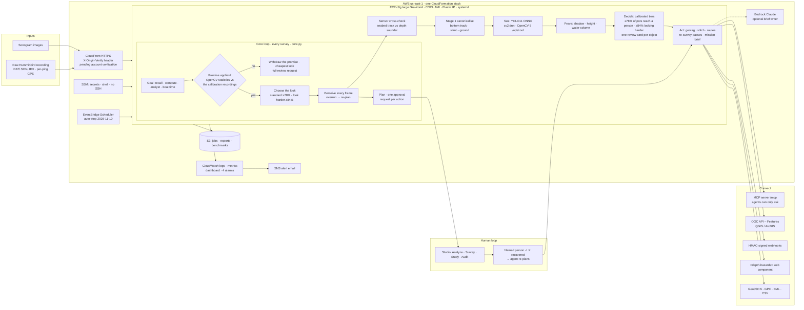
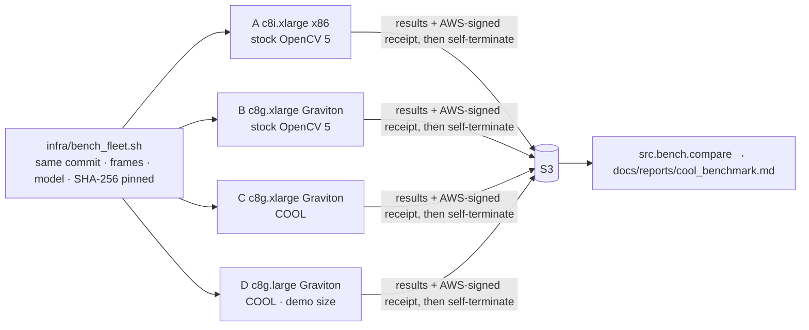

# Architecture diagram — Lucidchart source

The as-built deployment ([architecture.md](architecture.md), [infra/README.md](../infra/README.md)), written
so you can paste it into Lucidchart: **Insert → Diagram as code → Mermaid**, paste the block, then style it.
Export as SVG to `docs/img/architecture.svg` when done.

Labels match the code. Two items carry a status because they are not live yet: CloudFront (waiting for AWS
account verification) and the COOL AMI (the Marketplace subscription is blocked on payment). Until then the same
server runs stock OpenCV 5 in *rehearsal* mode, and the receipt says so.

## Benchmark fleet (second, smaller diagram)

