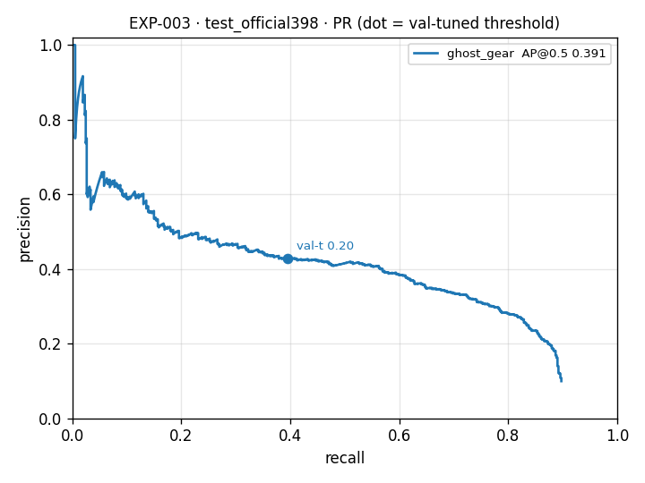

# EXP-003 evaluation — `test_official398` split — deploy-faithful (cv2.dnn ONNX), honest per-domain

_Model_: `models/EXP-003/best.onnx` · _Data_: `03_yolo_ready_dataset_v2b/test_official398` (398 images) · _AP_: VOC all-points @IoU 0.5 and COCO-style @0.5:0.95 · _NMS IoU_: 0.45 · _input_: 640 px · _bootstrap_: 1000 resamples

> Evaluated on the **exact ONNX artifact the studio and the MCP server run** (torch-free `cv2.dnn`). Thresholds are tuned on **val**; the **test_official398** split below is scored once.

## 1. Per-class (test_official398)

| class | n_gt | AP@0.5 | AP 95% CI | AP@0.5:0.95 | P@val-t | R@val-t | F1@val-t | val-t | shipped-t |
|---|--:|--:|:--:|--:|--:|--:|--:|--:|--:|
| ghost_gear | 567 | 0.391 | 0.35–0.44 | 0.135 | 0.428 | 0.395 | 0.411 | 0.20 | 0.05 |
| wreck_debris | 0 | — | —–— | — | 0.000 | — | — | 0.60 | 0.25 |

**mAP@0.5 (mean over classes present): 0.391** · **mAP@0.5:0.95: 0.135**  — *read the per-class rows: the mean hides the mission class.*

### Confusion matrix (test_official398, val-tuned thresholds, IoU ≥ 0.5)

Rows = predicted, columns = true. The `background` row counts missed objects; the `background` column counts false alarms. Matching is class-agnostic, so a right box with the wrong label shows as confusion.

| predicted \ true | ghost_gear | wreck_debris | background |
|---|--:|--:|--:|
| **ghost_gear** | 224 | 0 | 299 |
| **wreck_debris** | 0 | 0 | 0 |
| **background** | 343 | 0 | 0 |

## 2. Per-sensor (the product is SONAR)

| sensor | class | n_gt | AP@0.5 | P | R | F1 |
|---|---|--:|--:|--:|--:|--:|
| sonar | ghost_gear | 567 | 0.391 | 0.428 | 0.395 | 0.411 |

## 3. Per-source (where the boxes really come from)

| source | sensor | class | n_gt | AP@0.5 | R@val-t |
|---|---|---|--:|--:|--:|
| crabpot | sonar | ghost_gear | 567 | 0.391 | 0.395 |

## 4. GhostVision head-to-head (official crab-pot split)

Frames matched: **398** · n_gt 567

| metric | value | GhostVision |
|---|--:|--:|
| F1 | 0.411 | 0.71–0.73 |
| Precision | 0.428 | — |
| Recall | 0.395 | — |
| AP@0.5 | 0.391 | — |

---
_Generated by `src/detection/evaluate.py`. AP is an independent VOC all-points implementation over the deployed `cv2.dnn` path; expect small differences from ultralytics 101-pt interpolation._